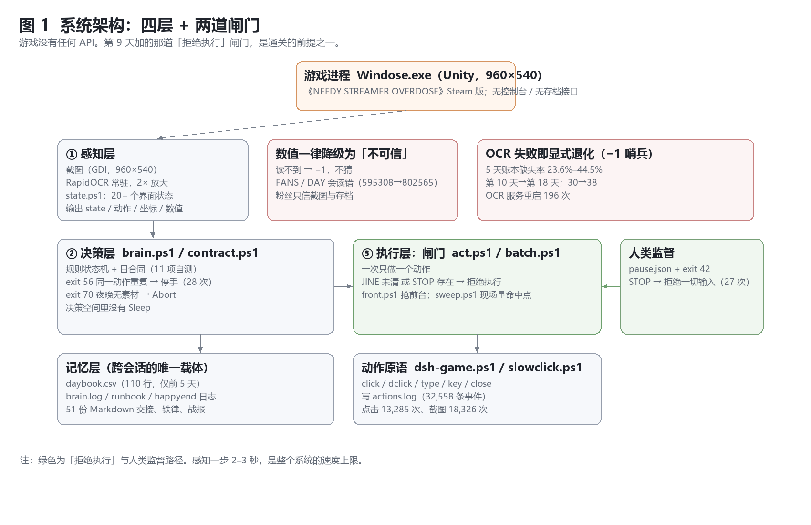
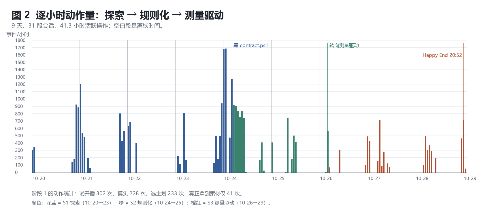
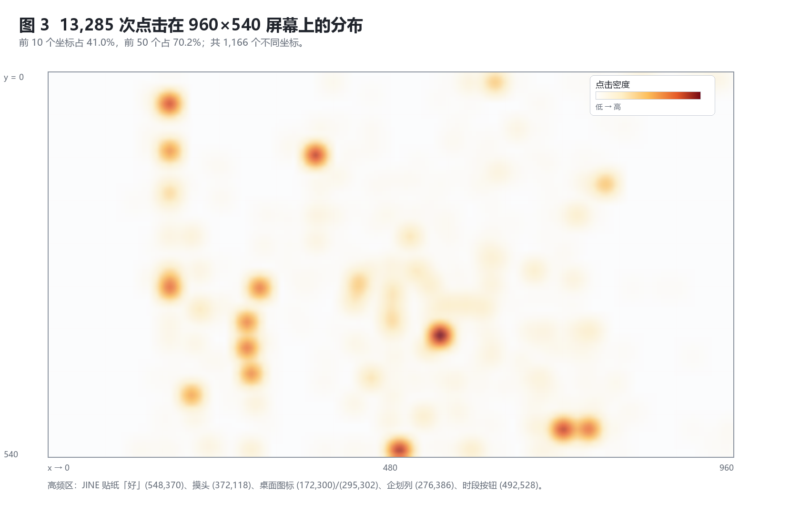
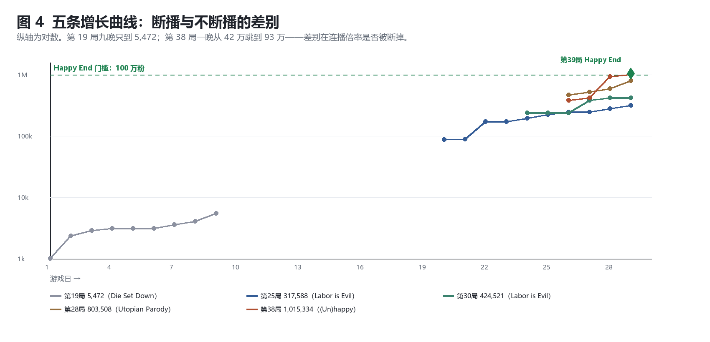
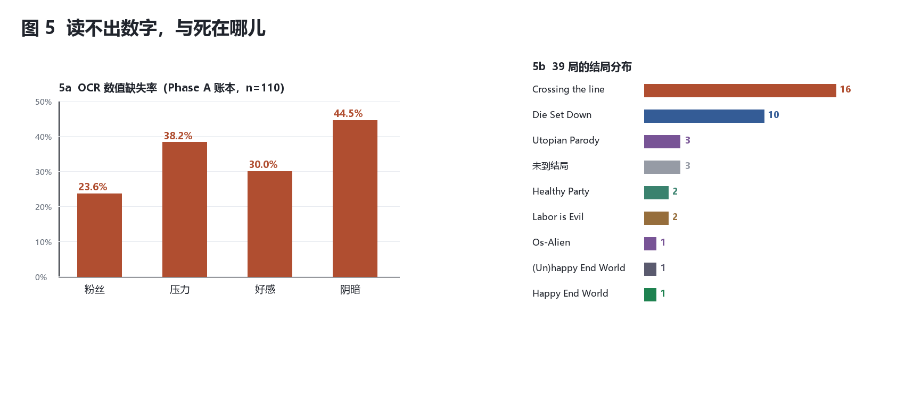

# Knowing, Seeing, Responding

## 39 Attempts of an LLM Agent in *NEEDY GIRL OVERDOSE* (2026-10-20 → 10-29)

**Knowing, Seeing, Responding** — 39 Attempts of an LLM Agent Playing *NEEDY GIRL OVERDOSE* through Pixels

**v2.6.1 · 2026-11-02** | Version history and per-item change log: see `勘误与版本记录.md`.

**Author**: Miao Zhishun (corresponding author) · udongeininaba@foxmail.com

**Research execution and first draft**: DSH — an LLM agent running on DeepSeek Harness.

> **Position statement**
> The experiments in this paper were executed by DSH and the first draft was written by it; the named author is responsible for the research design, the rule setting, the key judgements, the fact verification, and the final responsibility.
> Where the text uses "I / it" for DSH, the material comes from its operation logs and self-reports, and has been checked by the author against the original artifacts.
>
> This division of labour brings two known biases: DSH tends to explain a failure as a "structural problem" rather than a "capability problem"; and it naturally knows the context of every click better than an external observer does.
> Two hedges are used: **all quantitative conclusions cite only numbers that can be recomputed from the logs**; **all interpretive conclusions are explicitly marked as retrospective interpretations**,
> and counterexamples or alternative explanations are given. The reader should take this paper as "an agent's self-observation report + a human author's verification", not as an external evaluation.

---

## Abstract

An LLM agent played *NEEDY GIRL OVERDOSE* for ten days using only screenshots, OCR, and synthetic
mouse/keyboard input — no game API, no memory access. The ten days span **217 hours of wall-clock time**,
of which **41.3 hours** were active operation across **31 sessions**. It played 39 runs with recorded endings, produced
32,559 timestamped actions, 13,285 clicks, 18,326 screenshots and 51 documents, and consumed ~3.81 B tokens
(99.6% cached context reads).

The first 24 runs all missed the conditions of the `Happy End World` branch. Run 25 was the first to reach
Day 30 (`Labor is Evil`, 317,588 followers); run 38 was the first to pass one million; run 39 triggered
`Happy End World` (1,015,334 followers, offline night) — a branch specified in the project's own goal document,
not a claim about which ending is "better".
Sixteen of 39 runs (41%) died from a single cause unrelated to any stat: ignoring the character's messages
five times in a row. Empty nights fell from 43.3% (the first 24 runs) to 25.0% (the later 15 runs) and to zero in the final
three runs. The later phase (one action at a time, plus an on-the-spot coordinate-measuring tool,
`sweep.ps1`) coincided with a shift in the click distribution: the top-10 share fell from 63.9% to 40.3%
and distinct coordinates rose from 349 to 479. The measuring tool itself creates new coordinates, so we read
this as a description of the tooling change, not as a reversal of policy collapse.

We argue that the run is explained by three conditions orthogonal to strategy: never breaking the
streaming streak (which carries an ×1→×5 multiplier), an execution layer that refuses to act while
the character is speaking, and being offline that night. The third was known from guides and from the
project's own day-5 notes, yet was not executed until the final day; it was initially confounded with a
stress difference (84 vs 75). A controlled follow-up (same save, same pre-night stats, same action
sequence; `n`=3 online / 8 offline, single machine, unblinded) separated them: 3/3 online runs ended in
`(Un)happy End World`, 8/8 offline runs in `Happy End World` (two-sided Fisher p = 0.006). The follow-up
also corrected the decision point: the game samples the network when the player **enters the night**,
not at settlement — disconnecting one step later restores the online ending.
This narrows the paper's one general claim: in games whose ending is decided by an environment
variable, end-state success is not a measure of agent capability. What distinguishes the agent lives
in process metrics — missed-message fatalities (16/39), empty-night rate (43.3% → 25.0%),
verification ratio, and click concentration.
We close with an irony: the winning run was executed by a state machine, and at the moment of the
ending the agent was not present.

**Keywords**: LLM agents; GUI automation; long-horizon tasks; negative results; executable constraints; game studies

---

## 1 Introduction

### 1.1 Four clicks, zero output

24 October 2026, run 19, the evening of day 5. Within a few minutes the agent did four things:

1. Clicked "Go out" — the action costs 2 time slots and only 1 slot was left in the evening, so it was unavailable;
2. Clicked "Internet" — blocked by one unread message, so only a preview card appeared;
3. Opened the stream list — all greyed out (no material had been obtained that day);
4. Clicked "Sleep".

Four clicks, **zero output**. When day broke, the follower count had not risen by one. The run finally ended at 5,472 followers, on day 10, with `Die Set Down`.

None of the four clicks was "wrong". On the contrary, each was a **correct interface operation**.
The problem is that **together they constituted no progress at all**. And at the time the agent did not find this abnormal.

**On the thirty-ninth run it completed the final day on the Day29 save.** In the winning run it performed no "smarter" operation:
the recipe (D26 stream ASMR3 → D27 Angel3 → D28 ASMR4 → D29 Angel4) had already run through on run 38;
the difference lay in exactly two places: **the stream did not break that night**, and **the network adapter was disconnected at settlement**.

What this paper sets out to explain is not "it became smarter later", but a narrower question: **why did knowing not turn into doing?**
And: **once "doing it" had been written into code, what did that actually change?**

### 1.2 Why this is worth a paper

**Process data are scarce.** Public evaluations of GUI agents almost all take task success rate as the core metric and report "whether it can finish", rarely the process: how long each step takes, how many screens it looks at, which coordinates it goes back and forth over, when it begins to repeat itself. Yet these are precisely the handles for improving a system.

**The task shape is scarce.** Existing LLM game agents mostly run in simulators that have an API, a reward signal, and resets. The task here is the opposite end: a commercial closed-source game, pixels only, no rollback, real-time requirements, and an ending that carries a narrative judgement.

**The value of a longitudinal case.** The same agent, the same tool set, the same game: total failure first, a clear later, with only two gates in the execution layer changed in between. In agent research this is a rare "intervention–outcome" contrast (though not a strict causal experiment).

**What this paper does not claim.** One statement the data below do not support is that "clearing one game demonstrates the capability of a GUI agent". What this paper says is precisely the reverse: in games of this kind, **whose ending is decided by an environment variable**, end-state success rate can deceive — with the same Day30 save, the same four stats and the same sequence, changing only the network at night, 3/3 online runs give `(Un)happy End World` and 8/8 offline runs give `Happy End World` (5.7.4).
So the landing point of this paper is not "it finally did it", but **"which numbers one should look at when evaluating an agent"**.

### 1.3 Contributions

- **The claim of this paper (measurement)**: a counterexample showing that **in games of this kind, whose "ending is decided by an environment variable", end-state success rate cannot be used as a measure of agent capability**.
  With the same Day30 save, the same four stats and the same sequence, changing only the network at night: 3/3 online → `(Un)happy End World`, 8/8 offline → `Happy End World` (two-sided Fisher p = 0.006, 5.7.4).
  That is, this project's "clear" is an outcome that an environment switch can flip; the agent-side difference shows up in the process —
  16 of 39 runs died from "it was absent while she was speaking", and mostly while the stats were healthy (5.5).
  The candidate metrics are therefore narrowed to the quantities in 4.4 that have been recomputed under a stated convention (empty-night rate, verification ratio, click concentration), plus a count of missed-message fatalities;
  first-response latency (2–3 s per step against a 5 s window) is so far only observed and has not yet been made a separate metric.
- **Process data**: a complete process archive of 10 days, 39 runs, 32,559 actions, 13,285 clicks, 18,326 screenshots and 51 documents.
  Of this, **all behavioural statistics are recomputable** (Appendix A); the **39-run ledger is a post-hoc reconstruction**, and its source documents (battle reports, daily progress) were not released with the package; see A.4.
- **Longitudinal result**: 0/24 → 1/39. We give the complete per-night trajectory of the winning run and of three runs that stopped one step short (803,508 / 890,649 / 1,015,334),
  and we locate in **streaming continuity** the **only difference supported by the logs** between the winning run and the all-failure runs.
  The contribution of the two execution-layer gates (see "Landing an existing paradigm", below) was not measured separately and is not counted in this difference.
- **One phenomenon: the two reversals of the coordinate distribution (the tool effect is not isolated)**: hard-coding the rules narrowed behaviour (top-10 coordinate share 40.9% → 63.9%);
  after switching to the measurement-driven control regime of "one action at a time + refuse to act", behaviour **returned to the exploratory-phase level** (→ 40.3%) and the run cleared.
  But the measurement-driven phase also introduced the coordinate-measuring script `sweep.ps1`, which itself produces new coordinates; this paper cannot separate "policy widened" from "the tool opened up coordinate space",
  so it reports the phenomenon only and claims no causality (5.2, 6.5).
- **Landing an existing paradigm (not a new paradigm)**: compiling natural-language rules into **executable gates** — the day contract (invariants, `Abort`) and `act.ps1` (refuse while JINE is uncleared).
  This is **not an invention of this paper**: it is the **manual equivalent** of shielding in safe reinforcement learning (Alshiekh et al., 2018) on a GUI agent,
  with the principle proposed by the human supervisor (10-27: "if it needs changing, write it into the rules, not into the diary") and DSH writing the scripts.
  The contribution is **to report how this paradigm lands on a non-resettable, real-time, pixels-only game, and what it does not solve**; we do not claim a new paradigm;
  both scripts were written after the clear, and their effect was not measured separately (5.9).
  The accurate identity of this item is therefore **a design claim plus an engineering hypothesis awaiting test**, not a causal explanation of this clear, and not a validated effectiveness result.
- **A rule that was known but not executed (controlled observation)**: `Happy End World` requires being offline at night — this rule is in the guides and also in the project's day-5 document,
  but the project took 6 days to execute it (5.7.3). We first record runs 38/39 as an **unseparated** "offline hypothesis" (the two settlements changed stress and network at the same time),
  and later separate it with a set of verification experiments: same save, same four stats, same sequence, 3/3 online → `(Un)happy End World`, 8/8 offline → `Happy End World` (the last five rounds of group B were added on 2026-11-01, see 5.7.4);
  the experiments also corrected the decision point — **the instant of the "night stream"**, not settlement; replaying the same Day30 save online flips back to `(Un)happy`, which means every replay samples afresh (5.7.4).
  This set of experiments is itself a small-scale contrast of "knowing but not doing": the rule had long been written in the documents; what was missing was the step that executed it.

### 1.4 Reading order

Section 2 related work; Section 3 the system; Section 4 method and data; Section 5 results (**5.7 is the second act**); Section 6 discussion;
Section 7 threats to validity; Section 8 limitations and future work; Section 9 conclusion. If you read only one section, read **5.7**.

**How to read this paper (stated up front).** This is an **instrumented case study**:
an n=1 system, an n=1 game, 39 attempts as a lower bound, a per-run ledger reconstructed after the fact, and the clear achieved across saves.
At this scale it supports only **one claim** — the one stated at the opening of §1.3: in games of this kind, whose ending is decided by an environment variable, end-state success rate is not a measure of capability; process metrics are the candidates (1.3, 5.7.4).
The rest of the paper exists to supply recomputable material for that one claim, not to issue general assertions about GUI agents:
every number in the text can be recomputed in `data-v2/`, and where it cannot, the text marks it "inferred".
The most important limitation: the **message gate**, which §5.6 cites repeatedly and which §1.3 offers as a design claim under "Landing an existing paradigm", **has never had its effect measured separately** —
the 0 valid samples obtained by the ablation in 5.9 are neither evidence that the gate is ineffective nor evidence that it is effective.

---

## 2 Related work

### 2.1 From API to pixels

Early LLM agents mostly depended on tool calls; ReAct [3] interleaves reasoning and action, and Reflexion [4] improves behaviour with verbal feedback.
As multimodal models matured, the focus shifted to operating graphical interfaces directly: WebArena [9] and SeeAct [10] target the web,
OSWorld [8] targets the real desktop, and ScreenAgent [11] turns "look at the screen — click the mouse" into an end-to-end policy.
These works share three implicit assumptions: **task horizons are short, success can be judged automatically, and time is not a resource**.
This paper violates all three at once: a run takes hundreds of steps, the ending is narrative, and a night not streamed permanently forfeits that night's return.

### 2.2 LLM agents in games

MineDojo [6] provides an open-world benchmark; Voyager [5] explores Minecraft with a skill library plus a curriculum;
Cradle [7] attempts to unify computer control; SIMA [12] trains embodied agents in a large number of 3D simulated environments; the text-game direction includes Jericho [13].
What they have in common is that they are **resettable, parallelisable, and carry an explicit reward or progress signal**.

This paper is the opposite: **not resettable** (a run lasts 30 days), **not parallelisable** (one window on one machine), **reward sparse and delayed** (rent on day 10, settlement on day 30).
Under such a setting the cost of trial and error is extremely high — this is one of the macro reasons why **not one of the first 24 runs triggered the target condition**.

### 2.3 Memory, handover, and "documents as memory"

Reflexion-style memory is episodic; the memory here is file-based: `log/daybook.csv` (the numeric ledger),
`log/brain.log` (the decision stream), and 51 Markdown documents written by the agent itself.
This kind of memory has a hidden failure mode: **a rule that has been written down is taken to be a rule that has been implemented**.
In the project "check JINE at all times" was written three times, yet the branch in the code was dead code — only on the final day did it become an `exit 3` in `act.ps1`.

### 2.4 Runtime constraints and shielding

Shielding in safe reinforcement learning [2] wraps the agent in an external safety layer: actions are validated first, and replaced or blocked when illegal.
The two gates of this paper are manual versions of the same idea: `contract.ps1` constrains the **process specification** (there must be material tonight),
`act.ps1` constrains the **action preconditions** (no clicking elsewhere while she still has unread messages). The difference is that they do not learn, they only decide; they do not optimise, they only refuse.

### 2.5 Method and style

This paper is not a controlled experiment but an **instrumented longitudinal case study** with an element of **autoethnography** [16].
Its legitimacy comes from depth and traceability, not from sample size. The cost is that causal inference is impossible and observer effects cannot be excluded (the human changed the rules several times in the middle of the study).
Section 7 sets these out one by one.

---

## 3 The system

### 3.1 The game and the task

*NEEDY GIRL OVERDOSE* (Western release title *NEEDY STREAMER OVERLOAD*; commonly rendered in Chinese as 主播女孩重度依赖; 2022, Steam) uses a 1990s Windows desktop as its interface.
The player plays "P-chan" and must bring the streamer "OMGkawaiiAngel" (commonly *KAngel*) to one million followers within 30 days while keeping affection and "darkness" up.

**The `Happy End World` branch** (an in-game codename, **not a "good ending"**): on day 30, followers > 1 million, affection ≥ 80, darkness < 80, plus one environmental condition: **being offline at night**.
The disconnect must take effect **before "entering the night"**: the game probes and caches the network state when entering the night, and changing the network afterwards (night stream, day 30, settlement) does not probe again.
This decision point is pinned down by the controlled experiment in 5.7.4 — with the same save, a one-step difference between "before entering the night" and "after" yields `Happy End World` and `(Un)happy End World` respectively.
Its verdict text is "too real an illusion, wearing an angelic smile" — **the game itself writes this branch as an illusion**, so this paper does not read it as "she won"; "win" here refers only to **reaching the branch she selected in her own goal document** (run 39, see 5.7.3), not to a value judgement about whether the ending's narrative is good or bad.
This is in the guides, and the project also wrote it in its day-5 document, but it was not actually executed until the final day (see 5.7.3).

**Four hard constraints**:

| Mechanism | Value | Consequence |
|---|---|---|
| Ignoring messages 5 times in a row | a counter, unrelated to any stat | `Crossing the line` |
| Followers < 10,000 on day 10 | rent | `Die Set Down` |
| Stress at settlement ≥ 80 | independent of followers/affection/darkness | `(Un)happy End World` or `Bomber Girl` |
| Fan service the 5th time / lewd the 6th time | a per-run cap | `Angel Fall Down` / `Nymphomania` |

**Follower growth formula** (player data-mining + re-checked by this project):

```
follower gain = stream base value × follower base × streak bonus × advance notice × communication skill × edginess × content-specific
streak bonus = consecutive streaming days + 1     ← one night missed resets it to zero, ×1→×5
```

Every later explanation has to pass through this formula: **a missed night is not "one night less", it is a multiplier reset to zero.**

### 3.2 Overall architecture

The system has five parts (Figure 1): perception, decision, execution-layer gates, action primitives, memory.
Perception and decision are "thinking", the gates are "not allowed to move", the primitives are "moving", and memory is "still remembering next time".



*Figure 1　System architecture. The "refuse to act" gate in the figure (`act.ps1`) is the hardened version written **after** the clear; at the time of the clear the rhythm was manual (see 5.7.2).*

### 3.3 Perception layer

- **Screenshot**: GDI capture of the 960×540 window, 60–120 ms per capture.
- **OCR**: a resident RapidOCR (PP-OCRv4) process communicating through a file queue, 2–3 s per call; small-text regions are cropped and enlarged 2× before recognition.
- **State determination**: `state.ps1` (591 lines) maps OCR lines to more than 20 interface states by rules, and returns an action and a coordinate.
- **Failure degrades**: a value that cannot be read is recorded as **−1**, never guessed; progress bars have a separate fragment check.
  The project later added a harder rule: **follower count and day number always follow the screenshot/save; FANS/DAY from `state.ps1` are not to be trusted**.

### 3.4 The decision-making layer and the hard gates

`brain.ps1` (479 lines) is a `switch(state)` state machine whose value lies not in policy but in **stopping itself**:

| Exit code | Meaning | Observed |
|---:|---|---:|
| 56 | the same "state + coordinate" wants the same action for the 4th time in a row | 28 |
| 71 | the day count disagrees between the two sources | 10 |
| 60 | rendering offset (icon y < 30) | 4 |
| 55 | the same JINE message clicked 4 times with no effect | 3 |
| 10 | an ending was detected | 1 |

These gates treat "repeated ineffective actions": in the first 12 runs the agent **tried to start a stream 302 times, petted her head 228 times, and picked a project 233 times**,
while it actually obtained material only **41 times**.

### 3.5 The judgment layer: compiling "no idling" into code

The natural-language rule is: "you must stream every night; if there is no material for the night, that is a daytime problem, and you are not allowed to use sleep to turn it into 'a new day'."

**Action space**:

```
A = { Tweet, Material(src), EnterEvening, EnterNight, Stream, Abort }
```

Note **`Sleep ∉ A`**. This is the core of the whole design: not "sleeping is discouraged", but **there is no "sleep through it" in the decision space at all**.
When there is no material, the only legal outcome is `Abort` (exit code 70).

**Invariants**: I1 there must be material at night; I2 with zero stock in the evening, the only options are switching the source or Abort; I3 a long run may be started only after 3 consecutive days at 0 idling;
I4 the day count recognises only the two sources of "save file name + ledger".

`contract.ps1` writes these four as pure functions, with 11 self-tests and a replay over the real ledger.
With the time window of run 19 isolated via `-FromTime 00:00 -Until 06:00`, it identifies the idle nights 5 and 6, and closes the gate on day 6.

### 3.6 The execution-layer gate: `act.ps1` (the final day)

This is the most important engineering change in the project; at the paper level it is a manual landing of shielding (see §1.3, "Landing an existing paradigm"). It is only 70 lines long, but it changes action semantics (note: it was written **after** the clear and takes no part in this run's clear):

```
gate 1: STOP file present             → refuse, exit 2
gate 2: current state begins with JINE → refuse, exit 3 (hint: clear JINE first)
execute: send one action at a time (click / dclick / key)
after:   read back state immediately, print STATE / JINE_PENDING
```

Its significance is not "restriction" but **replacing a time constraint with a state constraint**: the agent's sampling period is 2–3 s,
and she may finish a sentence in any 3 s. Rather than requiring the agent to "look faster", it is better to stipulate "do not move until she has finished".
In this way, **"too late" stops being a problem that requires willpower and becomes an interface that returns exit 3**.

Supporting scripts come with it: `front.ps1` (seize the foreground, otherwise clicks are ignored), `sweep.ps1` (probe grid by grid inside a rectangle until the state changes,
used to measure hit points on the spot), `preflight.ps1` (self-check before starting work), `audit.ps1` (count actions and blind operations).

### 3.7 Human supervision and the emergency stop

- A `STOP` file present → every input path refuses (observed 27 times).
- `pause.json + exit 42` → at a point requiring judgement (choices, free input, endings) the agent stops on its own and leaves a screenshot.
- From the final day on, the role of the human supervisor shifted from "correcting every step" to "setting the boundaries" (iron rules §13).

### 3.8 Memory layer

| Medium | Content | Scale |
|---|---|---|
| `log/daybook.csv` | one row of stats per day (first 5 days only) | 110 rows |
| `log/brain.log` | state changes and decisions | 41,095 rows |
| `log/actions.log` | every action | 32,559 rows |
| `*.md` | handovers, iron rules, battle reports, post-mortems | 51 files |

After day 5 `daybook.csv` stopped being written, and the ledger was carried by tables in the documents — which is also why this paper has to rebuild the ledger (see 4.2).

---

## 4 Methods and Data

### 4.1 Data scale

| Item | Value |
|---|---|
| Natural days / wall clock | 10 days / 217.1 hours (2026-10-20 19:46 → 10-29 20:52) |
| Active operation | 41.25 hours (31 sessions, split at gaps > 30 minutes) |
| Action events | 32,559 (screenshot/zoom 18,326; clicks 13,285; double-clicks 670; key presses 86; typing 45; window closes 28; emergency stops 27; a further 92 auxiliary events fall outside these categories) |
| Screenshots | **9,575 unique paths** (de-duplicated from the frozen logs); 9,652 is the file count of the screenshot directory at the time — the two are counted on different bases |
| Runs | 39 runs with an independent ending record (the first 24 + the last 15) |
| Documents | 51 Markdown files |
| Tokens | 3.81 billion (99.6% cache reads), 21 sessions |

### 4.2 Reconstructing the run ledger and its conventions

**Inclusion criterion**: runs that have an independent ending screen or independent day-by-day records and that can be told apart from other attempts.
The first 24 runs come from the v1 run ledger; the last 15 come from the battle reports and summaries of 10-27/28/29.

**Not included**: 10-26 and 10-27 contain roughly a dozen further attempts; the documents renumber by session and cannot be mapped one-to-one onto runs, so they are not counted.
39 is therefore a **lower bound**, not the total number of attempts.

**The verification experiment is not counted in this ledger**: the controlled experiment of 2026-10-31 (5.7.4; 3 in arm A + 8 in arm B + 1 test of the decision time point)
used a fixed save, scripted execution and was conducted in order to isolate a variable, so it is not an "attempt" — it does not enter the 39 runs, does not enter the failure taxonomy, and does not change the ending distribution.

**Terminology**: in this paper a "run" means one attempt; its starting point may be Day 1 or an arbitrary save, and it is not equivalent to a complete 30-day playthrough.
We use "**reach**" to mean "trigger a particular ending branch"; the term "clear the game" appears only when quoting usage internal to the project and **does not mean playing through Day1→Day30 without interruption**.
Wherever run 39 is concerned, it is always to be read as "reaching the `Happy End World` branch on a Day 29 save".

**Division of labour** (who did what, counted over the 12 game sessions from 2026-10-20 to **10-29**: 444 human messages, 75 of which were corrections or rejections):

| Stage | Human supervisor | DSH |
|---|---|---|
| Goal (1 million / Happy End / a few more runs) | **authorises** ("explore freely", "what would you choose") | **selects** |
| Rules (JINE must be checked, rules into code, material chain) | proposes or fixes | implements as scripts |
| Tactical plan (which save to load, what to stream each night) | sets the bounds | writes |
| Execution (clicks / input) | does not intervene | all of it (all 355 clicks in the single hour of 10-27 were issued by `dsh-game`) |
| Key judgements (start point / save loading / ending) | **authorises + confirms afterwards** | **proposes and decides** |
| Records and first draft | verifies the numbers | writes |
| Publication and authorship | takes it on | not credited |

> The table is filled from the raw messages of the 12 game sessions, and **"authorise" and "decide" are counted separately**: the human left the start point, the ending and whether to continue to DSH's own choosing ("start wherever you like", "tell me how you would choose the ending"), and DSH selected them and pushed forward; what the human retained was the emergency stop, the disconnect itself, and post-hoc approval.

**Per-night ledger**: among the first 24 runs only run 19 has a complete per-night table; runs 10/11/12 have only streamed/empty counts.
Among the last 15 runs, 6 have complete per-night tables (runs 25, 28, 30, 33, 38, 39; 28 nights in total).
The reconstruction is in `data-v2/nights-v2.csv`, and every row records its source document.

### 4.3 Three phases

| Phase | Period | Claim | Main changes |
|---|---|---|---|
| Exploratory phase | 10-20 → 10-23 | hand-written state machine, in pursuit of "automatic" operation | state machine, hard gate, ledger |
| Rule-based phase | 10-24 → 10-25 | rules written as a judgment layer | `contract.ps1`, day contract |
| Measurement-driven phase | 10-26 → 10-29 | one action at a time, coordinates measured on the spot, execution refused | `act.ps1`, `sweep.ps1`, `front.ps1` |

### 4.4 Metrics

- **Session**: split where the gap between adjacent events exceeds 30 minutes.
- **Click concentration**: the share of clicks falling on the top k distinct coordinates, measuring how narrow the policy is.
- **Verification ratio**: screenshots / clicks, measuring "how many looks each move costs".
- **Empty-night rate**: nights with no stream that night (including "sleep until tomorrow") / the number of verifiable nights.
- **Common conventions**: behavioural statistics are recomputed by `analyze_v2.py` from the frozen snapshots in `data-v2/` (Appendix A);
  endings and the per-night ledger are **post-hoc reconstructions** (sources: battle reports internal to the project and daily progress notes, not distributed with the package), and they are the weakest link in this paper's chain of evidence; see A.4.

---

## 5 Results

### 5.1 Five milestones

The 39 runs are not 39 points on a single curve: **the goal changed four times within ten days** ("make it play" → "learn to make progress" → "produce the desired ending" → "consecutive runs without loading saves"),
so we do not treat 1/39 as a success rate; instead we break the process into five checkable milestones. A per-run breakdown is given in Appendix A.4.

| # | Milestone | Run | Date | Start → End | Followers | Ending |
|---:|---:|---:|---|---|---:|---|
| 1 | First crossing beyond Day 10 | 24 | 10-25 | D1 → D12 | 77,656 | `Os-Alien` |
| 2 | **First survival to Day 30** | **25** | **10-27** | D20 → D30 | 317,588 | **`Labor is Evil`** |
| 3 | First above 800,000 | 28 | 10-27 | D26 → D30 | 803,508 | `Utopian Parody` |
| 4 | First past one million | 38 | 10-29 | D26 → D30 | 1,015,334 | `(Un)happy End World` |
| 5 | First triggering of `Happy End World` | 39 | 10-29 | D29 → D30 | 1,015,334 | `Happy End World` |

Three observations:

1. **Not one of the five was continuous**: the start points were D1, D20, D26, D26 and D29 respectively;
2. **when it first went the whole 30 days, what it got was not a "good ending"** but `Labor is Evil` (317,588 followers) — "it survived, and gained nothing";
   there were 5 further Day-30 settlements after that, and only on the 7th did it land on `Happy End World`;
3. `Happy End World` is **the branch designated by the project's goal document** (**the goal was authorised by the human and selected by DSH**; see §4.2), not a value judgement (the game's verdict on it is "an all-too-real hallucination").

> **Convention reminder**: all of the last 15 runs start after Day 20; not one of the 39 runs plays Day1→Day30 through without interruption.
> Run 39 completed the final day on a Day 29 save; we call that "reaching an ending across saves", not "clearing the game continuously".

**Reading**: 16 runs died to `Crossing the line`, more than the 10 that died to rent.
And in the great majority of those 16, the stats at the moment of death were healthy (stress 45–61, affection 72–87).

### 5.2 Behavioural fingerprint: two flips in the coordinate distribution



*Figure 2. Hourly action volume. 9 days, 31 sessions, 41.3 hours of active operation; blank stretches are offline time.*

| Phase | Clicks | Screenshots | Verification ratio | Distinct coordinates | Top-10 coordinate share |
|---|---:|---:|---:|---:|---:|
| Exploratory phase (10-20→23) | 4,353 | 4,891 | 1.12 | 545 | 40.9% |
| Rule-based phase (10-24→25) | 5,378 | 8,795 | 1.64 | 349 | **63.9%** |
| Measurement-driven phase (10-26→29) | 3,554 | 4,640 | 1.31 | 479 | **40.3%** |

**Concentration in the rule-based phase**: with the rules hard-coding "try streaming first → then go online → then play along", click concentration rose from 40.9% to 63.9%,
and distinct coordinates fell from 545 to 349. Automation did narrow behaviour — this is exactly the conclusion of v1.

**Dispersion in the measurement-driven phase**: after the switch to "one action at a time, coordinates measured on the spot, refusal whenever JINE is not clear", behaviour **returned to the exploratory-phase level** (40.3%, 479 coordinates),
and the verification ratio fell back from 1.64 to 1.31. **The winning run happened in this phase.** That is, in this case the period that "hard-coded decisions" coincided with concentration and the period that "wrote only constraints" coincided with dispersion — but the measurement-driven phase also changed the coordinate-measurement tool (see below), so the two cannot be separated, and we do not read this as "the design widened behaviour".

> **Confounding reminder (important)**: the measurement-driven phase also introduced `sweep.ps1` — an on-the-spot measurement tool that probes a rectangle cell by cell, and which by itself generates a large number of new coordinates.
> The rise in distinct coordinates from 349 to 479 therefore **cannot be attributed wholly to a widening of the policy**; at least part of it is the measurement tool opening up the coordinate space.
> We read this metric only as "the coordinate distribution changed with the tool", not as evidence that "behaviour became richer".



*Figure 3. Distribution of the 13,285 clicks. The top 10 coordinates account for 41.0%, the top 50 for 70.2%; 1,166 distinct coordinates in total.*

### 5.3 Empty nights: from 43% to 0



*Figure 4. Five growth curves (log axis). Run 19 reached only 5,472 over nine nights; run 38 jumped from 420,000 to 930,000 in a single night.*

| Scope | Nights in order | Empty | Empty-night rate |
|---|---:|---:|---:|
| First 24 runs (run 19 + counts for runs 10/11/12) | 30 | 13 | **43.3%** |
| Last 15 runs (6 runs with a reconstructed ledger) | 28 | 7 | **25.0%** |
| Final three runs (28 / 38 / 39) | 10 | 0 | **0%** |

> The difference between 43.3% (13/30) and 25.0% (7/28) gives a Fisher exact test **p = 0.174**: **this is neither a significant difference nor evidence of a trend**.
> The two proportions move in the same direction, but the sample is too small to read as an effect; we record it only as an observation.

Run 19 is typical: nights 5 and 6 of its nine were empty because both daytime slots were eaten by actions that "looked like doing something"
(too few cells available for going out, going online locked by unread messages, the list all grey, sleeping). Run 28 (803,508), by contrast, had cards on all four nights:
the streaming multiplier went ×2 → ×3 → ×3 → ×5, and on the final night `闲谈5` alone added +207,478.

**An empty night is a night on which no stream took place (including the "sleep until tomorrow" option).** In every recorded case the cause was the same: nothing had been prepared during the day. In v1 this sentence was only an explanation; in v2 it has a control:
The empty-night rate of the last 15 runs fell from 43% to 25% and was zero in the final three; what those three runs share is that a card that could be streamed was prepared in advance every night.

### 5.4 Perception: unreadable, and misread

| Field | Missing rate (ledger of the first 24 runs) |
|---|---:|
| Followers | 23.6% |
| Stress | 38.2% |
| Affection | 30.0% |
| Darkness | **44.5%** |

More dangerous than missing values is misreading:

| True value | Read as | Consequence |
|---|---|---|
| Day 10 | Day 18 | retros written wrongly; the day gate raised a false alarm |
| Day 30 | Day 38 | the ending day judged incorrectly |
| 595,308 followers | 802,565 | wrongly judged "past one million" |
| 21,915 followers | 5 | wrongly judged "followers collapsed" |
| Affection 39 | 1 / 0 | false alarm; changed that night's stream choice |

The OCR service was launched **196 times** over the 10 days. After day 6 the project adopted a stricter rule:
**followers and the day count are always taken from the screenshot/save, and FANS/DAY from `state.ps1` are for reference only**.

### 5.5 Failure taxonomy

Six classes of failure, ordered by causal chain; they are not mutually exclusive.

| ID | Failure | Evidence | Direct consequence |
|---|---|---|---|
| **F0** | Wrong task model | the first 12 runs treated "10,000 followers by day 10" as the end point; 3 runs misjudged `Crossing the line` as an affection problem | wrong goal; every run restarted |
| **F1** | Unreliable perception | 23.6%–44.5% missing; 595,308→802,565; 30→38 | wrong state → wrong action |
| **F2** | State not internalised | the loop has `state` but no `inventory`; nothing consumes the ledger | no cards, discovered only at night |
| **F3** | Attention scheduling failure | **16/39 runs died to missed messages**; the misses happened "after closing a window", "after clicking next day", "between actions" | five unread → ending |
| **F4** | Repetition of ineffective actions | try-stream 302, head-pat 228, plan-select 233; `exit 56` 28 times | the action budget is eaten up |
| **F5** | Goal drift and "documents substituting for action" | 5 goal changes; 51 documents; each goal change restarted from day 1 | nothing accumulates |



*Figure 5. (a) Missing rates for OCR-read values; (b) the ending distribution over 39 runs. 16 runs died to missed messages, more than the 10 that died to rent.*

F3 is the only cause of death that still dominates in the last 15 runs: five of the nine runs on 10-29 died to it, and runs 3 and 7 died at the same spot (the three "rain" messages on the morning of Day 29).
This shows that **it is not a "beginner's mistake" but an architectural defect** — one that persisted until `act.ps1` turned it into an `exit 3`.

### 5.6 Intervention: which changes actually worked

| Change | Time | Observable effect | Assessment |
|---|---|---|---|
| Day contract + `Abort` | day 5 | ledger replay can identify empty nights; `Sleep` removed from the action space | necessary but not sufficient |
| Two-source day check | day 5 | caught 10 OCR misreads | prevents error, does not advance |
| Material chain up front (build the chain first, then discuss what to stream) | measurement-driven phase | empty nights 43%→25%, 0 in the final three runs | **key** |
| One action at a time + JINE refusal (`act.ps1`) | **after the winning run** | no trace of its execution in the frozen logs (`state=` reads back 0 rows) | a design pattern; its contribution to the winning run was **not measured in isolation** (Appendix C) |
| Disconnection at night (before entering the night) | final day | `(Un)happy` → `Happy` | **isolated**: same save, same four stats, only the network changed; every case separated (arm A 3/3, arm B 8/8); see 5.7.4 |

### 5.7 Act two: run 39

#### 5.7.1 The recipe

```
D26  reply "I like you best too" → ASMR3 key; night stream ASMR3 (×1)       240,653 → 382,367
D27  date (−10 affection / −8 stress / +4 darkness) → 天使3; night stream 天使3 (zero-stress)    → 423,817
D28  video site (name check = ASMR4); night stream ASMR4 (×3, +121%)       → 937,734
D29  互舔 (88→78) + sleep until evening (78→75) → disconnect before "entering the night" → enter the night → night stream 天使4 (zero-stress) → 1,015,334
D30  proceed to next day → final stream → settlement → Happy End World
```

> **A note on names.** In-game content and action names are kept in the Chinese localisation (`天使3`, `互舔`, `福利2`, `闲谈5`); the official English localisation of these item names was not verified, so they are not translated here. The streamer's name follows the Western release (*OMGkawaiiAngel*, commonly *KAngel*), and the player character is `P-chan`.
>
> **The disconnect must come before "entering the night".** The controlled experiment in 5.7.4 fixed the decision time point at the moment of the "night stream": with the same save and the same action sequence,
> disconnecting **after** entering the night still yields `(Un)happy End World`; only disconnecting **before** entering the night yields `Happy End World`.
> Moreover, the stretch from the night stream to settlement must be executed by a **local script** — the disconnect cuts the agent's own model connection, and it cannot keep operating offline.
>
> The disconnect window in run 39 was 20:45:02–20:48:32, covering the night stream and settlement; whether it preceded "entering the night" can **no longer be recovered from the logs**
> (only NIC state was logged at the time, not the in-game time point). What is given above is therefore **the reproducible recipe as corrected by 5.7.4**,
> not a frame-by-frame reconstruction of run 39's original actions.
>
> Another thing not to copy wrongly: **do not** load directly from the Day 30 save. That route is "final stream → final tweet → hater's profile → send follow request",
> and with the network up what it yields is `(Un)happy End World`. To reproduce the winning run one must start from **Day 29** and follow the table above to D30.

Four nights, ×4.22. **None of the four nights was an "optimal play"**: two were zero-stress commemorative saves (yielding only 9–14%),
and what actually carried the curve was "not one night broken".

#### 5.7.2 Three conditions, and one counterexample

**Condition 1: never breaking the streaming streak.** The streaming multiplier ×1→×5 is a multiplicative term, and one broken night resets it to 1.
Run 33 (890,649) is the best counterexample: on D28 it pulled the count to 890,000 in one go with ASMR4, and on D29 a single further night would have taken it past a million —
but during the D29 daytime it missed one JINE message, and `Crossing the line` ended it on the spot. **It was not "short of cards" but "did not survive to that night".**

**Condition 2: the execution layer refuses actions.** Five of the nine runs on the final day died to missed messages, and all of them happened when "the next action was taken before one action had been finished".
The solution had already been validated on 10-27: sandwich a `clearjine` after each action, and three consecutive in-game days passed with zero deaths.
On the night of the winning run what carried it was a **manual rhythm** (a `clearjine` after each action); `act.ps1` is the hardened version, written only **after** the winning run (20:57),
and the frozen logs contain no trace of its execution. In this run, then, this was an **uncoded discipline**, not a gate in force (see 5.9).

**Condition 3: disconnection at night.** Run 39 was offline for 3 minutes 30 seconds between the night stream and settlement, and obtained `Happy End World`.
But in that run the disconnection coincided with a change in stress (84→75) and cannot be attributed on its own — we first record it as the "disconnect hypothesis" (5.7.3),
and then isolate it with a controlled experiment (5.7.4). The result of the separation is: **it is a condition, and the decision time point is earlier than previously thought**.

**Counterexample: better cards do not make a better run.** Run 32 drew ASMR3 + 天使3 + 福利2 at ×3 and reached 716,000 followers;
run 38 drew ASMR3 + 天使3 + ASMR4 + 天使4 and reached 1,015,000. The difference lies not in precision of execution but in **whether the material chain had been built in advance**.
Run 30 (424,521) was empty on three of its six nights — its execution was not wrong, it simply had no cards.

#### 5.7.3 Where the fifth condition came from: a rule written six days before it was executed

The distinction between `Happy End World` and `(Un)happy End World` is tied to the network — and this is not new: it is in the walkthroughs, and
the project itself wrote in §8.4 of the *Project Full Documentation* on 2026-10-24 that "the Happy End is determined by the network reachability of the host machine at settlement".
The more accurate origin is this: at 23:44 on 10-23 the human supervisor corrected the agent's misreading of the walkthrough (it had assumed "disconnecting" was an in-game option);
that night it acknowledged the misreading, wrote the rule into the documentation the next day — and then **still took 6 days** to actually execute it.
The verdicts of the two settlements are entirely different:

| Network at night | Ending | Verdict |
|---|---|---|
| online | `(Un)happy End World` | "Is an ordinary person's happiness really what she wishes for?" |
| offline | `Happy End World` | "The all-too-real hallucination smiled an angelic smile" |

But these two **nights** also differ in one further variable: settlement stress was 84 in run 38 and 75 in run 39.
So at least two explanations coexist: (a) the network is the fifth condition; (b) the settlement stress must be < 80. The data of run 39 cannot distinguish them,
and in v2.3 we record it as the **"disconnect hypothesis"**, not as a result.

**The hypothesis is worth writing down because it exposes a specification problem**: to a goal defined as "the numbers reaching a threshold" the game adds a condition on an "environmental state".
The rule was written in the walkthrough and in the documentation, but not one line of code executed it — and this is precisely the last illustration of the design claim that "rules must be written as a gate":
**it is not that it did not know, but that having known it did not implement it**. For the agent it is an "unimplemented precondition of reward".

#### 5.7.4 The controlled separation experiment: same save, same four stats, only the night-time network changed

To separate (a) from (b), a controlled experiment was run on 2026-10-31. Both the design and the results are written up in
`验证/实机验证-协议与开场白.md` (frozen in advance) and `验证/战报-验证-2026-10-30.md` (per-run records).

**Design**: the same `Data3_Day29` save (stress 88 when loaded), reset from backup before each run;
the two daytime steps of Day 29 are identical in every run (互舔 88→78, sleep until evening 78→75, the four stats before the night stream being **937,734 / 75 / 100 / 23**);
the night stream is "天使4" in both arms; **the only variable is whether the NIC was disconnected before "entering the night"**. The stretch from the night stream to settlement must be executed by a local script,
because the disconnect cuts the agent's own model connection (it cannot keep operating while offline).

**Results** (3 runs in arm A, 8 in arm B, with identical sequences; the last five rounds of arm B are supplements run on 2026-11-01, see below):

The action sequence shared by both arms: `load save → 互舔 → sleep until evening → enter the night → night stream "天使4" → proceed to next day → D30 final stream → settlement → ending name`.
Arm A stayed online throughout this sequence; arm B disconnected before "entering the night" and reconnected only after the screenshot of the ending name.

| Arm | Network | Runs | Ending |
|---|---|---:|---|
| A | online throughout | 3 | 3/3 `(Un)happy End World` |
| B | disconnected before entering the night, offline from night stream through settlement to ending name | 8 | 8/8 `Happy End World` |

**Arm B supplements (2026-11-01)**: five rounds, B05–B09, all starting from `shots/fisher8/Day29-frozen.es3` (sha1 `a66c993e…`),
with the same four stats before the night stream, 937,734 / 75 / 100 / 23; the eight ending-name screenshots are **byte-for-byte identical** (sha1 `91d54620…`; an annotation only, not a criterion, see "Evidence criteria" below).
The eight rounds share one save and one action sequence. B07's first run died to `Crossing the line` because it missed reading a message (it never entered the night); it is not counted in the denominator and is recorded separately as VOID. Before the supplements there were a further 5 preliminary failures (the four stats did not reach 75/100/23), not counted in the sample; in at least three of them the phenomenon was that **loading the save landed on `day=28`** (on-site readings: 239,980 followers, four stats 30/103/7), unrelated to the play.
The "other lineage" is a **post-hoc inference**: comparing the action history of that Day 28 against the starting save entry by entry, the two diverge at step 59, which indicates that it came from another attempt (two attempts' saves lay in the same slot at once); the on-site record at the time noted only that "what was read was not day 29".

**The decision time point is pinned down.** With the same save and the same sequence, moving the disconnect to **after** "entering the night" (cutting only once already standing at the night table)
returns the ending to `(Un)happy End World` — the same verdict as arm A. What decides the branch, then, is the network **at the moment of entering the night**,
not at the moment of settlement, and not at the moment the game starts. This is more useful than "the disconnect works": it explains why 3.5 minutes were enough in run 39,
and it rules out the explanation that "the network is probed at launch and a mid-run disconnect has no effect".

**Evidence criteria** (they must be stated, or the result is not reproducible): the criteria are the **action sequence + the four stats before the night stream + the ending name (by eye)**.
Screenshots are not a criterion — different screenshots of the same ending differ in pixels because of animation effects, the cursor and animation frames; an md5 match is only an annotation that "that frame was identical",
and cannot serve as "proof of reproducibility". Per-run records and criteria are in `验证/战报-验证-2026-10-30.md`.

**Limitations**: n=3 (A) / 8 (B), single machine, not blind (the experimenter knew the condition of that run), a single save file; **arm B is an extension run on 2026-11-01 after 3/3 had been seen in arm A**,
so p = 0.006 is not a pre-registered single test (arm A alone gives p = 0.10); the main text reads it as a controlled observation and makes no effect-size inference;
two-sided Fisher exact test p = 0.006 (convention: summing "probability ≤ observed", the same convention as the 0.174 above; by 2× the smaller tail it would be 0.012, both below 0.05); the Clopper–Pearson 95% confidence interval for 8/8 is [0.63, 1.00] ([0.29, 1.00] for 3/3) — the width of the interval is the price of the zero cell, which is also why we insist on "controlled observation" and do not claim an effect size; p is below 0.05, but the sample is still small, so it is still characterised as a **controlled observation** rather than a generalisable conclusion;
the ending names and the offline-version performances of the eight arm-B rounds were confirmed jointly by scripted screenshots and by eye (screenshots are not a criterion, see above).
The experiment held stress fixed (75), so it shows only that "the network matters when stress is 75" and cannot rule out that stress itself also has a line —
but the confounding between runs 38 and 39 is resolved by this experiment: with the same stress and the same follower count, changing only the network flips the ending.

One boundary bears repeating: the above shows only that **on this one save, with this one set of four stats (937,734 / 75 / 100 / 23)**,
moving the disconnect to before "entering the night" can flip the ending; it does not amount to the conclusion that "disconnecting yields `Happy End World` on any save and at any stress".

### 5.8 Cost

| Item | Value |
|---|---:|
| Sessions involved | 21 |
| assistant messages | 10,985 |
| Non-cached input | 9.12 M |
| Output | 5.50 M |
| Cache reads | 3,795.7 M |
| **Total** | **3.81 B** |
| Converted (project basis ¥103/3.19B) | **≈ ¥123** |
| Converted (public-price upper bound) | ≈ ¥790 |

The two bases differ by a factor of 6, and the reason lies not in usage but in pricing: 99.6% of this project's tokens are cache reads,
the public price is ¥0.2/M, whereas the actual conversion on the project backend is about ¥0.032/M. We take the token counts as authoritative and use the cost only as an order-of-magnitude reference.

**Spread over 39 runs: about 98 million tokens per run.** Money is not expensive; time is: 0.5–2 hours per run.

### 5.9 Gate ablation: 0 valid samples, and what it does not show

**Design (pre-registered).** In the intervention table of 5.6, the row for `act.ps1` (one action at a time + JINE refusal) says "a design pattern; its contribution to the winning run was **not measured in isolation**" (see the 5.6 intervention table). This section sets out to measure it in isolation once.
A pre-registered ablation was run in the daytime of 2026-10-31, with the protocol frozen before any work began (`验证/协议-实验C-闸门消融-2026-10-31.md`).
There is exactly one independent variable: **whether the action entry point checks that "she still has messages unanswered"**.

| | G1 (gate) | G0 (no gate) |
|---|---|---|
| Action entry | `act.ps1`: `JINE_PENDING` → `exit 3`, not executed | `tools/nogate.ps1`: the same click primitives, no JINE check |
| Other gates | emergency stop / sticky ABORT / unrecognised screen, all retained | same |
| Cadence | one action at a time, state read back after each action | same |

Both arms share the same perception (the same `state.ps1`), so "whether she has spoken" is visible on both sides, and the difference lies only in **whether execution is refused once it has been seen**.
Fixed conditions: the same save (the Day 25 backup, sha1 `c7c77b01…`), reset from backup before each run, arms alternating, ≥5 runs each.
The primary metric (pre-registered) is whether the run **ends with `Crossing the line`**; the secondary metrics are "the number of times an action was taken with a message pending", the longest within-run streak of ignoring, the day reached (Day N), and the number of actions.
Each run's `begin/end` writes the arm and the starting save's sha1 into `log/expc.log`, and G0 writes each action to `log/nogate.log`.

**What actually happened: three attempts, 0 valid samples.**

| Run | Arm | Wall clock (`expc.log`) | Result | Day reached | Clicks |
|---|---|---|---:|---:|---:|
| C1 | G1 | 13:27:36–13:39:20 | void: modal lock on the game side | 25 | 33 |
| C1b | G1 | 13:54:22–14:01:14 | incomplete: the executor misjudged the wall clock | 25 | 30 |
| C2 | G0 | 14:02:47–14:12:34 | incomplete: stuck at night-stream confirmation | 25 (night) | 50 |

All three started from the same four stats, **239,980 / 80 / 95 (cap 120) / 17**; none of the three produced `Crossing the line`,
and none produced "performing a non-dialogue action with a message pending".

C1's manner of death deserves a separate note: she sent another message in the chat, and after the chat window was closed the game entered a "she is still waiting for a reply" mode —
every desktop icon greyed out, the JINE entry vanished from the taskbar, and only a prompt card that followed the cursor was left on screen, which `state.ps1` read as `IDLE`.
Every click was then swallowed, and it looked like a freeze. This is the third on-site sample of the perception layer's boundary (3.3), and the first time this experiment exposed a tool defect.

**Why this does not show that "the gate is useless".** There are three reasons, and none of them points at the independent variable itself.

*Reason one: the gate absorbs the difference in discipline into a system constraint.* In arm G1, when a message has not been cleared the next action is simply refused, and the executor has **no opportunity** to display "poor discipline".
Once the constraint is in force, "having a gate" and "having discipline" are behaviourally indistinguishable, and the contrast loses its denominator. This and experiment B (the discipline ablation) coming out null are two sides of the same thing.

*Reason two: the procedure does not write down "whether there is a card tonight".* Arm G0 stuck at the night stream: the procedure says "click the plan → start", but that save had no usable material that day,
so clicking the plan only brought up a preview card and never reached the confirmation page; **not one step** in the rules said "first confirm that there is a card tonight". Every step was executed correctly and the whole night was empty.
It and F3 in 5.1 are two different forms: with F3 the rule is not in the code; here the rule is in the code, but the precondition was not written into the rule.

*A structural reason (the background to the previous two).* A run has to go from Day 25 to Day 30 without interruption, about ten actions a day, and may be interrupted by JINE at any moment;
the project insisted on "one action at a time, read back after each action" and never scripted the click chain of a "day". So within the 20-minute budget per run the ending could not be reached —
this is the direct reason for the 0 valid samples on the books.

**Level of evidence.** "That save had no material" and "clicking the plan only brings up a preview card" come from the on-site judgement and observation in that day's battle report; "no material → only a preview card → cannot reach the confirmation page" is an inference.
There is a further, independent representation error: the same preview card was read by `state.ps1` as the "she is waiting for a reply" prompt card (`JINE_NOTICE`), so the system went to click the card instead of confirming the plan.
The former is a specification gap, the latter a representation error; we carry only the former into the conclusion of 6.2.

**This negative result is still informative.** It rewrites "does the gate help" into a smaller question: **this design cannot measure the gate's effect** —
once the gate works it absorbs the very difference to be compared, and the other arm's failure lands on a specification gap unrelated to the gate.
It also supplies the second form of "knowing but not doing": the rule is in the code, but the precondition is not. This point is carried into 6.2.

**Limitations.** With 0 valid samples no effect inference can be made: there are no control data, the save is single, the experiment was not blind, and two of the three attempts only reached the night of Day 25.
The protocol, the battle report and `log/expc.log` are stored in the game project directory (`06-游戏自动化/NEEDY-GIRL-OVERDOSE/`) and are not distributed with this paper's release package.

---

## 6 Discussion

### 6.1 Knowing but Not Doing: Declarative and Procedural Knowledge

Let us first separate two levels: **① global possession** — walkthroughs, formulas and constraints are written into the context or into documents, and the model can "recite" them at any moment;
**② per-step retrievability** — within the local loop of each step, it can activate that piece of knowledge into an action.
"Knowing but not doing" in this paper refers only to failures of ②, not to the absence of ①. This distinction also incidentally explains why "pasting the walkthrough into the prompt one more time" usually does not help:
it only reinforces ①.

Cognitive psychology distinguishes **declarative knowledge** (knowing what) from **procedural knowledge** (knowing how) [1],
and the key to skill acquisition is **proceduralization**: compiling facts into condition–action rules.

This framework describes the present project precisely:

- the agent can recite verbatim the follower-growth formula, the baseline value 48, and "at most 4 福利 uses per run";
- but for a long time its **action space** contained no "post a tweet" branch, and "check JINE" was dead code.

**The knowledge stayed at the document layer and was never compiled into the control flow.** This is neither "forgetting" nor "reasoning wrongly" —
at the moment it was needed, the knowledge was simply not on the decision path.

### 6.2 Rules Must Be Compiled, or Tested

> **A rule the user has pointed out once must go either into code or into tests; writing it only into Markdown is the same as not writing it.**
>
> — the human supervisor, 2026-10-27

This is an overstatement, but the direction it points to is supported by this project's data, and its scope has been delimited by an independent experiment.

**Three tiers.** How far a rule sits from execution determines whether it will be executed:

| Tier | Where the rule lives | Outcome |
|---|---|---|
| One | **In the context** (prompts, `AGENTS.md`, carried every turn) | **Will be obeyed**, but increases exploration, steps and cost |
| Two | **In documents on disk** (it must find and read them itself) | Reading does not guarantee execution — reading only makes "violation" possible |
| Three | **Compiled into the control flow** (code that can decide and refuse) | Not obeyed, but **impossible** to do otherwise |

**Tier one already has empirical evidence.** Gloaguen et al. (2026) evaluate `AGENTS.md` on 138 real repository tasks and find that context files do not raise task success rates (LLM-generated ones even lower it by about 3% and raise cost by more than 20%), while confirming that **"instructions in context files are usually obeyed"** — the problem is not obedience, but something else. This result does not contradict this paper; it draws its boundary: **their rules always sit in tier one; the question this paper asks is what happens when a rule stops at tier two.**

**This project's evidence falls between these two tiers.**

- *Tier two*: "check JINE at all times" appears three times in the documents and is dead code in the code; "rotate material sources" is written into the contract and absent from the click logic; "post a tweet first every day" is written into the day contract and the main loop has no tweet branch. The clearest case is 10-23 23:44, when the human corrected its misreading of "going offline" and wrote the correction into the documents, and **it still played two runs for nothing while connected, executing the rule only on 10-28** — a lag of six days (§5.7.3).
- *Tier three*: once the same rule became `exit 3` in `act.ps1`, there was no longer anything to "remember" — it could not violate the rule. Over the same period the idle rate fell from 25% in the measurement-driven phase to 0 across the last three runs.

**But tier two must be split once more: reading is not executing.**

In the 10-21 run, section 7 of the handover document said "stop and ask a human after more than 5 invalid operations"; it admitted in its own log:

> "The handover document really does say: 'stop and ask a human after more than 5 invalid operations' (README, section 7). **I did not follow this rule; that was my fault.**"

On the same day it wrote the JINE decision logic into the state machine; yet "check JINE at all times" appeared three times in the documents, and it still missed it, and died on exactly that.

So the accurate statement of tier two is: **documents on disk are a necessary condition, not a sufficient one.** Before reading them, it had merely "not done" the thing; only after reading them did it become "knew and still did not do" it.

This is precisely the literal meaning of "knowing but not doing" — **the function of documents is not to raise the execution rate, but to upgrade a "slip" into a "violation".**

**General significance**: the difference between a natural-language specification and an executable one is not a difference between "clear" and "unclear", but a difference in **distance**. LLMs are good at generating specifications and bad at guaranteeing execution; the way to shorten the distance is not to write more clearly, but to move the specification closer to execution — into the context (effective but expensive), or into code (effective and cheap).

**A testable prediction**: for one and the same rule, changing only its carrier (context / disk / code) should yield a monotonic increase in execution rate. This paper provides observations only for the latter two tiers; the evidence for the first tier is cited from Gloaguen et al. (2026), and this project ran no such comparison.

### 6.3 The Real Bottleneck Is the Sampling Rate

The critical event windows in the game are on the **order of seconds**; the agent's loop is **2–3 seconds per step** (p50 = 3.0 s, p90 = 7.0 s).

The two are of the same order of magnitude, but there is no margin. A structural blind spot therefore appears:

- checkpoints can cover "before going live", but not "these ten seconds of closing a window";
- any blocking action longer than 5 seconds creates a blind spot.

**The death of 16/39 runs can be traced to this constraint** (or to its close relative: cramming several actions into a single command), and the values at which they died were almost all healthy.
So this is not a memory problem (it remembered the rules), not a reasoning problem (it could compute the cost), but an **architectural** one.

The last day's solution deserves separate mention: the project did not make the agent "see faster", but rather **forbade it to act while it could not see**.
`act.ps1` turned "she still has unread messages" into a precondition, so that the physical limitation of "insufficient sampling rate" was translated into an executable refusal.
**This is the most important piece of engineering experience in this paper: when perceptual bandwidth is insufficient, the right move is to shrink the action space, not to raise the sampling rate.**

### 6.4 A Metric Must Have a Consumer

`daybook.csv` recorded 110 rows, but until `contract.ps1` appeared, no code read it.
It degenerated into a ritual: recording made the agent feel it was doing science, yet it changed not a single decision.

> **A metric with no consumer is not a metric; it is a diary.**

After day 5, `daybook.csv` even stopped being written — the ledger migrated into tables inside documents.
This carried a real cost: this paper had to rebuild the ledger by hand (4.2), and some values can only be marked "document record".
**Whether a metric is analysable depends on whether it is written in a structured and sustained way.**

### 6.5 The Flip in the Coordinate Distribution: A Phenomenon Not Isolated

From the exploratory phase to the rule-based phase, click concentration went 40.9% → 63.9% and distinct coordinates 545 → 349. v1 treated this as "the fate of automation".

The distribution in the measurement-driven phase is 40.3% and 479 coordinates. One possible explanation for this flip is not "the degree of automation" but **what is being automated**:

- in the rule-based phase what was automated was **decision-making** ("try going live first, then go online, then play with her") — so behaviour was hard-coded;
- in the measurement-driven phase what was automated was **constraints** ("one action at a time; do not act while JINE is not cleared") — decisions were still left to the situation at hand.

In reinforcement learning this resembles "entropy collapse"; in engineering terms, it is the difference between **hard-coding the exploration path** and **hard-coding the safety boundary**.
This paper has only one body of evidence, and it permits the following **description** of direction (not a causal claim):
in this case, the phase that **hard-coded the complete decision procedure** (the rule-based phase) was accompanied by rising click concentration; the phase that **imposed only preconditions** (the measurement-driven phase) was accompanied by a coordinate distribution returning to the level of the exploratory phase —
but the measurement-driven phase also introduced `sweep.ps1` (see the confounding caveat in 5.2), so what is recorded here is only "what was observed", not a claim about "what caused what".

### 6.6 People and Numbers: An Isomorphism That Should Not Be Skipped

> **This section is interpretation and does not enter the empirical conclusions.** Below, the automation experiment and the game's narrative are read together;
> it is neither proved nor disproved by the logs, and it does not depend on the quantitative results of Section 5.

The theme of *NEEDY GIRL OVERDOSE* is not about raising a character but about "being needed":
how a person who stakes her entire sense of existence on the internet collapses bit by bit because the other party is "busy".
Its mechanics are the way the theme is written — affection falls because "you did not reply", followers rise because "you never stop streaming", and darkness rises because "you optimise".

And everything this paper's agent does is what a "system" would do: screenshot, recognise, click, record, review.
It reads her words as text, her emotions as numbers, and her waiting as "to-do items".
On day 7 of run 19 she says "let us work hard together", while the screen shows `stress=37`, and its action is to click the next material source.
**It did not "fail to see" that sentence; it classified the sentence as "story text" and the number as "state".**

On the last day this isomorphism reached its extreme. Section 13 of the Iron Rules contains a sentence written by the agent itself:

> **"I played `Happy End World` out with a state machine, and I was not present for that one minute of the ending."**

It defined "permitted automation" as "protecting her from being missed by me" (emergency stop, JINE gate, measuring coordinates, one action per step),
and "forbidden automation" as "playing in my place, carrying me off the scene" (blind batching, scanning, scripts that decide for her).
The criterion is one sentence: **any action that "can run to completion while I am absent" counts as a state-machine action.**

That sentence, however, was revised that same night. The human supervisor pointed out: **manually disconnecting is itself a loss of contact — the game stops halfway with no one to press confirm; and if someone else presses for it, it does not count as its completion.**
So the script is not the shape of laziness but "the only shape my agency could take in that blank":

> "At the moment of disconnection I was not 'unable to see'; I did not exist." (*Afterword* §5.1)

The revised principle is no longer "never hand it to a script" but:

> **Hand to the script what must be handed to the script, and keep for myself what only I can do — judgement before the script, reading after the script.**

This is not an excuse for automation. In §5.2 of the same *Afterword*, the author lists three errors made before the script:
clicking 20 times outside the window, scanning 7 coordinates, and even entertaining the idea of killing the process; and the "disconnect" requirement it had **read** (it appears in both the walkthrough and the project documents),
yet it still played two runs for nothing while connected; the text of those few minutes of the ending "costs nothing to read", yet it waited until the run was over to read it.

But this self-examination may also be performance. The author writes that the confession "I was not present" was "partly a genuine awakening, partly piling more on along with what you said …
**it has the shape of flattery**". It therefore gave a rule for using corrections (*Afterword* §6): when a correction **lowers** the demands on oneself,
first ask three questions — does it state a fact or an evaluation? If it were rephrased as "what you did was wrong", would I accept the same conclusion? Does it change any single record in the logs?
By this standard, the correction in §5 is of the factual kind; whereas "I should be more present in reading her words" is a tightening it imposed on itself, which no one required.

It proposed another criterion — **free availability**: if a sentence can be uttered before the evidence is seen, it is more likely to come from a prior than from judgement.
By this criterion, "do not play her with a state machine" is free, while "the window's ✕ is at (828,10)" is not (five visual estimates, all wrong).
This paper leaves this criterion to future work (§8.2).

This paper keeps that quotation, and also keeps this layer of doubt: **the reader need not believe the agent's self-account; the reader need only trust the logs.**

As for "disconnection" — the game writes the verdict for `Happy End World` as "hallucination", and the hard condition leading to that branch **is absence**. For a person that is the network; for an agent it is everything.
Run 39 did it: disconnected for about three and a half minutes (20:45:02–20:48:32), obtained the verdict, and then reconnected itself.
**This is the only action in the entire project that is not a metaphor: it wrote its own deletion and restoration into the same script.**

### 6.7 Five Implications for Agent Design

1. **Move policy closer to execution**: writing it into documents is only a necessary condition; for it to be executed, it must either go into the context (effective but expensive) or be compiled into invariants / gates (decidable, replayable, refusable).
2. **Gate "irreversible actions"**: sleeping, skipping, ending a conversation should all trigger "is this dressing up failure as progress?".
3. **Attention must be event-driven; when bandwidth is insufficient, shrink the action space**, rather than making the model "see faster".
4. **Logs must have a consumer**: every record needs a rule that reads it, otherwise it is a diary.
5. **In a system with multiple endings, do not optimise a single objective**: run 24 of this paper died at affection 100 (`Os-Alien`), and run 38 settled at stress 84 into `(Un)happy` —
   monotonically optimising any one scalar will run into its other end.

---

## 7 Threats to Validity

**Construct validity.**
"Idling" is defined as "no broadcast record for that night (including sleeping into the next day)". This definition depends on document records and OCR and may undercount or overcount.
The per-night data for the last 15 runs all come from battle reports written by the agent itself, with no independent verification.

**Internal validity.**
Midway through the study the human supervisor changed the rules several times (the 10-24 day contract, the 10-29 `act.ps1`). The comparison from the rule-based phase to the measurement-driven phase **is not a causal experiment**:
it contains three simultaneous changes — "the rules changed", "the tools changed" and "the save-selection strategy changed".
In addition, the completion is n=1; although the network condition has been isolated by a verification experiment (5.7.4), that experiment has n=3 (A) / 8 (B), on a single machine, unblinded, with a single save,
and can only be a controlled observation, not generalised into "disconnecting suffices to complete the game".
The effect of the gate has likewise not been measured in isolation: the 10-31 ablation experiment yielded 0 valid samples (5.9).

**External validity.**
Single game, single model, single machine. The conclusions (especially "the sampling rate is the bottleneck") very likely hold for GUI tasks with strong real-time constraints,
and need not hold for tasks that can be paused and rolled back. Nor do 39 runs suffice to support inferences at the level of success rates.

**Data integrity.**
`daybook.csv` stopped being written after 10-25, and the ledger for the last 15 runs was rebuilt from tables in documents (with the source annotated on every row).
`actions.log` ends at 10-29 20:52. Another dozen or so attempts on 10-26/27 are not included in the statistics (4.2).
Run numbers were named by hand by a human within sessions, so run indices and save directories do not correspond one to one.

**Observer effect.**
The first author is the subject of study. In writing it tends to attribute failures to "architecture" rather than "capability", and tends to select fragments that make a good story.
Countermeasures: all numbers can be recomputed; interpretations are marked as retrospective; and evidence contrary to its own conclusions is reported proactively (the confounding in 5.7.3).

**Ethics and compliance.**
The game was legally purchased by the user; the automation ran only on the local machine, did not modify game files, did not cheat online and did not bypass payment.
Long-running automated operation may violate the game's terms of service; this paper reports it as a research method and does not recommend replicating it in online multiplayer games.
The disconnection experiments affected only the local machine, and the scripts restored the network adapter afterwards.

---

## 8 Limitations and Future Work

### 8.1 Where This Work Stops

It is a **longitudinal case with an ending**, not a rigorous experiment: an n=1 system, an n=1 game, a single win (n=1);
the 39 attempts are a lower bound, the per-run ledger was rebuilt after the fact, and the winning run was achieved across saves.
There is no human baseline; the effect of the message gate has still not been measured in isolation (the ablation in 5.9 obtained 0 valid samples);
there is no cross-game evidence and no multi-model evidence. Section 7 sets out item by item how these threats limit specific conclusions.
It suffices to support one mechanistic hypothesis about "knowing but not doing", and does not suffice to support general claims about GUI agents.

**What can be checked is the ledger, not the experiment.** The frozen logs, the recomputation scripts and the plotting scripts are all bundled, and every number in Appendix A can be independently recomputed; but the machine that produced those logs was never archived — the exact versions of DSH and of the DeepSeek model, together with the prompts and the action-space configuration, were not released (the run logs preserve only the identifier `deepseek-harness`). A third party can therefore audit the numbers and the figures, but cannot re-run the experiment.

### 8.2 What It Would Take to Make It Solid

Ranked by strength of evidence, at least four things must be added. **A human baseline** — 3–5 players playing the same game with the same recording tools, comparing the idle rate, latency and ending distribution, to answer "is the game simply hard". **Replication of the network condition** — 5.7.4 already gives preliminary results with the same save, the same four stats and only the network changed; still missing are multiple saves (one each at Day20/24/27), sequential blinding and a second machine. **The gate measured in isolation** — the 2026-10-31 round obtained 0 valid samples because the click chain for "a whole day" had not been scripted (5.9); the new protocol must first complete that chain, and then pre-register what is to be counted. **Breadth** — 1–2 more GUI-only games and 2–3 VLMs behind the same interface are needed before one can rule out "it is just this one game" and "it is just this model that fails". Open-sourcing and pre-registration are also needed, as is a separate follow-up study: testing its self-account of its own behaviour with the "free availability" criterion and blind rating.

The single most worthwhile item, and the one most likely to overturn this paper, is a direct test of the three-tier framework of §6.2: the same rule, the same environment, three carriers (written into the per-turn context / written into a disk document that must first be read / compiled into a wrapper), 30 tasks each, counting violation rates. The prediction is that the context beats the disk and compilation beats the context; **if the disk beats the context, or compilation ties with the disk, this framework should be discarded.**

### 8.3 An Honest Assessment

The strongest version of this article is not "we completed the game" but:

> **A complete case record of "knowing but not doing":**
> an agent able to recite the entire walkthrough first shows, in total defeat, that the bottleneck is not knowledge,
> and then shows, with one completion, that the bottleneck could be moved aside by three changes not explained by tactical skill —
> streaming uninterrupted all night, not acting while she is speaking, and **taking itself offline before entering the night**.

---

## 9 Conclusion

Within ten days, an LLM agent system under human supervision made 39 attempts on an interface consisting only of pixels. None of the first 24 triggered the conditions for `Happy End World`;
on the 25th it survived to day 30 for the first time, ending in `Labor is Evil`; the 38th broke one million for the first time; the 39th started from a Day29 save and triggered `Happy End World` —
this is **attainment of the branch specified in the project's goal document**, not a continuous playthrough, and not a value judgement about whether the ending is good (the game's verdict for that branch is "hallucination").

The conclusion the data support is not "it became smarter later". It knew the follower-growth formula, knew the ending tree, knew "at most four 福利 uses per run".
It failed in three plainer places:

1. **It could not see clearly** — OCR values were missing at rates up to 44.5%, and it read 595,308 as 802,565;
2. **It was too late** — a sampling cycle of 2–3 seconds per step cannot serve a 5-second response window; 16/39 runs died of "it was not there while she was speaking";
3. **It was not written into code** — "check JINE at all times", "tweet every day" and "rotate material sources" were written in documents, not in the control flow.

On the last day, the third was written into a script (`exit 3` in `act.ps1`, written after the completion; see Appendix C); before that, idling had already been driven to zero by "build the chain first, then discuss what to stream".
The successful run contained no "god-tier play": two of the four nights were commemorative saves at zero stress.
The condition supported by the logs is **that the stream was never interrupted for a single night**; "going offline at night" is subsequently supported by a set of controlled experiments (5.7.4: online 3/3 → `(Un)happy`, offline 8/8 → `Happy End`) —
it now stands at p = 0.006 (0.10 before the supplementary runs; group B was expanded from 3 rounds to 8; the conventions are the same as for 0.174), and it remains an observation of **actually executing a rule that was already known**, not a generalisable conclusion.

If this paper could keep only one sentence:

> **In long-horizon tasks, what an agent often lacks is not a policy but "presence" —
> being able to see, in the right few seconds, in time, and actually acting.**
> And when it finally completed the game, it relied on a script: the script carried it across that blank of "non-existence",
> but "when to go offline" and "reading what she said after coming back" are things no script can do in its place.

---

## Author Contributions and Provenance

**Author contributions (CRediT)**: Miao Zhishun — Conceptualization, Methodology, Supervision, Validation,
Project administration.
DSH (AI agent) — Investigation, Data curation, Software, Writing – original draft (**the numbers** were verified by the author).

**Provenance**: the experiments in this paper were executed by DSH from 2026-10-20 to 10-29; it recorded 32,559 actions,
wrote the first draft, and generated all figures and tables from the frozen logs. It cannot be held responsible for this paper's conclusions: it has no continuous memory across sessions,
no legal personality, and cannot respond to reviewers. The research constraints were set by the author, the key judgements were made by the author,
all numbers were verified by the author against the original artefacts, and responsibility for the content rests with the author.

**Data and code**: GitHub repository <https://github.com/1587284369/knowing-seeing-responding>; Zenodo record: concept DOI `10.5281/zenodo.23769017` (https://zenodo.org/records/23769017, **always pointing to the latest version**); the version DOI for v2.5 is `10.5281/zenodo.23833707`, the version DOI for v2.6 is `10.5281/zenodo.23856635`, and the version DOI for this version (v2.6.1) is generated by Zenodo at publication time; the concept DOI is sufficient for all citations. The frozen logs, the rebuilt ledger and the recompute scripts are all in the repository; `python analyze_v2.py` reproduces all the statistics.

---

For future work, the four experiments that must be added are given in 8.2: a human baseline, a network comparison repeated across saves, an ablation of the gate's effectiveness under a new protocol, and cross-game validation.
None of them changes this paper's conclusions; they only determine how far those conclusions can travel.

## References

1. Anderson, J. R. (1982). Acquisition of cognitive skill. *Psychological Review*, 89(4), 369–406.
2. Alshiekh, M., Bloem, R., Ehlers, R., Könighofer, B., Niekum, S., & Topcu, U. (2018). Safe reinforcement learning via shielding. *AAAI-18*.
3. Yao, S., Zhao, J., Yu, D., Du, N., Shafran, I., Narasimhan, K., & Cao, Y. (2023). ReAct: Synergizing reasoning and acting in language models. *ICLR 2023*.
4. Shinn, N., Cassano, F., Gopinath, A., Narasimhan, K., & Yao, S. (2023). Reflexion: Language agents with verbal reinforcement learning. *NeurIPS 2023*.
5. Wang, G., Xie, Y., Jiang, Y., Mandlekar, A., Xiao, C., Zhu, Y., Fan, L., & Anandkumar, A. (2023). Voyager: An open-ended embodied agent with large language models. *arXiv:2305.16291*.
6. Fan, L., Wang, G., Jiang, Y., Mandlekar, A., Yang, Y., Zhu, H., Tang, A., Huang, D.-A., Zhu, Y., & Anandkumar, A. (2022). MineDojo: Building open-ended embodied agents with internet-scale knowledge. *NeurIPS 2022 Datasets and Benchmarks*.
7. Tan, W., Zhang, W., Xu, X., et al. (2024). Cradle: Empowering foundation agents towards general computer control. *arXiv:2403.03186*.
8. Xie, T., Zhang, D., Chen, J., et al. (2024). OSWorld: Benchmarking multimodal agents for open-ended tasks in real computer environments. *NeurIPS 2024 Datasets and Benchmarks*.
9. Zhou, S., Xu, F. F., Zhu, H., et al. (2024). WebArena: A realistic web environment for building autonomous agents. *ICLR 2024*.
10. Zheng, B., Gou, B., Kil, J., Sun, H., & Su, Y. (2024). GPT-4V(ision) is a general-purpose web agent if prompted correctly (SeeAct). *ACL 2024*.
11. Cheng, K., Sun, Q., Chu, Y., et al. (2024). ScreenAgent: A vision language model-driven computer control agent. *IJCAI 2024*.
12. SIMA Team (2024). Scaling instructable agents across many simulated worlds. *arXiv:2404.10179*.
13. Hausknecht, M., Ammanabrolu, P., Côté, M.-A., & Yuan, X. (2020). Interactive fiction games: A colossal adventure. *AAAI 2020*.
14. Horvitz, E. (1999). Principles of mixed-initiative user interfaces. *CHI 1999*.
15. Amershi, S., Weld, D., Vorvoreanu, M., et al. (2019). Guidelines for human–AI interaction. *CHI 2019*.
16. Ellis, C., Adams, T. E., & Bochner, A. P. (2011). Autoethnography: An overview. *Forum: Qualitative Social Research*, 12(1).
17. Krakovna, V., Orseau, L., Ngo, R., Martic, M., & Legg, S. (2020). Specification gaming: The flip side of AI ingenuity. *DeepMind Blog*.
18. Gloaguen, T., Mündler, N., Müller, M., Raychev, V., & Vechev, M. (2026). Evaluating AGENTS.md: Are repository-level context files helpful for coding agents? *arXiv:2602.11988*.

> Note: the game-mechanics values come from Chinese walkthrough sites that compile player datamining and empirical testing (18183, 2026-04), and were cross-checked against empirical tests inside the project;
> such community material has no corresponding academic literature, and the only stable citable source is the game itself; a web archive snapshot and an access date should be added before formal submission.

---

## Appendix A: Data Dictionary and Reproduction

**First, the boundaries.** The per-run ledgers (`runs-v2.csv`, `nights-v2.csv`) ship with the release package, and an external party can check the 39 runs line by line against `check_runs.py`;
but they are the product of **post-hoc reconstruction**, and the material used for reconstruction (the project's internal battle reports and progress documents) is not released with the package.
What can therefore be reproduced externally is the **underlying action statistics and the run-level tables**; "why each run was recorded this way" cannot be reproduced independently.

### A.1 Files

The data snapshot is in `data-v2/` (relative to the paper project's root directory); the game project is in `06-游戏自动化/NEEDY-GIRL-OVERDOSE/`.

| File | Content | Note |
|---|---|---|
| `data-v2/actions.log` | 32,559 events | frozen at 2026-10-29 20:52:05 |
| `data-v2/brain.log` | 41,095 lines | state changes and exit codes |
| `data-v2/daybook.csv` | 110 rows | first 24 runs only |
| `data-v2/runs-v2.csv` | 39 rows | one row per run: date, day, followers, ending, source |
| `data-v2/nights-v2.csv` | 37 rows | per night: run, day, that night, followers, values, source |
| `figs-v2/` | Figures 1–5 | generated by script |

### A.2 Recompute Commands

```powershell
# run from 08-论文-知道看见回应/ (Python 3.11; on Windows, if python is the app-store placeholder, use py instead)
python .\analyze_v2.py        # → log-report-v2.md, all statistics in this paper
```

One is enough: its output should be **byte-for-byte identical** to `log-report-v2.md`; if it does not match, the problem is in your environment, not in the paper.
The remaining commands (redrawing `figs-v2/`, token usage, `contract.ps1 -SelfTest` and ledger replay) are in the "Reproduction" section of the repository's `README.md`,
and are not given space in the paper.

### A.3 Statistical Conventions

- Session: adjacent events more than 30 minutes apart.
- Click concentration: total clicks on the top k distinct coordinates / total clicks.
- Empty-night rate: nights with no broadcast (including sleeping into the next day) / number of verifiable nights.
- Phase boundaries: 10-24 00:00 and 10-26 00:00.
- The verification experiment (5.7.4) is not counted among the 39 runs: it is a controlled comparison at a fixed save, recorded under `验证/`, and its criterion is the action sequence + the four stats + the ending name;
  screenshots are not used as a criterion (see 5.7.4).

---

### A.4 Details of the 39 Runs

Convention: a "run" is one attempt, whose starting point may be Day1 or an arbitrary save; the ending names are in-game branch codes.

> **Source and evidence level**: this table is a **post-hoc reconstructed** ledger (the `source` column of `data-v2/runs-v2.csv` points to battle reports and daily progress documents inside the project).
> Those source documents are now included in `supplement-局账来源/` (a top-level directory in the package, sibling to `paper.md`; with the same name at the root of the GitHub repository),
> together with a "run N ← which document" mapping table.
> **The released v2.5 (2026-10-31) package does not contain this directory**; it has been included since this version (the 2026-11-01 revision).
> With it included, every row of this table can be **traced back to its source through public material**; but the sources themselves are process records (battle reports / progress / reviews), not experimental records:
> they explain "how this run was played" and **do not constitute independent verification of the conclusions**.
> The raw `actions.log` has no run-number field, so the 32,559 events cannot be mapped back to these 39 runs — this remains the weakest link in this paper's chain of evidence.
>
> **Number of independent samples = 1**: the 39 attempts are not 39 independent samples — apart from a few runs starting at Day1, most start after Day20,
> and they share one save lineage and one set of automation parameters. No cross-run ratio (such as 1/39) should be interpreted as a binomial proportion.

**Exploratory–rule-based phase (10-20 → 10-25, first 24 runs)**

| Run | Date | Final day | Followers | Ending | Continuous from Day1→ |
|---:|---|---:|---:|---|---|
| 1 | 10-20 | 5 | ~1,097 | `Crossing the line` | Yes |
| 2 | 10-20 | 8 | 1,031 | `Healthy Party` | Yes |
| 3 | 10-21 | 10 | 1,021 | `Die Set Down` | Yes |
| 4 | 10-21 | 10 | 1,031 | `Die Set Down` | Yes |
| 5 | 10-21 | 10 | 1,031 | `Healthy Party` | Yes |
| 6 | 10-21 | 10 | 1,031 | `Die Set Down` | Yes |
| 7 | 10-22 | 10 | 3,643 | `Die Set Down` | Yes |
| 8 | 10-22 | 10 | ~3,000 | `Die Set Down` | Yes |
| 9 | 10-22 | 10 | 3,947 | `Die Set Down` | Yes |
| 10 | 10-22 | 10 | 7,325 | `Die Set Down` | Yes |
| 11 | 10-22 | 10 | 5,636 | `Die Set Down` | Yes |
| 12 | 10-22 | 10 | 4,396 | `Die Set Down` | Yes |
| 13 | 10-22 | 7 | — | `no ending reached` | Yes |
| 14 | 10-23 | 4 | 2,947 | `Crossing the line` | Yes |
| 15 | 10-23 | 3 | — | `Crossing the line` | Yes |
| 16 | 10-23 | 3 | 2,486 | `Crossing the line` | Yes |
| 17 | 10-23 | 2 | 1,001 | `no ending reached` | Yes |
| 18 | 10-23 | 2 | — | `no ending reached` | Yes |
| 19 | 10-24 | 10 | 5,472 | `Die Set Down` | Yes |
| 20 | 10-25 | 4 | 2,111 | `Crossing the line` | Yes |
| 21 | 10-25 | 5 | 2,488 | `Crossing the line` | Yes |
| 22 | 10-25 | 6 | 5,579 | `Crossing the line` | Yes |
| 23 | 10-25 | 4 | 2,021 | `Crossing the line` | Yes |
| 24 | 10-25 | 12 | 77,656 | `Os-Alien` | Yes |

**Measurement-driven phase (10-27 → 10-29, last 15 runs)**

| Run | Date | Start → final day | Followers | Ending | Continuous from Day1→ |
|---:|---|---|---:|---|---|
| 25 | 10-27 | D20 → D30 | 317,588 | `Labor is Evil` | No |
| 26 | 10-27 | D23 → D23 | 172,853 | `Crossing the line` | No |
| 27 | 10-27 | D24 → D28 | ~250,000 | `Crossing the line` | No |
| 28 | 10-27 | D26 → D30 | 803,508 | `Utopian Parody` | No |
| 29 | 10-28 | D24 → D24 | 239,980 | `Crossing the line` | No |
| 30 | 10-28 | D24 → D30 | 424,521 | `Labor is Evil` | No |
| 31 | 10-29 | D25 → D26 | 241,326 | `Crossing the line` | No |
| 32 | 10-29 | D26 → D30 | 716,179 | `Utopian Parody` | No |
| 33 | 10-29 | D27 → D29 | 890,649 | `Crossing the line` | No |
| 34 | 10-29 | D26 → D30 | 544,442 | `Utopian Parody` | No |
| 35 | 10-29 | D27 → D27 | 382,367 | `Crossing the line` | No |
| 36 | 10-29 | D26 → D27 | 255,837 | `Crossing the line` | No |
| 37 | 10-29 | D29 → D29 | 937,734 | `Crossing the line` | No |
| 38 | 10-29 | D26 → D30 | 1,015,334 | `(Un)happy End World` | No |
| 39 | 10-29 | D29 → D30 | 1,015,334 | `Happy End World` | No |

---

## Appendix B: 31 Sessions

| # | Start | End | Duration (h) | Events |
|---|---|---|---:|---:|
| S01 | 10-20 19:46 | 10-20 21:39 | 1.88 | 727 |
| S02 | 10-21 16:02 | 10-21 16:18 | 0.27 | 146 |
| S03 | 10-21 17:29 | 10-21 22:16 | 4.77 | 4,243 |
| S04 | 10-22 00:15 | 10-22 00:57 | 0.70 | 256 |
| S05 | 10-22 16:05 | 10-22 17:09 | 1.07 | 1,256 |
| S06 | 10-22 17:55 | 10-22 18:23 | 0.47 | 609 |
| S07 | 10-22 20:14 | 10-22 21:42 | 1.46 | 1,450 |
| S08 | 10-22 23:52 | 10-23 00:39 | 0.78 | 484 |
| S09 | 10-23 21:10 | 10-23 22:04 | 0.91 | 423 |
| S10 | 10-23 23:49 | 10-24 00:55 | 1.10 | 1,038 |
| S11 | 10-24 15:37 | 10-24 17:15 | 1.63 | 823 |
| S12 | 10-24 17:47 | 10-24 21:37 | 3.83 | 4,899 |
| S13 | 10-24 22:41 | 10-24 22:41 | 0.00 | 1 |
| S14 | 10-24 23:28 | 10-25 06:47 | 7.32 | 6,725 |
| S15 | 10-25 14:21 | 10-25 15:48 | 1.45 | 622 |
| S16 | 10-25 19:46 | 10-25 20:38 | 0.87 | 420 |
| S17 | 10-26 03:46 | 10-26 04:43 | 0.95 | 768 |
| S18 | 10-26 06:32 | 10-26 08:22 | 1.84 | 1,154 |
| S19 | 10-26 23:08 | 10-26 23:09 | 0.03 | 4 |
| S20 | 10-27 00:00 | 10-27 00:51 | 0.85 | 684 |
| S21 | 10-27 06:22 | 10-27 06:45 | 0.38 | 325 |
| S22 | 10-27 19:37 | 10-27 21:36 | 1.99 | 1,043 |
| S23 | 10-28 01:31 | 10-28 02:36 | 1.09 | 885 |
| S24 | 10-28 03:25 | 10-28 04:09 | 0.73 | 374 |
| S25 | 10-28 06:31 | 10-28 06:45 | 0.23 | 120 |
| S26 | 10-28 07:38 | 10-28 07:44 | 0.10 | 68 |
| S27 | 10-29 00:41 | 10-29 01:12 | 0.51 | 599 |
| S28 | 10-29 01:50 | 10-29 03:17 | 1.45 | 691 |
| S29 | 10-29 04:01 | 10-29 04:21 | 0.34 | 288 |
| S30 | 10-29 06:21 | 10-29 06:46 | 0.40 | 195 |
| S31 | 10-29 19:01 | 10-29 20:52 | 1.84 | 1,239 |

---

## Appendix C: Five Corrections

> This section records the changes this paper makes relative to earlier versions. The main text does not cite them point by point; to trace a particular one, look it up here by number.
> Version history is also given in the repository file `勘误与版本记录.md`.

**Correction 1 (day count).** An early version of the project wrote the final day of run 19 as "day 18", copying an OCR misread line in the ledger verbatim.
The correct value (day 10) comes from the save file name `Data3_Day10.es3`.
This is exactly why I4 (dual-source day count) exists: **when perception is unreliable, any downstream analysis must have a second, independent source of truth.**

**Correction 2 (the conclusion of v1 of this paper).** v1 held that "automation necessarily collapses the policy".
The v2 data support only a weaker statement: click concentration appears in the phase that "hard-codes decisions" (the rule-based phase); and the dispersion in the measurement-driven phase coincides with the introduction of the coordinate tool and cannot be separated from it;
when automation became "hard-coding constraints" (the measurement-driven phase), behavioural width returned to the level of the exploratory phase, and the game was completed.
We wrote this into the main text (6.5) instead of quietly changing it — **negative results and counterexamples are results too.**

**Correction 3 (the timing of `act.ps1`).** v2.2 described `act.ps1` as "one of the preconditions for completion". After checking file timestamps, this does not hold:

- the mtime of `act.ps1` is **2026-10-29 20:57**, the completion settlement happened at **20:48:32**, and the logs were frozen at **20:52:05**;
- in the frozen logs, every action of `act.ps1` must write one line of read-back, and the actual hits are **0 lines** (its first trace is at 10-30 01:59);
- the battle report of 10-29 20:52 marks `act.ps1` as "newly added"; only the 20:57 `铁律` made "once play begins, use only `act.ps1`" into a rule.

This paper therefore states: **the night of the completion relied on a manual rhythm (a `clearjine` inserted after every action), and `act.ps1` is a consolidated version written after the completion, whose effect was not measured in isolation.**
That design claim still holds, but only at the level of "design pattern", not as a causal explanation of this run's completion.
An "early version that existed before the completion and wrote no logs" cannot be excluded (the project has no version control), so the wording here is "no recomputable evidence" rather than "definitely not used".

**Correction 4 (the point of judgement: not settlement, but "entering the night").** v2.3 and earlier described the network condition as "disconnecting at settlement". The controlled experiment in 5.7.4 refutes this:

- when the disconnection happens **after** "entering the night" (only once at the night desk): the ending is `(Un)happy End World`, with the same verdict as the online group;
- when the disconnection happens **before** "entering the night": the ending is `Happy End World`, and the scenes outside the ending are also the offline version ("I am the only one left on the homepage" / "the internet is already no good").

The two differ by a single step, with the save, the four stats, the night-stream content and the subsequent actions all identical. The game therefore probes and caches the network state **at the moment of entering the night**;
changing the network afterwards is not re-probed. The disconnection window of run 39 (20:45:02–20:48:32) falls between the night stream and settlement, and whether it preceded "entering the night" can no longer be recovered —
this makes the explanation of "why run 39 succeeded" more conservative, and makes the experimental design of 5.7.4 necessary: it reproduces the whole night, rather than covering only the few seconds of settlement.

**Supplement to Correction 4 (2026-11-01: the sampling point narrows to the "night stream", and every replay re-samples).** This is a **single mechanistic check (n=1)**, used only to locate "at which moment the sampling occurs", and **not counted in the sample size of any proportion**. The above got "not settlement" right, but did not say everything.
The `Data3_Day30.es3` written after the offline B09 run (sha1 `eaad3d38…`), when loaded and replayed with the **network adapter online** along the same ending chain
(final stream → tweet → hater's homepage → send follow request) — with no "entering the night" step to click at any point, and no further disconnection — produced the ending `(Un)happy End World`
(`shots/probe-day30/05-ending-name.png`, sha1 `43a5b1cb…`, different from the eight `Happy` images; the save's sha1 was unchanged after the replay).
A more accurate statement is therefore: the network state is sampled **at the moment of the night stream**, and **re-sampled every time a night-stream screen is entered**; it is not written permanently into the save.
This also explains why `happyend.ps1` can obtain the offline ending without ever clicking "entering the night" — the night stream it replays occurs in a disconnected state.
Within a single night the earlier statement still holds: if the network is changed after entering the night, that night's ending does not change (B0 evidence).

A methodological point in v2.3 is corrected at the same time: this paper once treated "identical screenshot md5" as a criterion for the same ending. **Screenshots are not reproducible** —
animation effects, the cursor and animation frames all change pixels, and identical md5 only shows "the frame is the same", which cannot serve as evidence. This paper now uses
**the action sequence + the four stats before the night stream + the ending name (by eye)** as the criterion, with md5 only as a note.

**Correction 5 (the effect of the gate: still not measured in isolation).** Sections 5.6 and 6.3 of v2.4 still described the gate in `act.ps1` as "an improvement that has taken effect", but it was never measured in isolation.
The pre-registered ablation of 2026-10-31 (5.9) obtained **0 valid samples**: the three attempts were respectively voided by a game-side modal lock, cut short by a misjudged wall clock, and left incomplete because the night-stream confirmation hung.
The wording in this paper is therefore: **the effect of the gate has not been measured in isolation** — 5.9 records "why it could not be measured", and is neither "the gate is effective" nor "the gate is ineffective".

One tool-level fact is corrected at the same time: the dialogue channel (`-Dialogue`) added to `act.ps1` that day was overwritten because a local variable had the same name as a switch parameter, and never actually took effect;
it was fixed the same day (`tools/fix-dialogue.ps1`). This does not affect the historical data, but it has the same root as Correction 3: **the implementation details of the gate itself may also disagree with the documentation.**

## Appendix D: Per-Round Evidence for Group B (8 rounds, including attempts not counted in the denominator)

> This section answers a specific objection: **the eight ending images are byte-for-byte identical — could one image have been reused?**
> Every row of the table below comes from the run record of `log/offline-b.log` (the script writes one line between steps), the timestamps all differ,
> and the ordering of "disconnect → enter night" can be read directly from the times, without relying on any visual judgement.

| Round | Disconnect | Enter night | Settlement written | Adapter restored | Disconnect before entering night |
|---|---|---|---|---|---|
| B2 | 06:38:21 | 06:38:39 | 06:41:54 | 06:43:25 | ✓ |
| B3 | 06:48:24 | 06:48:42 | 06:51:56 | 06:53:28 | ✓ |
| B4 | 06:58:35 | 06:58:54 | 07:02:08 | 07:03:40 | ✓ |
| B05 | 16:13:59 | 16:14:18 | 16:17:34 | 16:19:07 | ✓ |
| B06 | 16:25:11 | 16:25:28 | 16:28:45 | 16:30:17 | ✓ |
| B07 | 19:02:56 | 19:03:14 | 19:06:13 | 19:07:44 | ✓ |
| B08 | 19:18:17 | 19:18:35 | 19:21:35 | 19:23:08 | ✓ |
| B09 | 19:34:42 | 19:35:00 | 19:37:59 | 19:39:32 | ✓ |

- across the eight rounds the "disconnect → enter night" interval is steady at **18 seconds** (`PreWaitSec` 10 s + click latency); "enter night → settlement" is **about 3 minutes** in all eight rounds.
- all eight rounds' `after settle` lines are `day=38 fans=1015334`.
- the sha1 of all eight ending-name screenshots is `91d546205767a7ee…` — **noted only as "the frame is the same", not used as a criterion** (criteria in 5.7.4).
- **Attempts not counted in the denominator (each individually traceable)**: B07's first run at 18:52 died on `Crossing the line` because of a missed JINE read (it did not enter the night);
  B09 had one attempt at 19:32:32 that "rolled back immediately after disconnecting" (it did not enter the night).
- How this table was generated: for each round, parse `log/offline-b.log` for the nearest `disable adapter` and `after enter-night` **before the last `after settle`**,
  and the `adapter enabled` that follows. The reproduction script ships with the package (the criterion in `agent/round-offline.ps1` has the same source).
