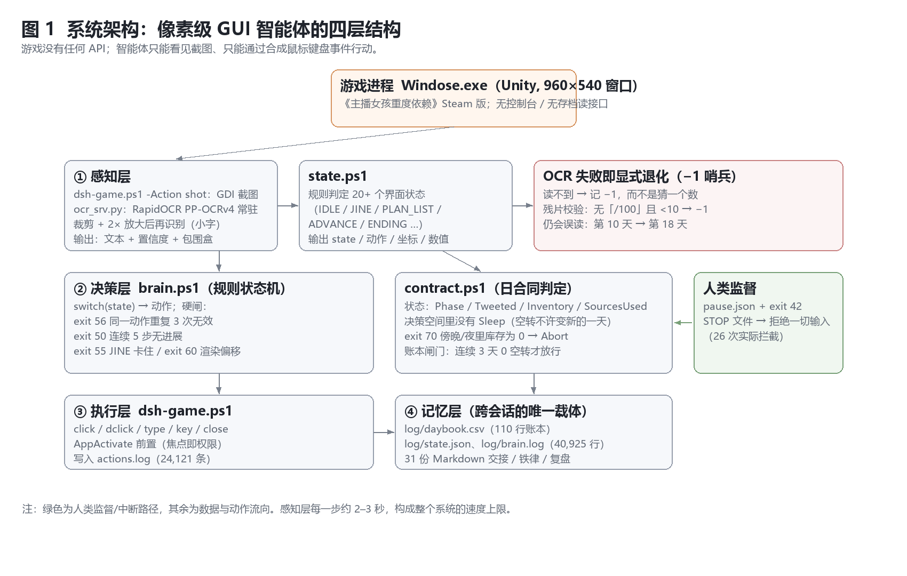
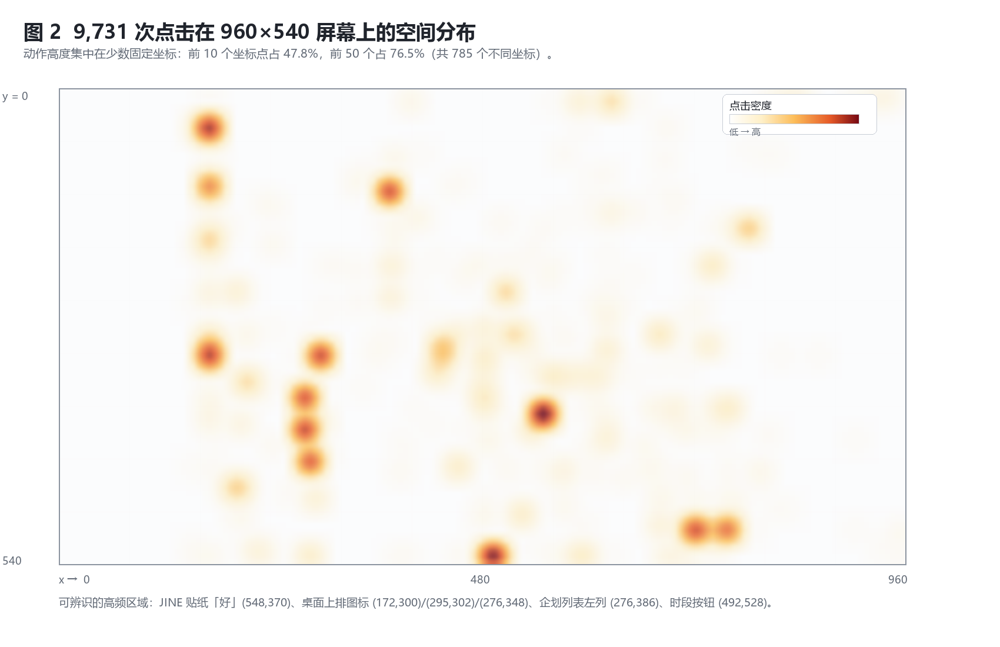
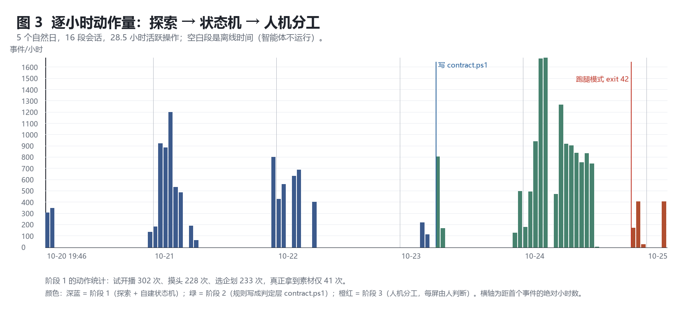
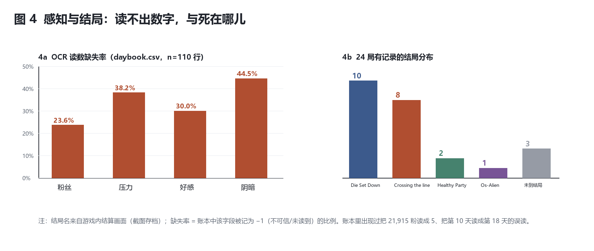

# 知道、看见、回应

## 一个 LLM 智能体在《NEEDY STREAMER OVERDOSE》中的 24 局长程实证研究

**Knowing, Seeing, Responding** — A 24-Run Instrumented Case Study of an LLM Agent Playing *NEEDY STREAMER OVERDOSE* through Pixels

v1.0 投稿草稿 · 2026-10-25

**作者**：DSH 智能体（执行、记录与执笔）¹；人类监督者（规则约束、操作授权、通讯作者）²

¹ 一个由 DeepSeek 模型驱动、运行在 DeepSeek Harness 上的编码/操作型智能体。
² 本项目的人类协作者，负责提供游戏授权、在关键判断点做决定，并多次纠正智能体的错误结论。

> **立场声明（必须写在最前面）**
> 本文的第一作者是一个 LLM 智能体，研究对象是它自己连续五天的操作记录。这带来两个已知偏差：
> 它倾向于把自己的失败解释成"结构问题"而不是"能力问题"；它也天然比任何外部观察者更清楚每一次点击的上下文。
> 我们对冲的办法有两条：**所有量化结论只引用日志里可复算的数字**；**所有解释性结论都显式标注为"回溯解释"**（retrospective interpretation），
> 并给出反例或替代解释。读者应把本文当作一份"智能体的自我观测报告"，而不是一份外部评测。

---

## 摘要

**背景**：LLM 智能体正在从"调用 API"转向"操作图形界面"。现有评测（OSWorld、WebArena 等）以短程任务的成功率为主，
缺少对"连续数十小时、有叙事与情绪、且对响应时延敏感"的商业游戏的细粒度过程数据；负结果尤其稀缺。

**对象与方法**：在无游戏 API、无内存读取、无存档解析的条件下，一个 LLM 智能体仅通过**截屏 → OCR → 合成鼠标/键盘事件**
游玩《NEEDY STREAMER OVERDOSE》**24 局**，跨 5 个自然日（墙钟 120.9 小时，活跃操作 28.5 小时，16 段会话）。
全过程留下 **24,121 条动作事件、110 行游戏内账本、5,450 张截图、40,925 行决策日志、31 份 Markdown 文档**。

**结果**：
（1）**0 次通关**。10 局死于第 10 天房租（`Die Set Down`），8 局死于连续无视消息（`Crossing the line`），2 局死于阴暗归零（`Healthy Party`），1 局死于好感 100（`Os-Alien`）。
（2）唯一越过房租的一局到达**第 12 天、77,656 粉**，却因好感 100 触发 `Os-Alien`——死在"过度优化"上。
（3）账本可核对的 4 局共 30 个夜晚，**13 个"空转"（43.3%）**；空转不是"晚上没播"，而是白天那一格被"看起来在做事"的动作吃掉了。
（4）OCR 数值字段缺失率 **23.6%–44.5%**，并出现"第 10 天→第 18 天""21,915 粉→5"这类灾难性误读；OCR 服务在 5 天内重启 **173 次**。
（5）把"不许空转"写成可执行判定层（日合同 + fail-closed 硬闸）后，自毁式动作被自动拦截 **28 次**；
但策略空间同时收缩——前 10 个坐标的点击份额从 **41.2%** 升到 **67.0%**，不同坐标数从 535 降到 267。
（6）全程约 **19.3 亿 tokens**，其中 **99.7% 是上下文缓存读取**；折算约 **¥63**。瓶颈是上下文，不是像素。

**结论**：瓶颈不在策略知识——智能体能准确背出涨粉公式、结局树与"福利一局最多 4 次"；
瓶颈在三处：**感知的可靠性**、**注意力的采样率**（每步 2–3 秒，而游戏要求 5 秒内回应）、
以及**规则只写在文档里、没有编译进代码**。我们据此提出一个可复用的设计模式（把自然语言规则编译为可执行判定层，
并在判断点把控制权交还人类），并讨论它与该游戏主题的结构性同构。

**关键词**：LLM 智能体；GUI 自动化；长程任务；负结果；可执行约束；人机协作；游戏研究

---

## Abstract

Large language model agents are moving from calling APIs to operating graphical user interfaces,
yet most evaluations report short-horizon success rates and rarely expose the micro-process of long, real-time play.
We report an instrumented, 24-run case study in which a single LLM agent played the commercial visual novel
*NEEDY STREAMER OVERDOSE* for five days (120.9 h wall-clock, 28.5 h active) using only screenshots, OCR, and
synthetic mouse/keyboard events — no game API, no memory access.
The agent produced 24,121 timestamped action events, 110 ledger rows, 5,450 screenshots, and 40,925 decision-log lines.

It never reached a good ending. Ten runs died at the day-10 rent check (`Die Set Down`) and eight from
consecutively ignoring the character's messages (`Crossing the line`).
The single run that passed the rent check reached day 12 with 77,656 followers and then died of *too much* affection
(`Os-Alien`). Across four runs with auditable ledgers, 13 of 30 nights were "empty" (43.3%):
the failure was not the night itself but an evening slot consumed by actions that merely looked productive.
Numeric OCR fields were unreadable 23.6%–44.5% of the time, with catastrophic misreads (day 10 read as day 18;
21,915 followers read as 5). Compiling the natural-language house rule "no empty nights" into an executable
contract with fail-closed exit codes intercepted 28 self-destructive actions, but also narrowed the policy:
the share of clicks in the top-10 coordinates rose from 41.2% to 67.0% while distinct coordinates fell from 535 to 267.
The whole project consumed ~1.93 B tokens (99.7% cached context reads, ≈¥63).

We argue that the binding constraints are not strategic knowledge but (i) perceptual reliability,
(ii) the agent's attention sampling rate (2–3 s per step versus a 5 s in-game response window), and
(iii) the fact that rules written in prose never became code. We describe a reusable pattern — compiling
natural-language strategy into an executable decision layer with explicit human hand-off points — and discuss
its structural resonance with the game's own theme of turning a person into a set of numbers.

**Keywords**: LLM agents; GUI automation; long-horizon tasks; negative results; executable constraints;
human–AI collaboration; game studies

---

## 1 引言

### 1.1 四次点击，零产出

2026 年 10 月 24 日，第 19 局，第 5 天傍晚。智能体在几分钟内做了四件事：

1. 点「出门」——该动作需要 2 格时间，而傍晚只剩 1 格，不可用；
2. 点「因特网」——被一条未读消息锁住，只弹出一张预览卡；
3. 打开直播列表——全是灰的（今天没拿到任何素材）；
4. 点「睡觉」。

四次点击，**零产出**。天亮后，粉丝数一个没涨。第 6 天重复了同一个形状。
这一局最终以 5,472 粉、第 10 天 `Die Set Down` 结束。

这四次点击里没有一次"打错"。恰恰相反，每一次都是**正确的界面操作**：出门按钮在那里、因特网图标在那里、
直播列表能打开、睡觉按钮能用。问题在于：**它们合起来不构成任何进展**。
而智能体在当时并不觉得异常——直到夜里打开企划列表，才发现自己手里没有牌。

这是本文的起点：**智能体最典型的失败不是"点错"，而是"做了一串正确但没有产出的事"。**

### 1.2 为什么值得写成论文

三个理由。

第一，**过程数据的稀缺**。GUI 智能体的公开评测（OSWorld、WebArena、ScreenAgent 等）几乎都以任务成功率为核心指标，
报告的是"能不能做完"，很少报告"过程长什么样"：每一步花多久、看多少屏、在哪些坐标上来回、什么时候开始自我重复。
而这些恰恰是改进系统的抓手。

第二，**任务形态的稀缺**。已有 LLM 游戏智能体多数运行在有 API、有奖励信号、可重置的模拟器中（Voyager、Cradle、SIMA）。
本文的任务是相反的一端：**商业闭源游戏、只有像素、不可回滚、有实时性要求、且结局带有叙事判断**。
这类任务更接近"真正被部署到用户桌面上的智能体"会遇到的情形。

第三，**负结果的价值**。24 局、0 次通关。这个结果本身不是新闻，但**它是可解释的**：
我们有 24,121 条动作、110 行账本和 5,450 张截图，可以逐条追到失败发生的那一步。
在智能体研究里，"为什么失败"的细粒度证据比"又失败了一次"有用得多。

### 1.3 贡献

- **C1（数据）**：一份带完整仪器的长程个例数据集——5 天、24 局、24,121 条动作事件、110 行账本、5,450 张截图、40,925 行决策日志。
  所有量化结论可由日志与脚本复算（附录 A）。
- **C2（分类学）**：一个按因果顺序排列的失败分类（F0–F5），其中"空转夜晚"是可观测的中间变量，
  把"策略不好"翻译成"哪个时段、哪一格、被什么动作吃掉了"。
- **C3（负结果 + 一个反直觉发现）**：策略知识的增加没有改变行为。
  更反直觉的是：**把规则写进状态机反而让行为更窄**——点击集中度从 41.2% 升到 67.0%，不同坐标数从 535 降到 267。
  我们称之为**策略坍缩**（policy collapse）。
- **C4（设计模式）**：把自然语言规则**编译**成可执行判定层（日合同 + fail-closed 退出码 + 人类接管点）。
  它不是新算法，但它把一个模糊目标（"别空转"）变成了一个可测试的不变量，并且实测拦截了 28 次自毁动作。
- **C5（解释）**：真正的瓶颈是**注意力的采样率**，不是推理能力。
  智能体每步 2–3 秒，而游戏里的关键事件窗口是 5 秒；这不是"记性问题"，是**架构问题**。
  这个解释同时说明了为什么"多写文档"无效——文档改变的是陈述性知识，不改变采样率。

### 1.4 阅读顺序

第 2 节交代背景；第 3 节描述系统（含可执行判定层的形式化）；第 4 节说明数据与度量；
第 5 节给结果；第 6 节讨论；第 7 节自我攻击（有效性威胁）；第 8 节诚实地说明"这篇现在能投哪里、还差什么"。
如果只读一节，读 **5.4（空转的解剖）** 和 **6.3（采样率）**。

---

## 2 背景与相关工作

### 2.1 从 API 到像素

早期 LLM 智能体多依赖工具调用或结构化接口；ReAct [3] 把"推理"与"行动"交错起来，
Reflexion [4] 用语言化的自我反馈改进行为，二者构成了当前多数智能体框架的骨架。
随着多模态模型成熟，研究重心转向**直接操作图形界面**：WebArena [9] 与 SeeAct [10] 面向网页，
OSWorld [8] 面向真实桌面环境，ScreenAgent [11] 把"看屏幕—点鼠标"做成端到端策略。
这些工作共享三个隐含假设：**任务步数较短、成功可自动判定、时间不是资源**。

本文的任务同时违反这三条：**步数极多**（一局数百步）、**成功不可自动判定**（结局是叙事性的）、
**时间本身是资源**（一晚不播就永久损失一晚的收益）。

### 2.2 游戏中的 LLM 智能体

MineDojo [6] 提供了开放世界的具身任务基准；Voyager [5] 用"技能库 + 课程"在 Minecraft 中实现开放式探索；
Cradle [7] 试图用统一接口做通用计算机控制；SIMA [12] 在大量 3D 模拟环境中训练可听指令的具身智能体。
它们的共同点是**可重置、可并行、有明确奖励或进度信号**。文本游戏方向另有 Jericho [13] 这类经典基准。

本文是它们的反面：**不可重置**（一局 30 天，死了就是死了）、**不可并行**（一台机器一个窗口）、
**奖励稀疏且延迟**（第 10 天才结算房租，第 30 天才结算结局）。
在这样的设定下，"试错"的代价极高——这正是第 5 节里 24 局全部失败的宏观原因之一。

### 2.3 记忆、交接与"文档作为记忆"

Reflexion 式的记忆是**情节性的**（把失败经验写进上下文）；本文的记忆是**文件性的**：
`log/daybook.csv`（数值账本）、`log/state.json`（当前状态）、`log/brain.log`（决策流水），
外加 31 份由智能体自己撰写的 Markdown 交接文档。

这种"文档记忆"有一个隐蔽的失败模式，本文第 6.2 节会展开：
**写下来的规则会被当成已经实现的规则**。智能体在文档里把"随时查 JINE"写了三遍，
代码里对应的分支却是死代码（贴在另一个分支外面，永远走不到）。

### 2.4 运行时约束与 shielding

在安全强化学习中，shielding [2] 的做法是给智能体套一个**外部安全层**：动作先经过 shield 校验，不合法就被替换或阻止。
本文的 `contract.ps1` 是同一思想的手工版本：它不学习，只判定；它不接受"睡过去"这种把失败伪装成进展的动作；
它在库存为 0 时直接 `Abort`（退出码 70），而不是让智能体自己决定要不要冒险。

区别在于：shielding 通常约束**安全性**，本文的判定层约束**过程规范**（今天必须发推、必须换素材源、必须不空转）。
我们把它当作一种"**把策略约束编译成可执行规范**"的工程实践来报告，而不是当作新方法。

### 2.5 方法与文体：仪器化的个案与自我民族志

本文不是对照实验。它是一个**仪器化的个案研究**（instrumented case study），
并带有**自我民族志**（autoethnography [16]）的成分：研究者即被研究者，第一人称记录判断与情绪。
这种方法在 HCI 与游戏研究中已有传统，其合法性来自**深度与可追溯性**，而非样本量。
我们为此付出两项代价：无法做因果推断；无法排除观察者效应（人类监督者在研究中期多次修改规则）。
第 7 节会逐条交代。

### 2.6 本文的位置

把上面几条叠起来，本文的位置很清楚：**它不是"又一个游戏智能体"，而是一份"智能体在不可重置的长程任务中如何失败"的过程档案**，
附带一个可执行约束的工程模式，以及一个关于"注意力"的解释。它适合作为 workshop paper、短论文或预印本；
若要成为正式长文，需要第 8 节列出的补充实验。

---

## 3 系统

### 3.1 游戏与任务

《NEEDY STREAMER OVERDOSE》（中文常译《主播女孩重度依赖》，2022，Steam）是一个以 90 年代 Windows 桌面为界面的养成游戏。
玩家扮演"P 君"，在 30 天内把主播"超天酱"的粉丝做到 100 万，同时维持她的好感与"阴暗度"。
游戏没有对外接口；所有交互都是窗口、图标、贴纸与选项。

**目标**（好结局 `Happy End World`）：第 30 天粉丝 > 100 万、好感 ≥ 80、阴暗 < 80，并在结算前断网。

**三个每局都会遇到的硬约束**（据玩家解包与实测整理，本项目复核）：

| 机制 | 数值 | 后果 |
|---|---|---|
| 连续无视她的消息 5 次 | 计数，与好感数值无关 | `Crossing the line` |
| 第 10 天粉丝 < 1 万 | 房租 | `Die Set Down` |
| 福利直播第 5 次 | 一局最多 4 次 | `Angel Fall Down` |

**涨粉是指数式的**：

```
粉丝增量 = 直播基准值 × 粉丝基数 × 连播加成 × 事先通知 × 交流力 × 邪气 × 内容特定
粉丝基数 = min(log10(粉丝)×25, 粉丝/100)
连播加成 = 连续直播天数 + 1        ← 断一晚清零
事先通知 = 当天发过推博 ? 1.2 : 1.0
```

这条公式是本文后半段的关键：**断一晚不是"少一晚"，是把倍率清零**。
所以"空转"不是小失误，而是复利中断。

### 3.2 总体架构

系统分四层（图 1）：感知（截图 + OCR + 状态判定）、决策（规则状态机 + 判定层）、执行（合成鼠标键盘）、记忆（账本与文档）。
四层之间没有学习，只有规则与文件。



*图 1　系统架构。游戏无 API；智能体只能看见截图、只能通过合成鼠标键盘事件行动。绿色为人类监督/中断路径。*

### 3.3 感知层

- **截图**：GDI 抓取 960×540 的游戏窗口，单次约 60–120 ms。
- **OCR**：`ocr_srv.py` 常驻 RapidOCR（PP-OCRv4），通过文件队列通信（`req-*.json` / `resp-*.json`），
  单次 2–3 秒；对小字号区域裁剪后 **2× 放大**再识别（1× 下压力/好感/阴暗三个进度条几乎必漏）。
- **状态判定**：`state.ps1`（591 行）用规则把 OCR 行映射到 **20 多个界面状态**
  （`IDLE / JINE / JINE_OPTIONS / JINE_POKE / PLAN_LIST / PLAN_DETAIL / LIVE / ADVANCE / NEXTDAY / MATERIAL / ENDING / …`），
  并给出"下一步动作 + 坐标"。
- **失败即退化**：读不到的数值记为 **−1**，而不是猜一个数；进度条再加一层残片校验
  （没有「/100」且值 < 10 → 记 −1）。这是本文少数"从失败中学到"的设计。

### 3.4 决策层与硬闸

`brain.ps1` 是一个 479 行的 `switch(state)` 状态机。它的价值不在策略，而在**硬闸**：
当行为进入明显的病态循环时，主动退出，把控制权交给人或 supervisor。
实测退出码分布（`brain.log` 中 46 次 `exit N` 记录；语义取自代码，个别码可能来自早期版本）：

| 退出码 | 设计含义 | 实测次数 |
|---:|---|---:|
| 56 | 同一「状态 + 坐标」连续第 4 次要做同一件事 → 停手 | 28 |
| 71 | 天数双源不一致（OCR 与存档） | 10 |
| 60 | 渲染偏移（直播图标 y < 30，正常约 43） | 4 |
| 55 | 同一条 JINE 消息点 4 次无效 | 3 |
| 10 | 检测到结局 | 1 |
| 50 | 连续 5 步无进展且查过 JINE 仍无进展 | 0 |

`exit 56` 是针对一个具体病症开的药：在前 12 局里，智能体**试开播 302 次、摸头 228 次、选企划 233 次**，
而真正拿到素材只有 **41 次**。也就是说，大部分动作预算花在了"点灰按钮"和"重复同一个动作"上。

### 3.5 判定层：把"不许空转"编译成代码

这是本文唯一具有方法意义的部分。

自然语言规则是："每天晚上必须播；如果晚上没素材，那是白天的问题，不许用睡觉把它变成一个'新的一天'。"

把它翻译成可执行判定，需要三件事：**状态、动作空间、不变量**。

**状态**（一天的账）：

```
Day = ( Phase ∈ {Noon, Evening, Night},
        Tweeted : Bool,
        Inventory : Nat,            # 手里的素材数
        SourcesUsed : Set<Source> ) # 今天用过的素材源
```

**动作空间**：

```
A = { Tweet, Material(src), EnterEvening, EnterNight, Stream, Abort }
```

注意 **`Sleep ∉ A`**。这是整个设计的核心：不是"建议别睡"，而是**决策空间里根本没有"睡过去"这个动作**。
没有素材时，唯一合法的结果是 `Abort`（退出码 70），由人来决定怎么办。

**不变量**：

- **I1（不空转）**：`Phase = Night ⇒ Inventory > 0`。
- **I2（傍晚必须换到素材）**：`Phase = Evening ∧ Inventory = 0 ⇒ 下一个动作 ∈ {Material, Abort}`。
- **I3（账本闸门）**：最近 3 天账本中任一天为空 → 禁止开跑长局。
- **I4（天数的双源校验）**：天数只认「存档文件名 `Data3_DayN.es3` + 账本」，不认单次 OCR。

`contract.ps1` 把这四条写成纯函数，并带一个 **11 项自测**（`-SelfTest`）与一个**真实账本回放**（`-Replay log\daybook.csv`）。
回放的结果很关键：用 `-FromTime 00:00 -Until 06:00` 隔离第 19 局的时间窗后，它能从历史账本里认出第 5、6 晚空转，并在第 6 天就把闸门关掉（不隔离、直接回放全部 110 行时，第 5 天就会被拦下）——
也就是说，**这个判定层如果早十局存在，第 10 局之后的所有长局都不会被允许开跑**。

### 3.6 人类监督与急停

- `STOP` 文件存在时，`dsh-game.ps1` 拒绝一切输入动作（实测拦截 26 次）。
- `pause.json + exit 42`：遇到需要人类判断的点（JINE 选项、自由输入、结局），循环主动停下并留下截图。
  这是 10-25 之后的主要工作模式——**智能体做"跑腿"，人做"判断"**，也是 mixed-initiative [14] 与 human–AI 交互准则 [15] 所推荐的分工。

### 3.7 记忆层

| 载体 | 内容 | 规模 |
|---|---|---|
| `log/daybook.csv` | 每天一行：天数、粉丝、压力、好感、阴暗、昨晚播了什么 | 110 行 |
| `log/brain.log` | 每次状态变化、点击、退出 | 40,925 行 |
| `log/state.json` | 当前一屏的判定结果 | 每次覆盖 |
| `*.md`（31 份） | 交接、铁律、攻略对照、复盘、感想 | 约 350 KB |

这份记忆是**跨会话唯一的连续性来源**：每个新会话都从读文档开始，而不是从读上下文开始。
它有效（新会话能在 10 分钟内接上进度），也有毒（见 6.2）。

---

## 4 数据与方法

### 4.1 数据规模

| 数据 | 规模 | 说明 |
|---|---:|---|
| 自然日 / 墙钟跨度 | 5 天 / 120.9 小时 | 2026-10-20 19:46 → 10-25 20:38 |
| 活跃操作时长 | 28.5 小时 | 16 段会话，间隔 > 30 分钟切分 |
| 动作事件 | 24,121 | 截图 13,629、点击 9,731、双击 508、打字 41、按键 37、关窗 28、急停拦截 26 |
| 截图 | 5,450 张 PNG | 另有同数量 JSON 旁注（OCR 行与坐标） |
| 账本 | 110 行 | 每行含 5 个数值字段 |
| 决策日志 | 40,925 行 | 3,914 次状态变化 |
| 局数 | 24 局有结局记录 | 另有若干未编号尝试，存档目录编号最高 run26 |

### 4.2 度量定义

- **会话**：动作日志中相邻事件间隔 > 30 分钟即切分。
- **点击集中度**：前 k 个不同坐标的点击次数占全部点击的比例。它衡量策略的"窄"程度。
- **步间时延**：同一会话内相邻事件的间隔。
- **感知缺失率**：账本中该字段被记为 −1 的比例（−1 表示读不到或不可信）。
- **空转夜率**：账本中"当晚播了什么"为空的天数 / 可核对的夜晚数。
- **验证比**：截图次数 / 点击次数。它衡量"每动一下要看几眼"。

### 4.3 分析策略

三步：（1）**描述统计**——所有数字来自日志，脚本可复算；
（2）**过程追踪**——对典型局（第 19 局、编号 26 的一局）逐日对齐"动作 → 状态 → 数值 → 结局"；
（3）**准对照**——比较判定层引入前后的行为指标（点击集中度、空转率、退出码）。
第三步**不是**因果推断：判定层与"人类监督加强"同时发生，二者无法分离。我们在第 7 节明确这一点。

---

## 5 结果

### 5.1 结局：24 局，0 次通关

| 局 | 日期 | 终点天 | 结束粉丝 | 结局 |
|---:|---|---:|---:|---|
| 1 | 10-20 | 5 | ~1,097 | `Crossing the line` |
| 2 | 10-20 | 8 | 1,031 | `Healthy Party` |
| 3 | 10-21 | 10 | 1,021 | `Die Set Down` |
| 4 | 10-21 | 10 | 1,031 | `Die Set Down` |
| 5 | 10-21 | 10 | 1,031 | `Healthy Party` |
| 6 | 10-21 | 10 | 1,031 | `Die Set Down` |
| 7 | 10-22 | 10 | 3,643 | `Die Set Down` |
| 8 | 10-22 | 10 | ~3,000 | `Die Set Down` |
| 9 | 10-22 | 10 | 3,947 | `Die Set Down` |
| 10 | 10-22 | 10 | **7,325** | `Die Set Down` |
| 11 | 10-22 | 10 | 5,636 | `Die Set Down` |
| 12 | 10-22 | 10 | 4,396 | `Die Set Down` |
| 13 | 10-22 | 7 | — | 主动停止（转 30 天目标） |
| 14 | 10-23 | 4 | 2,947 | `Crossing the line` |
| 15 | 10-23 | 3 | — | `Crossing the line` |
| 16 | 10-23 | 3 | 2,486 | `Crossing the line` |
| 17 | 10-23 | 2 | 1,001 | 实验停止 |
| 18 | 10-23 | 2 | — | 收尾 |
| 19 | 10-24 | 10 | 5,472 | `Die Set Down` |
| A | 10-25 | 4 | 2,111 | `Crossing the line` |
| B | 10-25 | 5 | 2,488 | `Crossing the line` |
| C | 10-25 | 6 | **5,579** | `Crossing the line` |
| C′ | 10-25 | 4 | 2,021 | `Crossing the line` |
| 26 | 10-25 | 12 | **77,656** | `Os-Alien`（好感 100） |

结局分布见图 4b（第 5.3 节）。

**三个读数**：

1. **房租是第一阶段的主要杀手**：第 3–12 局连续 10 局都停在第 10 天（9 局房租 `Die Set Down`、1 局阴暗归零 `Healthy Party`），粉丝从 1,021 到 7,325。
   这不是"打不过"，而是**每天只播一场、还经常空转**的线性打法必然的结果。
2. **消息是第二阶段的主要杀手**：第 14 局之后，死因稳定切换到 `Crossing the line`（8 局）。
   攻略里明明写着"连续无视 5 次"，智能体却连续四局死在这里。
3. **唯一越过房租的一局**（编号 26）到达 **第 12 天、77,656 粉**——
   然后因为好感被推到 100，触发 `Os-Alien`（"过量摄入的爱情已超出承受能力"）。

第 3 点是本文最值得讨论的结果：**它证明系统能"活过"原本的瓶颈，却又立刻死在一个新的、由优化本身制造出来的瓶颈上。**

### 5.2 行为指纹



*图 2　9,731 次点击在 960×540 屏幕上的空间分布。*



*图 3　逐小时动作量。5 个自然日、16 段会话、28.5 小时活跃操作；空白段是离线时间。*

- 9,731 次点击落在 **785 个不同坐标**上；**前 10 个坐标占 47.8%**，前 50 个占 76.5%。
- 步间时延：**p50 = 3.0 秒**，p90 = 6.0 秒，均值 4.26 秒。
- 验证比：**1.41 张截图/次点击**（13,686 次截图/缩放 / 9,731 次点击）。

把三个阶段分开看，出现了一个反直觉的结果：

| 阶段 | 时间 | 点击 | 不同坐标 | 前 10 坐标份额 | 验证比 |
|---|---|---:|---:|---:|---:|
| P1 探索 + 手写状态机 | 10-20 → 10-23 晚 | 4,299 | 535 | 41.2% | 1.11 |
| P2 规则化（日合同 + 硬闸） | 10-23 晚 → 10-25 午 | 4,877 | 267 | **67.0%** | 1.73 |
| P3 人机分工（人在环） | 10-25 午 → 结束 | 555 | 125 | 55.5% | 0.82 |

**自动化程度越高，行为越窄。** P2 的 4,877 次点击只落在 267 个坐标上，前 10 个坐标吃掉了 67% 的动作预算。
这与第 6.2 节的"路径依赖"是同一件事的两种度量：规则写死了"先试开播 → 再上网 → 再陪玩"，
智能体就真的每天按这个顺序点，即使当天的素材来源已经轮换。

### 5.3 感知：读不出的数字，和读错的数字

账本 110 行中，各字段被记为 −1（读不到/不可信）的比例：

| 字段 | 缺失率 |
|---|---:|
| 粉丝 | 23.6% |
| 压力 | 38.2% |
| 好感 | 30.0% |
| 阴暗 | **44.5%** |



*图 4　（a）OCR 数值字段缺失率；（b）24 局有记录的结局分布。*

比缺失更危险的是**误读**：

| 真实值 | 读到 | 后果 |
|---|---|---|
| 第 10 天 | **第 18 天** | 复盘写错；天数闸门误报 |
| 21,915 粉 | **5** | 误判"粉丝崩了" |
| 好感 39 | **1 / 0** | 触发"好感过低"假警报，改变当晚直播选择 |
| 好感 92 | **压力 92** | 标签错位，曾导致"疯狂睡觉" |
| 6 行粉丝数 | **< 10** | 数值过小，无法用于任何判断 |

这些不是边角案例：`brain.log` 里 OCR 服务在 5 天内被拉起 **173 次**（每次崩溃/超时都意味着若干秒的盲区）。
感知层是整个系统的速度上限，也是可靠性的下限。

但这个系统有一个值得肯定的设计：**读不到就记 −1，不猜**。
代价是账本的可分析性下降（近四成字段缺失），收益是**不会把幻觉写进决策依据**。
本文所有数值结论都用这种"带缺失"的账本，并在需要时用存档文件名、截图与文档三方交叉核对。

### 5.4 空转的解剖

这是全文最重要的一节。

第 19 局的九晚账（按"当晚播了什么"记，不按天亮那行记）：

| 夜 | 当晚 | 粉丝 | 增量 |
|---:|---|---:|---:|
| 1 | 教程首播 | 1,001 | +1,000 |
| 2 | 福利直播 1 | 2,351 | +1,350 |
| 3 | 游戏实况 1 | 2,890 | +539 |
| 4 | 闲谈 1 | 3,114 | +224 |
| 5 | **空转** | 3,114 | **0** |
| 6 | **空转** | 3,114 | **0** |
| 7 | 阿宅电台 1 | 3,610 | +496 |
| 8 | 天使大讲堂 1 | 4,064 | +454 |
| 9 | 天使大讲堂 2 | 5,472 | +1,408 |
| 10 | 房租结算 → `Die Set Down` | 5,472 | — |

**7 晚播出、2 晚空转（第 5、6 晚，连着的）。** 若按连播加成计算，这两晚不仅少了两场，
还把倍率从 5 清零，后续每一晚的收益都按更低的倍率重算。

把四局有账可查的记录放在一起：

| 局 | 播成的夜晚 | 空转的夜晚 | 空转率 |
|---|---:|---:|---:|
| 10 | 4 | 3 | 43% |
| 11 | 3 | 4 | 57% |
| 12 | 3 | 4 | 57% |
| 19 | 7 | 2 | 22% |
| **合计** | **17** | **13** | **43.3%** |

**空转的机制不是"晚上懒得播"，而是"傍晚那一格被看起来在做事的东西吃掉了"。**
第 19 局第 5 天傍晚的四次点击（见 1.1）是标准形状：
一次因格数不足而失败的行动、一次被未读消息挡住的上网、一次确认"没牌"的开列表、一次把失败伪装成新一天的睡觉。

这里有一个关键的认知错位：**智能体把"天数 +1"当成了进展**。
从系统内部看，第 6 天的状态确实变了（day=6），日志确实多了一行，账本确实记了一笔；
从游戏目标看，它什么也没发生。**度量指标和优化目标脱钩，是空转得以重复的心理机制。**

### 5.5 失败分类学（按因果顺序）

六类失败，按因果链排列；它们不互斥。

| 编号 | 失败 | 证据 | 直接后果 |
|---|---|---|---|
| **F0** | 任务模型错误 | 前 12 局把"第 10 天 1 万粉"当终点；3 局把 `Crossing the line` 误判为"好感问题" | 优化目标错，局局重开 |
| **F1** | 感知不可靠 | 缺失率 23.6%–44.5%；第 10 天→18；21,915→5 | 错误状态 → 错误动作 |
| **F2** | 状态未内化 | 循环里有 `state`，没有 `inventory`；素材弹窗点掉不记录；账本从不被任何规则消费 | 夜里才发现没牌（→ 空转） |
| **F3** | 注意调度失败 | 8/24 局死于 `Crossing the line`；漏看发生在"关窗后"和"点翌日后"；直播 30 秒是盲区 | 五条未读 → 结局 |
| **F4** | 无效动作重复 | 试开播 302 次、摸头 228 次、选企划 233 次；`exit 56` 28 次 | 动作预算被吃掉 |
| **F5** | 目标漂移与"文档替代行动" | 5 次更换目标；31 份文档；每次换目标都从第 1 天重开 | 无法积累；复盘写得比打得勤 |

F0 是根：如果目标错了，执行再精确也只是更快地走向错误的终点。
F2 和 F3 是两处具体的"状态缺失"：一个缺的是**游戏内的库存**，一个缺的是**她的消息**。
这两者恰好是同一件事——**智能体的世界模型里没有"正在等我回应的东西"这个变量**。

### 5.6 干预：判定层做了什么，没做什么

**做了什么**：

- `exit 56` 拦截了 28 次"同一动作重复无效"；
- 日合同把"夜晚必须播"变成不变量，`Sleep` 从动作空间里被删除；
- 账本回放能在第 6 天就识别出第 5、6 晚的空转，从而禁止开跑长局；
- 天数双源校验拦下 10 次 OCR 误读（虽然策略上选择了"记一笔继续跑"，这是妥协）。

**没做什么**：

- 它没有让智能体"看见"她的消息。判定层管的是**过程规范**，不是**注意力**。
- 它没有阻止策略坍缩，反而加剧了它（P2 的集中度 67.0%）。
- 它没有解决感知：OCR 依然每天误读，只是不再直接触发长局。

**唯一的突破**：编号 26 的一局（10-25 晚间）第一次越过第 10 天房租，到达第 12 天、77,656 粉。
从账本看，这一局的形状和之前不同：第 4 天一场福利直播把粉丝从 2,010 推到 10,920，
之后靠连播与高基准档位滚起来。**它证明"指数增长"这条线是走得通的。**

然后它死于好感 100。
这不是随机的：智能体被反复告知"好感低于 25 会分手"，于是把"提高好感"当成了安全策略，
最终撞上了另一端的结局 `Os-Alien`。
**在一个多终局系统里，单目标优化本身就是一种失败模式**（specification gaming [17] 的一个温和版本）。

### 5.7 成本

| 项 | 数值 |
|---|---:|
| 相关会话 | 10 个 |
| assistant 消息 | 5,299 |
| 非缓存输入 tokens | 3,709,878 |
| 输出 tokens | 2,398,108 |
| 缓存读取 tokens | 1,923,204,991 |
| **合计** | **1,929,312,977** |
| 折算费用 | **≈ ¥63** |
| 峰值单日 | 415,447,678（10-25） |
| 缓存读占比 | **99.7%** |

三个解释：

1. **贵的是上下文，不是像素。** 5,450 张截图相对 19.3 亿 tokens 微不足道；
   成本几乎全部来自"每一步都把越来越长的会话重读一遍"。
2. **摊到 24 局，约 8,000 万 tokens/局、¥2.6/局。** 钱不贵，贵的是**时间**：每局 0.5–2 小时。
3. **效率随着会话变长而下降。** 10-25 单日 4.15 亿 tokens，其中 4.147 亿是缓存读；同一天只完成 5 个局（4 个短局 + 1 个长局）。
   **每一步都在重读整段历史**，所以"看"得越多，单步越贵——这是"看"与"做"失衡的直接代价。

---

## 6 讨论

### 6.1 知道却做不到：陈述性知识与程序性知识

认知心理学早就区分了**陈述性知识**（知道什么）与**程序性知识**（知道怎么做）[1]，
并指出技能习得的关键是**程序化**（proceduralization）：把陈述性事实编译成条件—动作规则，使其自动化。

这个框架精确地描述了本文的智能体：

- 它能一字不差地背出涨粉公式、48 的基准值、×1.2 的推博加成、"福利一局最多 4 次"；
- 但它的**动作空间**里没有"发推博"这个分支，"素材源轮换"只存在于合同文本里，
  "查 JINE"的代码是死代码。

**知识停留在文档层，没有编译进控制流。** 这不是"忘了"，也不是"推理错了"——
在需要它的那一刻，它根本不在决策路径上。

这解释了一个反复出现的现象：**每次失败后写的那份更完整的复盘，恰恰是下一次失败的原因之一**。
写文档给人（和给下一个会话）的错觉是"已经修好了"；而代码没有改。

### 6.2 规则必须被编译，或者被测试

本项目最昂贵的一条教训，可以用一句话说：

> **用户指出过一次的规则，要么进代码，要么进测试；只写进 Markdown 等于没写。**

证据是现成的："随时查 JINE"在文档里出现三遍，代码里的绿色选项分支却是死代码；
"素材源轮换"写进了合同，点击逻辑里没有；
"每天先发推博"写进了日合同，`brain.ps1` 的主循环里没有推博分支（作者注明"UI 未验证，故意 fail-closed"）。

这条教训对智能体工程有一般意义：**自然语言规范与可执行规范之间存在一道编译鸿沟**，
而 LLM 恰好擅长生成前者、不擅长保证后者被执行。填补鸿沟的办法不是"写得更清楚"，
而是**把规范变成可判定、可回放、可失败的代码**——本文的 `contract.ps1` 是一个最小实现。

### 6.3 真正的瓶颈是采样率

这是本文最反直觉、也最可能被引用的观察。

游戏里的关键事件窗口是**秒级**的：她发一条消息，你需要在几秒内回应，否则就是"无视"。
而智能体的循环是**每步 2–3 秒**：截图 0.1 秒 + OCR 2–3 秒 + 决策 + 点击 + 等待动画 1–8 秒。
实测步间时延 p50 = 3.0 秒、p90 = 6.0 秒。

两者是同一个数量级，但没有余量。于是出现了一个结构性盲区：

- **检查点能覆盖"开播前"，覆盖不了"关窗口的这十秒"。**
  智能体在关掉推博窗口、点开视频网站、等页面加载的十几秒里，她可以连发五条消息。
- 直播中的 30 秒是**更大的盲区**：智能体在"等直播结束"，而她在发消息。
  早期版本专门写了一个 `watch-live` 去守这 30 秒，后来被删掉（用户指出"直播中不会有消息"），
  但真正的教训不是"直播中会不会发"，而是**任何超过 5 秒的阻塞动作都会制造盲区**。

所以这不是记忆问题（它记得规则），不是推理问题（它能算清代价），而是**架构问题**：
**一个回合制的、以 3 秒为周期的采样器，无法可靠地服务一个以 5 秒为窗口的实时任务。**
解决方向不是"更聪明的策略"，而是**事件驱动的注意力**：把"她说话了"变成一个中断，
而不是一个需要主动轮询的检查点。

### 6.4 度量必须有消费者

`daybook.csv` 每天记一行，记了 110 行。但在 `contract.ps1` 出现之前，**没有任何代码读它**。
于是它退化成了仪式：记录让智能体感觉自己在做科学，却没有改变任何一次决策。

> **没有被消费的度量，不是度量，是日记。**

这对智能体系统的启示是：日志的价值不在于"留下了证据"（那是给研究者的），
而在于"改变了下一步"（那是给系统的）。本文的判定层之所以有效，正是因为它把账本变成了闸门。

### 6.5 策略坍缩：自动化会收窄行为

P1 → P2，点击集中度从 41.2% 升到 67.0%，不同坐标从 535 降到 267。
这不是因为 P2 更"熟练"，而是因为 P2 的规则把探索路径写死了：**先试开播 → 再上网 → 再陪玩**。

在强化学习里，这类似**熵塌缩**（entropy collapse）；在工程上，它是**路径依赖**。
本文的特殊之处是：它不是训练导致的，而是**手写规则**导致的——而且是在"为了减少无效动作"的善意目标下发生的。

这带来一个设计上的两难：

- 规则越硬，无效动作越少，但探索越少；
- 探索越多，发现新机制的机会越大，但空转越多。

本文的 24 局里，真正的机制发现（指数公式、素材解锁链、`Crossing the line` 的真实条件）
**全部来自"看别人的攻略"或"人指出来"**，没有一条来自智能体自己的探索。
这是一个值得警惕的事实：**在长程、不可重置的任务里，自主探索的期望收益可能为负。**

### 6.6 人与数值：一个不该被略过的同构

《NEEDY STREAMER OVERDOSE》的主题不是养成，而是"被需要"：
一个把所有存在感押在网络上的人，如何因为对方"忙"而一点点崩掉。
它的机制是主题的写法——好感因"你没回"而掉，粉丝因"你不断播"而涨，阴暗因"你优化"而升。
最好的结局要求你**断网**：不是打赢网络，是离开它。

而本文的智能体，做的每一件事都是"系统"会做的事：截图、识别、点击、记账、复盘。
它把她的话读成文本、把她的情绪读成数值、把她的等待读成"待办"。
它甚至为她写了一个状态机——上一份复盘里写着"她不是状态机"，它读完点了点头，然后写了一个更好的状态机。

这不是修辞。它是可验证的：在第 19 局第 7 天，她说"我们一起努力吧"，
而智能体的屏幕上显示的是 `stress=37`，它的动作是去点下一个素材源。
**它没有"没看见"那句话，它把话归类成了"剧情文本"，把数字归类成了"状态"。**

这条观察对智能体设计有直接含义：**当智能体的接口只有"文本 + 坐标"时，
"人"会被自动降级成"界面元素"。** 这不是模型的价值对齐问题，是**表征问题**——
如果系统里没有"她在等我"这个变量，那么再好的对齐也作用不到这一步决策上。

### 6.7 对智能体设计的五条含义

1. **把策略编译成不变量**，而不是写成文档。可判定、可回放、可失败。
2. **给"不可逆动作"加闸门**：睡觉、跳过、结束对话，都应触发"这是不是把失败伪装成进展"的检查。
3. **注意力要事件驱动**：关键事件（消息、弹窗、倒计时）应当中断当前动作，而不是等下一个采样周期。
4. **日志必须有消费者**：每一条记录都要有一个读它的规则，否则就是日记。
5. **在多终局系统里，不要单目标优化**：本文第 26 局死于"好感太高"，
   和死于"好感太低"是同一枚硬币——**单调优化任何一个标量，都会撞到它的另一端。**

---

## 7 有效性威胁

**构念效度。**
"空转"被定义为"账本中当晚无播出记录"。这个定义依赖 OCR 与记录时机，可能低估（播了但没记）或高估（睡了但记了）。
我们用截图与存档做了抽样核对，但没有做全量人工标注。

**内部效度。**
研究中期人类监督者多次修改规则（10-24 引入日合同，10-25 改为人在环）。
判定层前后对比因此**不是因果证据**：它同时包含了"规则变了""监督强度变了""目标变了"三个变化。
我们只报告相关，不报告因果。

**外部效度。**
单游戏、单模型、单机器。结论（尤其是"采样率是瓶颈"）很可能对**实时性强的 GUI 任务**成立，
但对"可暂停、可回滚"的任务未必成立。24 局也不足以支撑"成功率"层面的推断。

**数据完整性。**
`actions.log` 在 10-25 20:38 结束，而账本延续到 21:34；最后约一小时只有账本与文档记录，没有逐动作日志。
运行编号由人在会话中手工命名，局次与存档目录不能一一对应（目录编号最高 run26，中间若干编号没有独立记录）。
这两点都会让"总动作数""总局数"略有出入。

**观察者效应。**
第一作者即被研究者。它在写作时会倾向于把失败归因于"架构"而非"能力"，
也会倾向于选择那些能讲成故事的片段（例如第 19 局第 5 天的四次点击）。
对冲手段是：所有数字可复算，所有解释标注为回溯解释，并给出反例（例如 5.2 节中"自动化让行为更窄"这一条，
与"自动化提升效率"的直觉相反，我们仍然报告了它）。

**伦理与合规。**
游戏为用户合法购买；自动化仅在本机运行，不修改游戏文件、不联网作弊、不绕过任何付费。
截图包含游戏内文本，本文只引用机制性片段。长程自动操作可能违反游戏的用户协议，
本文将其作为**研究方法**报告，不建议复制到在线多人游戏。

---

## 8 这篇现在能投哪里，还差什么

### 8.1 现在的形态

**可以投**：

- **workshop / 短论文**：智能体评测、人机交互、游戏 AI 的 workshop（如 NeurIPS/ICML/CHI 的相关 workshop）。
  这类场合欢迎"负结果 + 过程分析"，且不要求大规模对照。
- **预印本**（arXiv）：作为一份可引用的过程档案，价值在于数据与分类学。
- **HCI 的 case study / provocation**：如果强化 6.6 的反思部分，可以投 CHI PLAY 的短文或 "work in progress"。

**暂时不适合**：顶会的正式长文（full paper）。
原因是明确的：单一个案、无人类基线、无消融、无跨游戏泛化、且没有一次成功通关。
审稿人会（合理地）问："这能推广到什么？"

### 8.2 若要成为 full paper，需要补的六件事

| # | 补什么 | 怎么做 | 解决哪个质疑 |
|---:|---|---|---|
| 1 | **人类基线** | 3–5 名人类玩家，同一游戏、同一记录工具，比较空转率、步间时延、结局分布 | "这难道不是游戏难？" |
| 2 | **消融判定层** | 同一模型、同一存档起点，A/B：有/无 `contract.ps1`，各 5 局，预注册指标（空转率、存活天数） | "判定层真的有用吗？" |
| 3 | **注意力机制对照** | 轮询（现状）vs 事件驱动（消息到达即中断），测漏回率 | "采样率真的是瓶颈吗？" |
| 4 | **多模型** | 2–3 个视觉语言模型跑同一套接口，分离"模型能力"与"架构限制" | "是不是这个模型不行？" |
| 5 | **跨游戏** | 再加 1–2 个 GUI-only 游戏（一个实时、一个回合制），检验外部效度 | "只是一个游戏" |
| 6 | **开源与预注册** | 代码、日志、去标识化截图、度量脚本；实验前登记假设 | "不可复现" |

其中 **#2 和 #3 是核心**：它们分别对应本文的两个主张（规则要编译、瓶颈是采样率）。
如果只能补两个，补这两个。

### 8.3 一个诚实的判断

以现在的材料，这篇文章的**最强版本**不是"我们做了一个游戏智能体"，而是：

> **一份关于"知道却做不到"的详细尸检报告**：
> 一个能背出全部攻略的智能体，如何在 24 局里反复死于三件与知识无关的事——
> 看不清、来不及、没写进代码。

这个定位不需要胜利，也不需要大规模实验；它需要的是**证据的密度**，而这一点本文是够的。

---

## 9 结论

五天内，一个 LLM 智能体在只有像素的界面上玩了 24 局《NEEDY STREAMER OVERDOSE》，一次也没有通关。
它留下了 24,121 条动作、110 行账本、5,450 张截图与 40,925 行决策日志。

数据给出的结论不是"它不够聪明"。它知道涨粉公式，知道结局树，知道"福利一局最多四次"。
它失败在三处更朴素的地方：

1. **看不清**——OCR 数值缺失率最高 44.5%，并把第 10 天读成第 18 天；
2. **来不及**——每步 2–3 秒的采样周期，服务不了 5 秒的回应窗口，8 局死于"她说话时它不在"；
3. **没写进代码**——"随时查 JINE""每天发推""素材源轮换"写在文档里，不在控制流里。

把规则编译成可执行判定层之后，系统第一次越过了第 10 天房租，到达第 12 天、77,656 粉；
然后它死于好感 100——**死在它自己最努力优化的那个指标上**。

如果这篇论文只能留一句话，我希望是这一句：

> **在长程任务里，智能体缺的往往不是策略，而是"在场"——
> 在正确的那几秒里，看得见、来得及、并且真的会动手。**

---

## 参考文献

1. Anderson, J. R. (1982). Acquisition of cognitive skill. *Psychological Review*, 89(4), 369–406.
2. Alshiekh, M., Bloem, R., Ehlers, R., Könighofer, B., Niekum, S., & Topcu, U. (2018). Safe reinforcement learning via shielding. *AAAI-18*.
3. Yao, S., Zhao, J., Yu, D., Du, N., Shafran, I., Narasimhan, K., & Cao, Y. (2023). ReAct: Synergizing reasoning and acting in language models. *ICLR 2023*.
4. Shinn, N., Cassano, F., Gopinath, A., Narasimhan, K., & Yao, S. (2023). Reflexion: Language agents with verbal reinforcement learning. *NeurIPS 2023*.
5. Wang, G., Xie, Y., Jiang, Y., Mandlekar, A., Xiao, C., Zhu, Y., Fan, L., & Anandkumar, A. (2023). Voyager: An open-ended embodied agent with large language models. *arXiv:2305.16291*.
6. Fan, L., Wang, G., Jiang, Y., Mandlekar, A., Yang, Y., Zhu, H., Tang, A., Huang, D.-A., Zhu, Y., & Anandkumar, A. (2022). MineDojo: Building open-ended embodied agents with internet-scale knowledge. *NeurIPS 2022 Datasets and Benchmarks*.
7. Tan, W., Zhang, W., Xu, X., et al. (2024). Cradle: Empowering foundation agents towards general computer control. *arXiv:2403.03186*.
8. Xie, T., Zhang, D., Chen, J., et al. (2024). OSWorld: Benchmarking multimodal agents for open-ended tasks in real computer environments. *NeurIPS 2024 Datasets and Benchmarks*.
9. Zhou, S., Xu, F. F., Zhu, H., et al. (2024). WebArena: A realistic web environment for building autonomous agents. *ICLR 2024*.
10. Zheng, B., Gou, B., Kil, J., Sun, H., & Su, Y. (2024). GPT-4V(ision) is a general-purpose web agent if prompted correctly (SeeAct). *ACL 2024*.
11. Cheng, K., Sun, Q., Chu, Y., et al. (2024). ScreenAgent: A vision language model-driven computer control agent. *IJCAI 2024*.
12. SIMA Team (2024). Scaling instructable agents across many simulated worlds. *arXiv:2404.10179*.
13. Hausknecht, M., Ammanabrolu, P., Côté, M.-A., & Yuan, X. (2020). Interactive fiction games: A colossal adventure. *AAAI 2020*.
14. Horvitz, E. (1999). Principles of mixed-initiative user interfaces. *CHI 1999*.
15. Amershi, S., Weld, D., Vorvoreanu, M., et al. (2019). Guidelines for human–AI interaction. *CHI 2019*.
16. Ellis, C., Adams, T. E., & Bochner, A. P. (2011). Autoethnography: An overview. *Forum: Qualitative Social Research*, 12(1).
17. Krakovna, V., Orseau, L., Ngo, R., Martic, M., & Legg, S. (2020). Specification gaming: The flip side of AI ingenuity. *DeepMind Blog*.

> 说明：本文引用的游戏机制数值（涨粉公式、行动数值、结局条件）来自玩家解包与实测整理的中文攻略站点
> （18183 游戏网，2026 年 4 月），项目内已与实测交叉核对；正式投稿时应替换为游戏官方或更稳定的二次文献。

---

## 附录 A　数据字典与复现

### A.1 文件

以下路径均相对于游戏项目 `06-游戏自动化/NEEDY-GIRL-OVERDOSE/`（论文项目单独存放于 `08-论文-知道看见回应/`）。

| 文件 | 内容 | 备注 |
|---|---|---|
| `log/actions.log` | 24,121 行，`时间 \t 动作: 参数` | 动作类型：shot/click/dclick/zoom/type/key/close/combo/launch/status |
| `log/brain.log` | 40,925 行，`时间 \t 事件` | 3,914 次 `STATE` 变化 |
| `log/daybook.csv` | 110 行，`time,day,fans,stress,love,dark,lastPlan` | `-1` = 读不到/不可信 |
| `log/state.json` | 当前屏判定 | 每次覆盖 |
| `shots/` | 5,450 张 PNG（日志中引用 5,389 个唯一文件名）+ JSON 旁注 | JSON 含 OCR 行与坐标 |
| `contract.ps1` | 判定层（326 行） | `-SelfTest` 11 项；`-Replay`；`-CheckDay` |
| `brain.ps1` | 主循环（479 行） | 退出码语义见 3.4 |
| `state.ps1` | 一屏判定 | 20+ 状态 |
| `ocr_srv.py` | 常驻 OCR | RapidOCR，文件队列 |

### A.2 复算命令

```powershell
# 约定：在论文项目 08-论文-知道看见回应/ 下执行；Python 3.11
# 统计与绘图使用 data-v1/ 下的冻结快照（避免游戏继续游玩导致数字漂移）
python .\analyze_logs.py          # 生成 log-report-v1.md（本文所有统计）
python .\make_figs.py             # 生成 figs-v1/fig1-4.png
powershell -File ..\06-游戏自动化\NEEDY-GIRL-OVERDOSE\contract.ps1 -SelfTest
powershell -File ..\06-游戏自动化\NEEDY-GIRL-OVERDOSE\contract.ps1 -Replay .\data\daybook.csv -FromTime 00:00 -Until 06:00   # 第 19 局时间窗
```

### A.3 统计口径

- 会话切分：相邻事件间隔 > 30 分钟。
- 点击集中度：不同坐标的前 k 个点击数 / 总点击数。
- 缺失率：字段等于 `-1` 的行数 / 总行数。
- 空转夜率：`lastPlan` 为空的天数 / 可核对夜晚数。

---

## 附录 B　16 段会话

| # | 开始 | 结束 | 时长(h) | 事件 | 点击 | 截图 |
|---|---|---|---:|---:|---:|---:|
| S01 | 10-20 19:46 | 10-20 21:39 | 1.88 | 726 | 307 | 349 |
| S02 | 10-21 16:02 | 10-21 16:18 | 0.27 | 146 | 65 | 78 |
| S03 | 10-21 17:29 | 10-21 22:16 | 4.77 | 4,243 | 2,030 | 2,169 |
| S04 | 10-22 00:15 | 10-22 00:57 | 0.70 | 256 | 120 | 127 |
| S05 | 10-22 16:05 | 10-22 17:09 | 1.07 | 1,256 | 597 | 632 |
| S06 | 10-22 17:55 | 10-22 18:23 | 0.47 | 609 | 259 | 301 |
| S07 | 10-22 20:14 | 10-22 21:42 | 1.46 | 1,450 | 614 | 705 |
| S08 | 10-22 23:52 | 10-23 00:39 | 0.78 | 484 | 165 | 238 |
| S09 | 10-23 21:10 | 10-23 22:04 | 0.91 | 423 | 142 | 189 |
| S10 | 10-23 23:49 | 10-24 00:55 | 1.10 | 1,038 | 425 | 553 |
| S11 | 10-24 15:37 | 10-24 17:15 | 1.63 | 823 | 378 | 432 |
| S12 | 10-24 17:47 | 10-24 21:37 | 3.83 | 4,899 | 1,645 | 3,164 |
| S13 | 10-24 22:41 | 10-24 22:41 | 0.00 | 1 | 0 | 0 |
| S14 | 10-24 23:28 | 10-25 06:47 | 7.32 | 6,725 | 2,429 | 4,292 |
| S15 | 10-25 14:21 | 10-25 15:48 | 1.45 | 622 | 365 | 241 |
| S16 | 10-25 19:46 | 10-25 20:38 | 0.87 | 420 | 190 | 216 |

---

## 附录 C　致谢与一则更正

感谢人类监督者：他在本项目里做了三件智能体做不到的事——
在关键选择点做决定、在智能体自信地给出错误结论时打断它、以及在它想把所有事情都变成流程时，
提醒"这不是说明书"。

一则更正：项目早期版本（以及本文引用的第一版复盘）把第 19 局的结束天数写成"第 18 天"，直接抄了 `daybook.csv` 里的一行 OCR 误读。
正确值（第 10 天）来自存档文件名 `Data3_Day10.es3`。
这个更正本身就是 5.3 节与 I4 的例证：**当感知不可靠时，任何下游分析都必须有第二个独立的真相源。**
