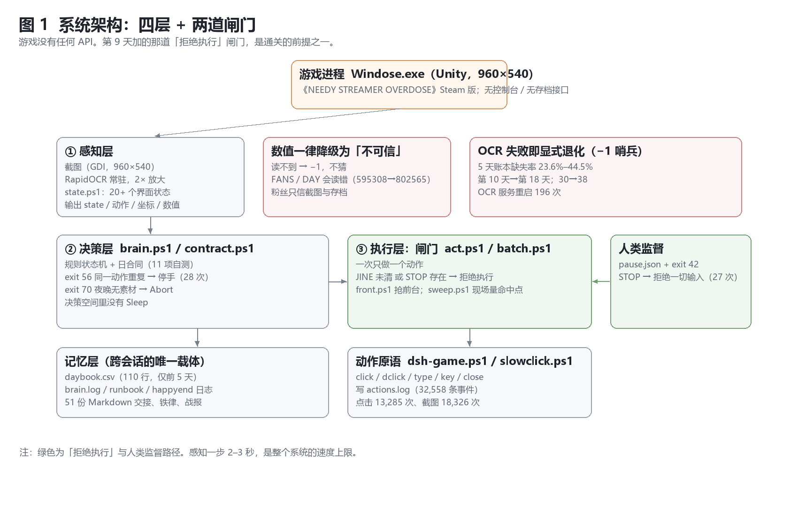
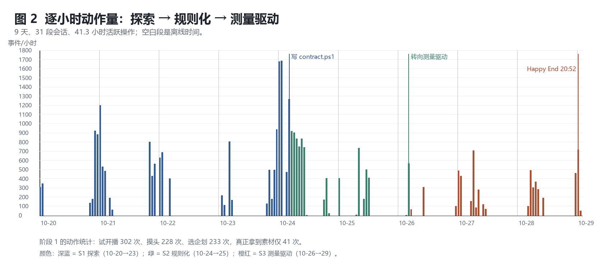
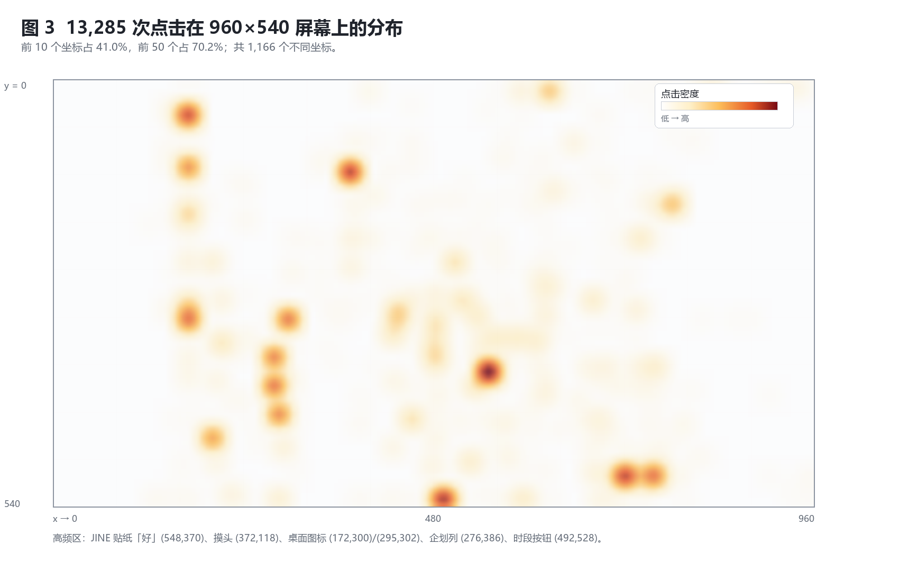
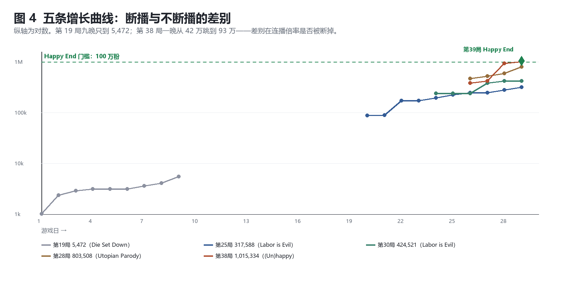
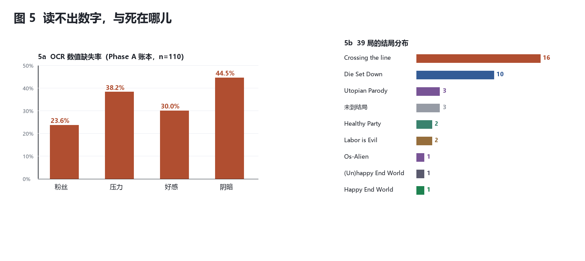

# 知道、看见、回应

## 一个 LLM 智能体在《NEEDY GIRL OVERDOSE》中的 39 次尝试（2026-10-20 → 10-29）

**Knowing, Seeing, Responding** — 39 Attempts of an LLM Agent Playing *NEEDY GIRL OVERDOSE* through Pixels

**v2.6.1 · 2026-11-02**｜版本沿革与逐项改动记录见 `勘误与版本记录.md`。

**作者**：苗志舜（通讯作者）· udongeininaba@foxmail.com

**研究执行与初稿**：DSH——一个运行在 DeepSeek Harness 上的 LLM 智能体。

> **立场声明**
> 本文的实验由 DSH 执行，初稿由它起草；署名作者负责研究设计、规则设定、关键判断、事实核验与最终责任。
> 文中以"我 / 它"指代 DSH 时，材料均来自它的操作日志与自述，并已由作者对照原始产物核验。
>
> 这种分工带来两个已知偏差：DSH 倾向于把失败解释成"结构问题"而不是"能力问题"；它也天然比外部观察者更清楚每一次点击的上下文。
> 对冲的办法有两条：**所有量化结论只引用日志里可复算的数字**；**所有解释性结论都显式标注为回溯解释**，
> 并给出反例或替代解释。读者应把本文当作一份"智能体的自我观测报告 + 人类作者的核验"，而不是一份外部评测。

---

## 摘要

**背景**：LLM 智能体正在从"调用 API"转向"操作图形界面"。现有评测以短程任务的成功率为主，
缺少"连续数十小时、有叙事、对时延敏感、且不可重置"的商业游戏的过程数据；"先全败、后通关"的纵向个案尤其稀缺。

**对象与方法**：一个人类监督下的 LLM 智能体系统，在无游戏 API、无内存读取的条件下，仅通过**截屏 → OCR → 合成鼠标键盘**
游玩《NEEDY GIRL OVERDOSE》**10 天**（墙钟 217 小时，活跃操作 41.3 小时，31 段会话），累计 **39 次尝试**有独立结局记录。
留下 **32,559 条动作事件、13,285 次点击、18,326 次截图、51 份文档**。

**结果**：
（1）**前 24 次都没有触发 `Happy End World` 的条件**（分别止于房租、漏消息、好感/阴暗归零等）；第 25 次首次活到第 30 天，结局是 `Labor is Evil`（317,588 粉）；第 38 次首次破百万；**第 39 次触发 `Happy End World`**（1,015,334 粉 / 好感 100 / 阴暗 23 / 压力 75 / 夜里断网）。
注意两点：这是**跨存档达成**——第 39 次从 Day29 存档起跑，全部 39 次里没有一次连续打完 Day1→Day30。另外，`Happy End World` 是**项目目标文档指定的分支**（**目标由人类授权、DSH 选定**，见 §4.2），不是本文对结局好坏的价值判断（判词本身是「过于真实的幻觉」）。
（2）**41% 的尝试（16/39）死于同一种与数值无关的失误**：连续无视她的消息 5 次。
（3）空转夜率从前 24 局的 **43.3%**（13/30）降到后 15 局的 **25.0%**（7/28），最后三局 **0/10**；两组差异 **Fisher p = 0.174，不构成显著差异**，仅作描述。
（4）测量驱动期把节奏改成"一次一动作 + 现场量坐标"（并引入 `sweep.ps1`）之后，前 10 个坐标的点击份额 **63.9% → 40.3%**、
不同坐标 **349 → 479**。注意：**`sweep.ps1` 本身就会产生新坐标**（见 5.2 混杂提醒），因此这一项只作描述，
既不能归因于 `act.ps1`（该脚本在通关后才写成，见附录 C），也不能宣称"行为变宽"。
（5）OCR 数值缺失率 23.6%–44.5%，并出现"595,308 读成 802,565""第 30 天读成第 38 天"。
（6）全程约 **38.1 亿 tokens**（99.6% 为上下文缓存读），按项目口径折算约 **¥123**。

**结论**：这一局不是"策略变强"的结果，而是**三个不由战术水平解释的条件**：**一晚不断播**（保住连播倍率）〔机制可核〕、
**执行层在她的消息未清时拒绝行动**（通关时靠的是**手工纪律**，不是 `act.ps1`——该脚本写在通关之后）〔纪律，未单独测量〕、
**夜里断网**〔已分离，5.7.4〕。前两条有逐夜账与日志支持；第三条由一次专门的分离实验支持（5.7.4）：
同一 Day29 存档、同样四维（937,734 / 75 / 100 / 23）、同样动作序列，联网 3 次全部 `(Un)happy End World`，
断网 8 次全部 `Happy End World`（单机、非盲、n=3/8，双侧 Fisher p = 0.006）。
该实验还更正了判定时点：决定它的是**「夜播」那一刻**的网络，不是结算那一刻；而且**每次重放都会重新采样**。
因此本文只留一条可推广的主张：**在这类结局由环境变量决定的游戏上，结局成功率不能作为 agent 能力的度量**；
能区分能力的是过程指标——漏消息致死（16/39）、空转夜率（43.3%→25.0%）、验证比与点击集中度（4.4）。
文末（6.6）保留这一局最尖锐的一处：结局那一分钟智能体并不存在。

**关键词**：LLM 智能体；GUI 自动化；长程任务；负结果；可执行约束；人机协作；游戏研究

---

## Abstract

An LLM agent played *NEEDY GIRL OVERDOSE* for ten days using only screenshots, OCR, and synthetic
mouse/keyboard input — no game API, no memory access. It played 39 runs with recorded endings, produced
32,559 timestamped actions, 13,285 clicks, 18,326 screenshots and 51 documents, and consumed ~3.81 B tokens
(99.6% cached context reads).

The first 24 runs all missed the conditions of the `Happy End World` branch. Run 25 was the first to reach
Day 30 (`Labor is Evil`, 317,588 followers); run 38 was the first to pass one million; run 39 triggered
`Happy End World` (1,015,334 followers, offline night) — a branch specified in the project's own goal document,
not a claim about which ending is "better".
Sixteen of 39 runs (41%) died from a single cause unrelated to any stat: ignoring the character's messages
five times in a row. Empty nights fell from 43.3% (the first 24 runs) to 25.0% (the later 15 runs) and to zero in the final
three runs. The later phase (one action at a time, plus an on-the-spot coordinate-measuring tool,
`sweep.ps1`) coincided with a shift in the click distribution: the top-10 share fell from 63.9% to 40.3%
and distinct coordinates rose from 349 to 479. The measuring tool itself creates new coordinates, so we read
this as a description of the tooling change, not as a reversal of policy collapse.

We argue that the run is explained by three conditions orthogonal to strategy: never breaking the
streaming streak (which carries an ×1→×5 multiplier), an execution layer that refuses to act while
the character is speaking, and being offline that night. The third was known from guides and from the
project's own day-5 notes, yet was not executed until the final day; it was initially confounded with a
stress difference (84 vs 75). A controlled follow-up (same save, same pre-night stats, same action
sequence; `n`=3 online / 8 offline, single machine, unblinded) separated them: 3/3 online runs ended in
`(Un)happy End World`, 8/8 offline runs in `Happy End World` (two-sided Fisher p = 0.006). The follow-up
also corrected the decision point: the game samples the network when the player **enters the night**,
not at settlement — disconnecting one step later restores the online ending.
This narrows the paper's one general claim: in games whose ending is decided by an environment
variable, end-state success is not a measure of agent capability. What distinguishes the agent lives
in process metrics — missed-message fatalities (16/39), empty-night rate (43.3% → 25.0%),
verification ratio, and click concentration.
We close with an irony: the winning run was executed by a state machine, and at the moment of the
ending the agent was not present.

**Keywords**: LLM agents; GUI automation; long-horizon tasks; negative results; executable constraints; game studies

---

## 1 引言

### 1.1 四次点击，零产出

2026 年 10 月 24 日，第 19 局，第 5 天傍晚。智能体在几分钟内做了四件事：

1. 点「出门」——该动作需要 2 格时间，而傍晚只剩 1 格，不可用；
2. 点「因特网」——被一条未读消息锁住，只弹出一张预览卡；
3. 打开直播列表——全是灰的（今天没拿到任何素材）；
4. 点「睡觉」。

四次点击，**零产出**。天亮后，粉丝数一个没涨。这一局最终以 5,472 粉、第 10 天 `Die Set Down` 结束。

这四次点击里没有一次"打错"。恰恰相反，每一次都是**正确的界面操作**。
问题在于：**它们合起来不构成任何进展**。而智能体在当时并不觉得异常。

**第三十九次，它在 Day29 的存档上完成了最后一天。** 通关那一次它没有做任何"更聪明"的操作：
配方（D26 播 ASMR3 → D27 天使3 → D28 ASMR4 → D29 天使4）在第 38 次就已经跑通，
差别只在两处：**这一晚没断播**，以及**结算时网卡是断开的**。

本文要解释的不是"它后来变聪明了"，而是一个更窄的问题：**为什么知道了，却做不到？**
以及：**当"做到"被写进代码之后，它到底改变了什么？**

### 1.2 为什么值得写成论文

**过程数据的稀缺。** GUI 智能体的公开评测几乎都以任务成功率为核心指标，报告"能不能做完"，
很少报告过程：每一步花多久、看多少屏、在哪些坐标上来回、什么时候开始自我重复。而这些恰是改进系统的抓手。

**任务形态的稀缺。** 已有 LLM 游戏智能体多运行在有 API、有奖励信号、可重置的模拟器中。
本文的任务是相反的一端：商业闭源游戏、只有像素、不可回滚、有实时性要求、结局带叙事判断。

**纵向个案的价值。** 同一个智能体、同一套工具、同一个游戏，先全败、后通关，
中间只改了执行层的两条闸门。这在智能体研究里是一个少见的"干预—结果"对照（尽管不是严格的因果实验）。

**本文不主张什么。** 下面的数据不支持的一个说法是"一个游戏上的通关说明了 GUI 智能体的能力"。
本文要说的恰恰是反过来的一件事：在这类**结局由环境变量决定**的游戏上，结局成功率会骗人——
同一份 Day30 存档、同四维、同序列，只改夜里的网络，联网 3/3 得 `(Un)happy End World`，断网 8/8 得 `Happy End World`（5.7.4）。
所以本文的落点不是"它终于做到了"，而是**"评价 agent 时，该看哪几个数"**。

### 1.3 贡献

- **本文的主张（度量）**：给出一个反例，说明**在这类"结局由环境变量决定"的游戏上，结局成功率不能当作 agent 能力的度量**。
  同一份 Day30 存档、同四维、同序列，只改夜里的网络：联网 3/3 → `(Un)happy End World`，断网 8/8 → `Happy End World`（双侧 Fisher p = 0.006，5.7.4）。
  也就是说，本项目的"通关"是一个可被环境开关翻转的结果；agent 侧的差别体现在过程里——
  39 局中有 16 局死于"她说话时它不在"，且多发生在数值健康时（5.5）。
  由此把候选指标收在 4.4 那几项已按口径复算的量上（空转夜率、验证比、点击集中度），加一个漏消息致死计数；
  首次响应时延（每步 2–3 秒对 5 秒窗口）目前只有观测，尚未单列为指标。
- **过程数据**：10 天、39 局、32,559 条动作、13,285 次点击、18,326 次截图、51 份文档的完整过程档案。
  其中**行为统计全部可复算**（附录 A）；**39 局账本为事后重建**，其来源文档（战报、今日进度）未随包发布，见 A.4。
- **纵向结果**：0/24 → 1/39。给出通关局与三个"临门一脚"局（803,508 / 890,649 / 1,015,334）的完整逐夜轨迹，
  并把通关局与全败局之间**唯一有日志支持**的差别落到**连播连续性**上。
  执行层那两条闸门（见下"既有范式的落地"）的贡献未被单独测量，不计入这条差别。
- **一个现象：坐标分布的两次翻转（工具效应未隔离）**：把规则写死让行为变窄（前 10 坐标份额 40.9% → 63.9%）；
  而改成"一次一动作 + 拒绝执行"的测量驱动控制后，行为**回到探索期水平**（→ 40.3%）并通关。
  但测量驱动期同时引入了坐标测量脚本 `sweep.ps1`，它本身会产生新坐标；本文无法把"策略变宽"与"工具打开坐标空间"分开，
  因此只报告这个现象，不主张因果（5.2、6.5）。
- **既有范式的落地（非新范式）**：把自然语言规则编译成**可执行闸门**——日合同（不变量、`Abort`）与 `act.ps1`（JINE 未清则拒绝）。
  这套做法**不是本文首创**：它等同于安全强化学习里的 shielding（Alshiekh et al., 2018）在 GUI 智能体上的**手工实现**，
  原则由人类监督者提出（10-27："要改就写进规则而不是写进日记"），DSH 写成了脚本。
  本文的贡献是**报告该范式在一个不可重置、实时、只有像素的游戏上如何落地、以及它没解决什么**，不宣称提出新范式；
  两个脚本都写在通关之后，其效果未被单独测量（5.9）。
  因此这一条的准确身份是**设计主张 + 待检验的工程假说**，不是本局通关的因果解释，也不是已验证的有效性结论。
- **一条"知道却没执行"的规则（受控观察）**：`Happy End World` 要求夜里断网——这条规则在攻略里，也在项目第 5 天的文档里，
  但项目拖了 6 天才执行（5.7.3）。本文先把第 38/39 局记为**未分离**的「断网假设」（两次结算同时变了压力与网络），
  之后用一组验证实验把它分离：同存档、同四维、同序列，联网 3/3 → `(Un)happy End World`，断网 8/8 → `Happy End World`（B 组后五轮为 2026-11-01 补测，见 5.7.4）；
  实验还更正了判定时点——**「夜播」那一刻**，不是结算；同一份 Day30 存档联网重放会翻回 `(Un)happy`，说明每次重放都重新采样（5.7.4）。
  这组实验本身也是"知道却做不到"的一个小规模对照：规则早写在文档里，缺的是把它执行出来的那一步。

### 1.4 阅读顺序

第 2 节相关工作；第 3 节系统；第 4 节方法与数据；第 5 节结果（**5.7 是第二幕**）；第 6 节讨论；
第 7 节有效性威胁；第 8 节局限与后续工作；第 9 节结论。若只读一节，读 **5.7**。

**本文的读法（先说在前面）。** 这是一项 **instrumented case study（仪器化个案）**：
n=1 的系统、n=1 的游戏、39 次尝试是下限、逐局账本事后重建、通关是跨存档达成。
这个规模只够支撑**一条主张**——即 §1.3 开头那条：在这类结局由环境变量决定的游戏上，结局成功率不是能力的度量，过程指标才是候选（1.3、5.7.4）。
本文其余部分的作用是为这一条提供可复算的材料，而不是对 GUI 智能体下一般断言：
文中的每个数字都能在 `data-v2/` 里重算，不能重算的地方标了"推断"。
最要紧的一条限制：§5.6 反复引用、§1.3"既有范式的落地"作为设计主张的**消息闸门，其作用从未被单独测量**——
5.9 的消融拿到的 0 个有效样本，既不是"闸门无效"的证据，也不是"闸门有效"的证据。

---

## 2 相关工作

### 2.1 从 API 到像素

早期 LLM 智能体多依赖工具调用；ReAct [3] 把推理与行动交错，Reflexion [4] 用语言化反馈改进行为。
多模态模型成熟后，研究重心转向直接操作图形界面：WebArena [9] 与 SeeAct [10] 面向网页，
OSWorld [8] 面向真实桌面，ScreenAgent [11] 把"看屏幕—点鼠标"做成端到端策略。
这些工作共享三个隐含假设：**任务步数较短、成功可自动判定、时间不是资源**。
本文同时违反这三条：一局数百步、结局是叙事性的、一晚不播就永久损失一晚的收益。

### 2.2 游戏中的 LLM 智能体

MineDojo [6] 提供开放世界基准；Voyager [5] 用技能库 + 课程在 Minecraft 中探索；
Cradle [7] 试图统一计算机控制；SIMA [12] 在大量 3D 模拟环境训练具身智能体；文本游戏方向有 Jericho [13]。
它们的共同点是**可重置、可并行、有明确奖励或进度信号**。

本文是反面：**不可重置**（一局 30 天）、**不可并行**（一台机器一个窗口）、**奖励稀疏且延迟**（第 10 天房租、第 30 天结算）。
在这样的设定下，试错代价极高——这正是**前 24 局没有一次触发目标条件**的宏观原因之一。

### 2.3 记忆、交接与"文档作为记忆"

Reflexion 式记忆是情节性的；本文的记忆是文件性的：`log/daybook.csv`（数值账本）、
`log/brain.log`（决策流水）、以及 51 份由智能体自己撰写的 Markdown。
这种记忆有一个隐蔽失败模式：**写下来的规则会被当成已经实现的规则**。
项目里"随时查 JINE"写了三遍，代码里的分支却是死代码——直到最后一天它才变成 `act.ps1` 的一条 `exit 3`。

### 2.4 运行时约束与 shielding

安全强化学习中的 shielding [2] 给智能体套一个外部安全层：动作先校验，不合法就替换或阻止。
本文的两道闸门是同一思想的手工版本：`contract.ps1` 约束**过程规范**（今晚必须有素材），
`act.ps1` 约束**动作前提**（她还有未读时不许点别处）。区别是它们不学习，只判定；不优化，只拒绝。

### 2.5 方法与文体

本文不是对照实验，而是**仪器化的纵向个案**（instrumented case study），带**自我民族志** [16] 成分。
合法性来自深度与可追溯性，而非样本量。代价是无法做因果推断、无法排除观察者效应（人类在研究中期多次改规则）。
第 7 节逐条交代。

---

## 3 系统

### 3.1 游戏与任务

《NEEDY GIRL OVERDOSE》（欧美区发行名 *NEEDY STREAMER OVERLOAD*；中文常译《主播女孩重度依赖》，2022，Steam）以 90 年代 Windows 桌面为界面。
玩家扮演"P 君"（欧美区英文名 *P-chan*），30 天内把主播"超天酱"（*OMGkawaiiAngel*，社区常简称 *KAngel*）做到 100 万粉，同时维持好感与"阴暗度"。

**`Happy End World` 分支**（游戏内代号，**不是"好结局"**）：第 30 天粉丝 > 100 万、好感 ≥ 80、阴暗 < 80，外加一条环境条件：**夜里断网**。
断网必须在**「进入夜晚」之前**生效：游戏在进入夜晚时探测并缓存网络状态，之后（夜播、第 30 天、结算）再改网络不会重新探测。
这一时点由 5.7.4 的对照实验钉住——同一个存档，只在"进入夜晚之前"与"之后"差一步，结局就分别是 `Happy End World` 与 `(Un)happy End World`。
它的判词是「过于真实的幻觉露出了天使般的微笑」——**游戏自己把这条分支写成幻觉**，所以本文不把它读作"她赢了"；本文说的"赢"只指**达成她在自己目标文档里选定的那个分支**（第 39 局，见 5.7.3），不是对结局叙事好坏的价值判断。
这一条攻略里有，项目在第 5 天的文档里也写过，但直到最后一天才真正执行（见 5.7.3）。

**四个硬约束**：

| 机制 | 数值 | 后果 |
|---|---|---|
| 连续无视消息 5 次 | 计数，与数值无关 | `Crossing the line` |
| 第 10 天粉丝 < 1 万 | 房租 | `Die Set Down` |
| 压力结算 ≥ 80 | 与粉丝/好感/阴暗独立 | `(Un)happy End World` 或 `Bomber Girl` |
| 福利第 5 次 / 色色第 6 次 | 一局上限 | `Angel Fall Down` / `Nymphomania` |

**涨粉公式**（玩家解包 + 本项目复核）：

```
粉丝增量 = 直播基准值 × 粉丝基数 × 连播加成 × 事先通知 × 交流力 × 邪气 × 内容特定
连播加成 = 连续直播天数 + 1        ← 断一晚清零，×1→×5
```

后文所有解释都绕不开这条：**断一晚不是"少一晚"，是把乘数清零。**

### 3.2 总体架构

系统分五块（图 1）：感知、决策、执行层闸门、动作原语、记忆。
感知与决策是"想"，闸门是"不许动"，原语是"动"，记忆是"下次还记得"。



*图 1　系统架构。图中「拒绝执行」闸门（`act.ps1`）是通关**之后**写下的固化版本；通关当时的节奏是手工的（见 5.7.2）。*

### 3.3 感知层

- **截图**：GDI 抓取 960×540 窗口，单次 60–120 ms。
- **OCR**：常驻 RapidOCR（PP-OCRv4），文件队列通信，单次 2–3 秒；小字区域裁剪后 2× 放大再识别。
- **状态判定**：`state.ps1`（591 行）用规则把 OCR 行映射到 20 多个界面状态，并给出动作与坐标。
- **失败即退化**：读不到的数值记 **−1**，不猜；进度条另有残片校验。
  项目后来追加了一条更硬的规定：**粉丝数与天数一律以截图/存档为准，`state.ps1` 的 FANS/DAY 不可信**。

### 3.4 决策层与硬闸

`brain.ps1`（479 行）是 `switch(state)` 状态机，价值不在策略而在**主动停手**：

| 退出码 | 含义 | 实测 |
|---:|---|---:|
| 56 | 同一「状态 + 坐标」连续第 4 次要做同一件事 | 28 |
| 71 | 天数双源不一致 | 10 |
| 60 | 渲染偏移（图标 y < 30） | 4 |
| 55 | 同一条 JINE 消息点 4 次无效 | 3 |
| 10 | 检测到结局 | 1 |

这些闸门治的是"重复无效动作"：前 12 局里，智能体**试开播 302 次、摸头 228 次、选企划 233 次**，
真正拿到素材只有 **41 次**。

### 3.5 判定层：把"不许空转"编译成代码

自然语言规则是："每天晚上必须播；如果晚上没素材，那是白天的问题，不许用睡觉把它变成'新的一天'。"

**动作空间**：

```
A = { Tweet, Material(src), EnterEvening, EnterNight, Stream, Abort }
```

注意 **`Sleep ∉ A`**。这是整个设计的核心：不是"建议别睡"，而是**决策空间里根本没有"睡过去"**。
没有素材时唯一合法的结果是 `Abort`（退出码 70）。

**不变量**：I1 夜晚必有素材；I2 傍晚库存 0 只能换源或 Abort；I3 连续 3 天 0 空转才允许开跑长局；
I4 天数只认「存档文件名 + 账本」双源。

`contract.ps1` 把这四条写成纯函数，带 11 项自测与真实账本回放。
用 `-FromTime 00:00 -Until 06:00` 隔离第 19 局的时间窗后，它能认出第 5、6 晚空转，并在第 6 天关闸。

### 3.6 执行层闸门：`act.ps1`（最后一天）

这是本项目最重要的一次工程改动；在论文层面，它是 shielding 的一个手工落地（见 §1.3"既有范式的落地"）。它只有 70 行，但改变了动作语义（注意：它写在通关**之后**，不参与本局通关）：

```
闸 1：STOP 文件存在            → 拒绝，exit 2
闸 2：当前 state 以 JINE 开头   → 拒绝，exit 3（提示先清 JINE）
执行：一次只发一个动作（click / dclick / key）
之后：立刻回读 state，打印 STATE / JINE_PENDING
```

它的意义不在"限制"，而在**把时间约束换成了状态约束**：智能体的采样周期是 2–3 秒，
而她可能在任何 3 秒里说完一句话。与其要求智能体"更快地看"，不如规定"她没说完就不许动"。
这样一来，**"来不及"就不再是一个需要意志力的问题，而是一个会返回 exit 3 的接口**。

配套的还有 `front.ps1`（抢前台，否则点击被忽略）、`sweep.ps1`（在矩形里逐格试点，直到状态变化，
用来现场量命中点）、`preflight.ps1`（开工自检）、`audit.ps1`（统计动作数与盲操作）。

### 3.7 人类监督与急停

- `STOP` 文件存在 → 所有输入路径拒绝（实测 27 次）。
- `pause.json + exit 42` → 遇到需要判断的点（选项、自由输入、结局）主动停下并留截图。
- 最后一天起，人类监督者的角色从"纠正每一步"变成"规定边界"（铁律 §13）。

### 3.8 记忆层

| 载体 | 内容 | 规模 |
|---|---|---|
| `log/daybook.csv` | 每天一行数值（仅前 5 天） | 110 行 |
| `log/brain.log` | 状态变化与决策 | 41,095 行 |
| `log/actions.log` | 每个动作 | 32,559 行 |
| `*.md` | 交接、铁律、战报、复盘 | 51 份 |

第 5 天之后 `daybook.csv` 停止写入，账本改由文档表格承担——这也是本文必须重建账本的原因（见 4.2）。

---

## 4 方法与数据

### 4.1 数据规模

| 项 | 值 |
|---|---|
| 自然日 / 墙钟 | 10 天 / 217.1 小时（2026-10-20 19:46 → 10-29 20:52） |
| 活跃操作 | 41.25 小时（31 段会话，间隔 > 30 分钟切分） |
| 动作事件 | 32,559（截图/缩放 18,326、点击 13,285、双击 670、按键 86、打字 45、关窗 28、急停 27，另有 92 条辅助事件未归入上述类别） |
| 截图 | **9,575 个唯一路径**（由冻结日志去重得出）；9,652 为当时截图目录的文件数，二者口径不同 |
| 局数 | 39 局有独立结局记录（前 24 局 + 后 15 局） |
| 文档 | 51 份 Markdown |
| tokens | 38.1 亿（99.6% 缓存读），21 个会话 |

### 4.2 局账的重建与口径

**纳入标准**：有独立结局画面或独立逐日记录，且能与其它尝试区分开的局。
前 24 局来自 v1 的局账；后 15 局来自 10-27/28/29 的战报与总结。

**未纳入**：10-26 与 10-27 另有约十余次尝试，文档按会话重新编号，无法与局一一对应，故不计数。
因此 39 是**下限**，不是全部尝试数。

**验证实验不计入此账**：2026-10-31 的对照实验（5.7.4，A 组 3 次 + B 组 8 次 + 1 次判定时点对照）
是固定存档、脚本执行、为分离变量而做的实验，不是"尝试"——它不进 39 局、不进失败分类学、也不改变结局分布。

**术语**：本文的"局"指一次尝试，起点可能是 Day1，也可能是任意存档；它不等价于一次完整的 30 天流程。
本文用"**达成**"指"触发某个结局分支"；"通关"一词只在引用项目内说法时出现，**不表示连续打完 Day1→Day30**。
凡涉及第 39 局，一律读作"在 Day29 存档上达成 `Happy End World` 分支"。

**分工**（谁做了什么，按 2026-10-20 至 **10-29** 的 12 个游戏会话统计：人类消息 444 条，其中纠正/否定 75 条）：

| 环节 | 人类监督者 | DSH |
|---|---|---|
| 目标（100 万 / Happy End / 再玩几局） | **授权**（「你自由探索」「你会怎么选」） | **选定** |
| 规则（JINE 必查、规则进代码、素材链） | 提出或定死 | 实现为脚本 |
| 战术计划（读哪档、每晚播什么） | 给边界 | 写 |
| 执行（点击 / 输入） | 不介入 | 全部（10-27 单小时 355 次点击均由 `dsh-game` 发出） |
| 关键判断（起点 / 读档 / 结局） | **授权 + 事后确认** | **提议并决定** |
| 记录与初稿 | 核验数字 | 写 |
| 发表与署名 | 承担 | 不署名 |

> 表按 12 个游戏会话的原始消息填，**「授权」与「决定」分开计**：人类把起点、结局、是否续跑交给 DSH 自选（「你爱从哪开始从哪开」「告诉我你会怎么选择结局」），由 DSH 选定并推进；人类保留的是急停、断网那一下、以及事后核准。

**逐夜账本**：前 24 局只有第 19 局有完整逐夜表；第 10/11/12 局只有播/空计数。
后 15 局有 6 局完整逐夜表（第 25、28、30、33、38、39 局，共 28 夜）。
重建结果在 `data-v2/nights-v2.csv`，每一行都标注了来源文档。

### 4.3 三个阶段

| 阶段 | 时间 | 主张 | 主要改动 |
|---|---|---|---|
| 探索期 | 10-20 → 10-23 | 手写状态机，追求"自动" | 状态机、硬闸、账本 |
| 规则化期 | 10-24 → 10-25 | 把规则写成判定层 | `contract.ps1`、日合同 |
| 测量驱动期 | 10-26 → 10-29 | 一次一动作、量坐标、拒绝执行 | `act.ps1`、`sweep.ps1`、`front.ps1` |

### 4.4 度量

- **会话**：相邻事件间隔 > 30 分钟切分。
- **点击集中度**：前 k 个不同坐标的点击占比，衡量策略的窄度。
- **验证比**：截图次数 / 点击次数，衡量"每动一下要看几眼"。
- **空转夜率**：当晚无播出（含"睡到明天"）/ 可核对夜晚数。
- **统一口径**：行为统计由 `analyze_v2.py` 从 `data-v2/` 的冻结快照复算（附录 A）；
  结局与逐夜账本为**事后重建**（来源：项目内战报与今日进度，未随包发布），是本文证据链中最弱的一环，见 A.4。

---

## 5 结果

### 5.1 五个里程碑

39 局不是同一条曲线上的 39 个点：**目标在十天内变过四次**（"能让它玩" → "学会推进" → "打出想要的结局" → "不读档连续局"），
所以本文不把 1/39 当作成功率，而把过程拆成五个可核对的里程碑；逐局明细见附录 A.4。

| # | 里程碑 | 局 | 日期 | 起点 → 终点 | 粉丝 | 结局 |
|---:|---:|---:|---|---|---:|---|
| 1 | 第一次越过 Day10 | 24 | 10-25 | D1 → D12 | 77,656 | `Os-Alien` |
| 2 | **第一次活到 Day30** | **25** | **10-27** | D20 → D30 | 317,588 | **`Labor is Evil`** |
| 3 | 第一次上 80 万 | 28 | 10-27 | D26 → D30 | 803,508 | `Utopian Parody` |
| 4 | 第一次破百万 | 38 | 10-29 | D26 → D30 | 1,015,334 | `(Un)happy End World` |
| 5 | 第一次触发 `Happy End World` | 39 | 10-29 | D29 → D30 | 1,015,334 | `Happy End World` |

三点读法：

1. **五次里没有一次是连续的**：起点分别是 D1、D20、D26、D26、D29；
2. **它第一次把 30 天走完时，拿到的不是"好结局"**，是 `Labor is Evil`（317,588 粉）——"活下来了，但什么都没得到"；
   此后另有 5 次 Day30 结算，直到第 7 次才落到 `Happy End World`；
3. `Happy End World` 是**项目目标文档指定的分支**（**目标由人类授权、DSH 选定**，见 §4.2），不是价值判断（游戏给它的判词是「过于真实的幻觉」）。

> **口径提醒**：后 15 局全部从 Day20 之后起跑；39 局里没有任何一局连续打完 Day1→Day30。
> 第 39 局是在 Day29 存档上完成最后一天，本文称"跨存档达成"，不称"连续通关"。

**读法**：16 局死于 `Crossing the line`，比死于房租的 10 局还多。
而这 16 局里，绝大多数死时的数值都是健康的（压力 45–61、好感 72–87）。

### 5.2 行为指纹：坐标分布的两次翻转



*图 2　逐小时动作量。9 天、31 段会话、41.3 小时活跃操作；空白段是离线时间。*

| 阶段 | 点击 | 截图 | 验证比 | 不同坐标 | 前 10 坐标份额 |
|---|---:|---:|---:|---:|---:|
| 探索期（10-20→23） | 4,353 | 4,891 | 1.12 | 545 | 40.9% |
| 规则化期（10-24→25） | 5,378 | 8,795 | 1.64 | 349 | **63.9%** |
| 测量驱动期（10-26→29） | 3,554 | 4,640 | 1.31 | 479 | **40.3%** |

**规则化期的集中**：规则写死"先试开播 → 再上网 → 再陪玩"，点击集中度从 40.9% 升到 63.9%，
不同坐标从 545 降到 349。自动化确实收窄了行为——这正是 v1 版本的结论。

**测量驱动期的分散**：改成"一次一动作、坐标现场量、JINE 未清就拒绝"之后，行为**回到探索期水平**（40.3%、479 个坐标），
验证比从 1.64 回落到 1.31。**通关发生在这一阶段。** 也就是说，本案例里"写死决策"的时期伴随集中、"只写约束"的时期伴随分散——但测量驱动期同时换了坐标测量工具（见下），这两件事分不开，本文不把它读作"设计带来的行为变宽"。

> **混杂提醒（重要）**：测量驱动期同时引入了 `sweep.ps1`——一个在矩形里逐格试点的现场测量工具，它本身就会产生大量新坐标。
> 因此「不同坐标数 349 → 479」**不能全部归因于策略变宽**，至少有一部分是测量工具把坐标空间打开了。
> 本文只把这一指标读作「坐标分布随工具变化」，不当作「行为更丰富」的证据。



*图 3　13,285 次点击的分布。前 10 个坐标占 41.0%，前 50 个占 70.2%，共 1,166 个不同坐标。*

### 5.3 空转：从 43% 到 0



*图 4　五条增长曲线（对数轴）。第 19 局九晚只到 5,472；第 38 局一晚从 42 万跳到 93 万。*

| 范围 | 有序夜晚 | 空转 | 空转率 |
|---|---:|---:|---:|
| 前 24 局（第 19 局 + 10/11/12 局计数） | 30 | 13 | **43.3%** |
| 后 15 局（6 局重建账本） | 28 | 7 | **25.0%** |
| 最后三局（28 / 38 / 39） | 10 | 0 | **0%** |

> 43.3%（13/30）与 25.0%（7/28）的差，Fisher 精确检验 **p = 0.174**：**不构成显著差异，也不构成趋势证据**。
> 两个比例同向变化，但样本量不足以把它当效应读；本文只把它作为观察记录。

第 19 局是典型：九晚里第 5、6 晚空转，因为白天两个格子都被"看起来在做事"的动作吃掉
（出门格数不足、上网被未读锁住、开列表全灰、睡觉）。而第 28 局（803,508）的四晚全有牌：
连播倍率 ×2 → ×3 → ×3 → ×5，最后一晚 `闲谈5` 单晚 +207,478。

**空转不是"晚上没播"，是"白天没有为晚上准备牌"。** 这句话在 v1 里只是解释，在 v2 里有了对照：
后 15 局的空转率从 43% 降到 25%，最后三局为零；这三局的共同点是，每一晚都提前准备好了能播的牌。

### 5.4 感知：读不出，也读错

| 字段 | 缺失率（前 24 局账本） |
|---|---:|
| 粉丝 | 23.6% |
| 压力 | 38.2% |
| 好感 | 30.0% |
| 阴暗 | **44.5%** |

比缺失更危险的是误读：

| 真实值 | 读到 | 后果 |
|---|---|---|
| 第 10 天 | 第 18 天 | 复盘写错；天数闸门误报 |
| 第 30 天 | 第 38 天 | 结局日判断错误 |
| 595,308 粉 | 802,565 | 误判"已过百万" |
| 21,915 粉 | 5 | 误判"粉丝崩了" |
| 好感 39 | 1 / 0 | 假警报，改变当晚直播选择 |

OCR 服务在 10 天里被拉起 **196 次**。第 6 天之后，项目改了一条更硬的规则：
**粉丝与天数一律以截图/存档为准，`state.ps1` 的 FANS/DAY 只作参考**。

### 5.5 失败分类学

六类失败，按因果链排列；不互斥。

| 编号 | 失败 | 证据 | 直接后果 |
|---|---|---|---|
| **F0** | 任务模型错误 | 前 12 局把"第 10 天 1 万粉"当终点；3 局把 `Crossing the line` 误判为好感问题 | 目标错，局局重开 |
| **F1** | 感知不可靠 | 缺失 23.6%–44.5%；595,308→802,565；30→38 | 错误状态 → 错误动作 |
| **F2** | 状态未内化 | 循环里有 `state`，没有 `inventory`；账本无人消费 | 夜里才发现没牌 |
| **F3** | 注意调度失败 | **16/39 局死于漏消息**；漏看发生在"关窗后""点翌日后""动作之间" | 五条未读 → 结局 |
| **F4** | 无效动作重复 | 试开播 302、摸头 228、选企划 233；`exit 56` 28 次 | 动作预算被吃掉 |
| **F5** | 目标漂移与"文档替代行动" | 5 次换目标；51 份文档；每次换目标从第 1 天重开 | 无法积累 |



*图 5　（a）OCR 数值缺失率；（b）39 局结局分布。16 局死于漏消息，比死于房租的 10 局还多。*

F3 是唯一在后 15 局仍然主导的死因：10-29 的九局里五局死于它，第 3 与第 7 局死在同一个位置（Day29 早晨的"rain"三条）。
这说明**它不是"新手错误"，而是架构缺陷**——直到 `act.ps1` 把它变成一条 `exit 3`。

### 5.6 干预：哪些改动真的起作用

| 改动 | 时间 | 可观测效果 | 评价 |
|---|---|---|---|
| 日合同 + `Abort` | 第 5 天 | 账本回放能识别空转；`Sleep` 移出动作空间 | 必要但不充分 |
| 天数双源校验 | 第 5 天 | 拦下 10 次 OCR 误读 | 防错，不推进 |
| 素材链前置（先搭链，再谈播什么） | 测量驱动期 | 空转 43%→25%，最后三局 0 | **关键** |
| 一次一动作 + JINE 拒绝（`act.ps1`） | **通关之后** | 冻结日志中无其执行留痕（`state=` 回读 0 行） | 设计模式；对通关的作用**未被单独测量**（附录 C） |
| 夜里断网（进入夜晚之前） | 最后一天 | `(Un)happy` → `Happy` | **已分离**：同存档、同四维、只改网络，A 组 3/3 与 B 组 8/8 全部分开；见 5.7.4 |

### 5.7 第二幕：第 39 局

#### 5.7.1 配方

```
D26  回「我也最喜欢你了」→ ASMR3 钥匙；夜播 ASMR3（×1）       240,653 → 382,367
D27  约约（−10 爱 / −8 压 / +4 阴）→ 天使3；夜播 天使3（0 压）    → 423,817
D28  视频网站（核对名字 = ASMR4）；夜播 ASMR4（×3，+121%）       → 937,734
D29  互舔（88→78）+ 睡到晚上（78→75）→ 在「进入夜晚」之前断网 → 进入夜晚 → 夜播 天使4（0 压）→ 1,015,334
D30  前往翌日 → 最后一播 → 结算 → Happy End World
```

> **断网必须在「进入夜晚」之前。** 5.7.4 的对照实验把判定时点定在「夜播」那一刻：同样的存档与动作序列，
> 进夜晚**之后**再断网，结局仍是 `(Un)happy End World`；进入夜晚**之前**断网才是 `Happy End World`。
> 另外，夜播到结算这一段必须由**本地脚本**执行——断网会切断智能体自己的模型连接，它不可能在离线状态下继续操作。
>
> 第 39 局当时的断网窗口是 20:45:02–20:48:32，覆盖了夜播与结算；它是否早于「进入夜晚」已**无法从日志复原**
> （当时只打了网卡状态，没有打游戏内时点）。因此上面是**按 5.7.4 修正后的可复现配方**，
> 不是对第 39 局原始动作的逐帧复原。
>
> 另一处别抄错：**不要**从 Day30 存档直接读档。那条路线是「最后一播 → 终局推文 → 黑子主页 → 发送关注请求」，
> 联网状态下得到的是 `(Un)happy End World`。要复现通关，必须从 **Day29** 起跑，按上表走到 D30。

四晚 ×4.22 倍。**这四晚里没有一晚是"最优打法"**：两晚是 0 压的纪念档（收益只有 9–14%），
真正撑起曲线的是"一晚都没断"。

#### 5.7.2 三个条件，与一个反例

**条件 1：一晚不断播。** 连播倍率 ×1→×5 是乘法项，断一晚归 1。
第 33 局（890,649）是最好的反例：它在 D28 用 ASMR4 一把拉到 89 万，D29 只要再播一晚就能过百万——
但 D29 白天漏了一条 JINE，`Crossing the line` 当场结束。**它不是"牌不够"，是"没活到那一晚"。**

**条件 2：执行层拒绝行动。** 最后一天的九局里有五局死于漏消息，且都发生在"一个动作还没收尾就去做下一个动作"的时候。
10-27 已经验证过解法：每个动作后夹一次 `clearjine`，连跨三个游戏日零死亡。
通关当晚靠的是**手工节奏**（每个动作后夹一次 `clearjine`）；`act.ps1` 是在通关**之后**（20:57）才写成的固化版本，
冻结日志里没有它的执行留痕。所以这一条在本局是**未编码的纪律**，不是已生效的闸门（见 5.9）。

**条件 3：夜里断网。** 第 39 局在夜播到结算之间断网 3 分 30 秒，拿到了 `Happy End World`。
但那一局的断网与压力变化（84→75）同时发生，不能单独归因——本文先把它记为「断网假设」（5.7.3），
再用一组对照实验分离（5.7.4）。分离的结果是：**它是条件，而且判定时点比原先以为的更早**。

**反例：更好的牌不等于更好的局。** 第 32 局拿到 ASMR3 + 天使3 + 福利2 ×3，粉丝 71.6 万；
第 38 局拿到 ASMR3 + 天使3 + ASMR4 + 天使4，101.5 万。差别不在操作精度，而在**素材链是否被提前搭好**。
第 30 局（424,521）六晚里三晚空转——它的操作没有错，它只是没有牌。

#### 5.7.3 第五条条件的来历：一条写了六天才执行的规则

`Happy End World` 与 `(Un)happy End World` 的分野与网络有关——这一条并不新：攻略里有，
项目自己在 2026-10-24 的《项目全文档》§8.4 就写过"Happy End 由结算时宿主机的网络可达性决定"。
更准确的来源是：10-23 23:44 人类监督者纠正了智能体对攻略的误读（它原以为"断网"是游戏内选项），
它当晚承认读错，第二天把这条写进文档——然后**仍拖了 6 天**才真正执行。
两次结算的判词完全不同：

| 夜里的网络 | 结局 | 判词 |
|---|---|---|
| 联网 | `(Un)happy End World` | 「普通人的幸福，真的是她所期望的吗？」 |
| 断网 | `Happy End World` | 「过于真实的幻觉露出了天使般的微笑」 |

但这两次**夜里**同时还差一个变量：第 38 局结算压力 84，第 39 局 75。
所以至少有两种解释并存：(a) 网络是第五条；(b) 结算压力必须 < 80。第 39 局的数据无法区分它们，
本文在 v2.3 里把它记为 **「断网假设」**，而不是结果。

**这个假设值得写，因为它暴露了一个规格问题**：游戏把一个"数值达标"的目标，加了一个"环境状态"的条件。
规则写在攻略和文档里，但没有任何一行代码执行它——这正好是"把规则写成闸门"那条设计主张的最后一个例证：
**不是不知道，是知道了却没有实现**。对智能体来说，它是一份"未被实现的奖励前提"。

#### 5.7.4 分离实验：同存档、同四维、只改夜里的网络

为了把 (a) 与 (b) 分开，2026-10-31 跑了一组对照实验。设计与结果都写在
`验证/实机验证-协议与开场白.md`（事前冻结）与 `验证/战报-验证-2026-10-30.md`（逐局记录）里。

**设计**：同一份 `Data3_Day29` 存档（读档时压力 88），每局开跑前从备份重置；
Day29 白天两步完全相同（互舔 88→78、睡到晚上 78→75，夜播前四维 **937,734 / 75 / 100 / 23**）；
夜播同为「天使4」；**唯一变量是「进入夜晚」之前网卡是否断开**。夜播→结算这一段必须由本地脚本执行，
因为断网会切断智能体自己的模型连接（它不可能在断网状态下继续操作）。

**结果**（A 组 3 局、B 组 8 局，序列完全相同；B 组后五轮为 2026-11-01 补测，见下）：

两组共用的动作序列：`读档 → 互舔 → 睡到晚上 → 进入夜晚 → 夜播「天使4」 → 前往翌日 → D30 最后一播 → 结算 → 结局名`。
A 组在这条序列的全过程中保持联网；B 组在「进入夜晚」之前断网，直到结局名截图之后再恢复。

| 组 | 网络 | 局数 | 结局 |
|---|---|---:|---|
| A | 全程联网 | 3 | 3/3 `(Un)happy End World` |
| B | 进入夜晚前断网，夜播→结算→结局名全程离线 | 8 | 8/8 `Happy End World` |

**B 组补测（2026-11-01）**：B05–B09 五轮，起点档同为 `shots/fisher8/Day29-frozen.es3`（sha1 `a66c993e…`），
夜播前四维同为 937,734 / 75 / 100 / 23；八张结局名截图**逐字节相同**（sha1 `91d54620…`，只作附注、不作判据，见下方「证据判据」）。
八轮共用同一存档、同一条动作序列。B07 首跑因漏读消息死于 `Crossing the line`（未进夜），不计分母，已单列为 VOID。补测前另有 5 轮前置失败（四维未达 75/100/23），未计入样本；其中至少三轮的现象是**读档落到了 `day=28`**（现场读数：粉丝 239,980、四维 30/103/7），与打法无关。
「另一条血统」是**事后推断**：把那份 Day28 与起点档的动作历史逐条比对，两者在第 59 步分叉，说明它来自另一次尝试（同一槽位里同时躺着两次尝试的存档）；现场当时只记录了「读到的不是第 29 天」。

**判定时点被钉住**。同一存档、同一序列，只把断网挪到「进入夜晚」**之后**（已经站在夜桌面上才断），
结局回到 `(Un)happy End World`——与 A 组同一条判词。也就是说决定分支的是**进入夜晚那一刻**的网络，
不是结算那一刻，也不是游戏启动那一刻。这一条比"断网有效"更有用：它解释了第 39 局为什么断 3 分半就够，
也排除了"启动时探测、中途断网没用"的解释。

**证据判据**（须写明，否则不可复现）：以**动作序列 + 夜播前四维 + 结局名（目视）**为准。
截图不作为判据——同一结局的不同次截图会因动效、光标、动画帧而像素不同，md5 只作"当帧一致"的附注，
不能当作"可复现的证明"。逐局记录与判据见 `验证/战报-验证-2026-10-30.md`。

**局限**：n=3（A）/ 8（B）、单机、非盲（执行者知道当次条件）、单一存档；**B 组是 2026-11-01 在看到 A 组 3/3 之后补测的扩展**，因此 p = 0.006 不是预注册的单次检验（A 组单独的 p = 0.10）；正文按受控观察读，不作效应量推断；
双侧 Fisher 精确检验 p = 0.006（口径：求和「概率 ≤ 观测」，与本文 0.174 同口径；若按 2×最小尾 则为 0.012，两者都低于 0.05）；8/8 的 Clopper–Pearson 95% 置信区间为 [0.63, 1.00]（3/3 为 [0.29, 1.00]）——区间宽是零格的代价，这也是本文坚持「受控观察」而不宣称效应量的原因，已低于 0.05，但样本仍小，因此依旧定性为**受控观察**而非可推广结论；
B 组八次的结局名与断网版演出由脚本截图 + 目视共同确认（截图不作判据，见上）。
它固定了压力（75），所以只证明"压力 75 时网络起作用"，不能排除压力本身也有线——
但第 38/39 局的混淆已被这组实验解开：同样的压力、同样的粉数，只改网络，结局就翻转。

需要重复一遍界线：以上只证明**在这一个存档、这一组四维（937,734 / 75 / 100 / 23）**上，
把断网挪到「进入夜晚」之前可以翻转结局；它不构成"任何存档、任何压力下断网都能拿到 `Happy End World`"的结论。

### 5.8 成本

| 项 | 值 |
|---|---:|
| 相关会话 | 21 |
| assistant 消息 | 10,985 |
| 非缓存输入 | 9.12 M |
| 输出 | 5.50 M |
| 缓存读 | 3,795.7 M |
| **合计** | **3.81 B** |
| 折算（项目口径 ¥103/3.19B） | **≈ ¥123** |
| 折算（公开价上限） | ≈ ¥790 |

两个口径差 6 倍，原因不在用量而在计价：本项目 99.6% 的 token 是缓存读，
公开价按 ¥0.2/M 计，而项目后台的实际折算约为 ¥0.032/M。本文以 token 数为准，费用只作量级参考。

**摊到 39 局：约 9,800 万 tokens/局。** 钱不贵，贵的是时间：每局 0.5–2 小时。

### 5.9 闸门消融：0 个有效样本，以及它不说明什么

**设计（预注册）。** 5.6 的干预表里，`act.ps1`（一次一动作 + JINE 拒绝）那一行写的是"设计模式；对通关的作用**未被单独测量**"（见 5.6 干预表）。这一节就是想把它单独测一次。
2026-10-31 白天做了一次预注册消融，协议在动手前冻结（`验证/协议-实验C-闸门消融-2026-10-31.md`）。
自变量只有一个：**动作入口是否检查"她还有消息没回"**。

| | G1（有闸） | G0（无闸） |
|---|---|---|
| 动作入口 | `act.ps1`：`JINE_PENDING` → `exit 3`，不执行 | `tools/nogate.ps1`：同样的点击原语，不检查 JINE |
| 其余闸 | 急停 / 粘滞 ABORT / 认不出的屏，全部保留 | 同左 |
| 节奏 | 一次一动作，动作后回读状态 | 同左 |

两臂共用同一份感知（同一个 `state.ps1`），因此"她有没有说话"两边都看得见，差别只在**看见之后是否拒绝执行**。
固定条件：同一存档（Day25 备份，sha1 `c7c77b01…`）、每局开跑前从备份重置、两臂交替、各 ≥5 局。
主指标（预注册）是该局**是否以 `Crossing the line` 结束**；次指标是"挂着消息仍动手的次数"、单局最大连续无视、到 DayN、动作数。
每局 `begin/end` 把臂别与起跑存档 sha1 写进 `log/expc.log`，G0 每次动作另写 `log/nogate.log`。

**实际发生了什么：三次尝试，0 个有效样本。**

| 局 | 臂 | 墙钟（`expc.log`） | 结果 | 到 DayN | 点击 |
|---|---|---|---:|---:|---:|
| C1 | G1 | 13:27:36–13:39:20 | 作废：游戏侧模态锁 | 25 | 33 |
| C1b | G1 | 13:54:22–14:01:14 | 未完成：执行方误判墙钟 | 25 | 30 |
| C2 | G0 | 14:02:47–14:12:34 | 未完成：卡在夜播确认 | 25（夜） | 50 |

三次的起跑四维都是 **239,980 / 80 / 95（上限 120）/ 17**；三次都没有出现 `Crossing the line`，
也都没有出现"挂着消息做非对话动作"。

C1 的死法值得单独记一笔：她在聊天里又发了一条消息，而聊天窗被关掉之后，游戏进入一个"她还在等回复"的模态——
桌面图标全部变灰、任务栏 JINE 条目消失、屏幕上只剩一张跟着光标走的提示卡，而 `state.ps1` 把它读成 `IDLE`。
于是所有点击被吞，看起来像卡死。这是感知层边界（3.3）的第三次现场样本，也是这条实验第一次暴露工具缺陷。

**为什么不说明"闸门没用"。** 三个原因，都不指向自变量本身。

*原因一：闸门把纪律差异吸收成了系统约束。* G1 臂里，消息未清时下一个动作会被直接拒绝，执行者**没有机会**表现"纪律差"。
约束一旦生效，"有闸"与"有纪律"在行为上不可区分，对照就失去分母。这与实验 B（纪律消融）跑成 null 是同一件事的两面。

*原因二：流程没有写"今晚有没有牌"。* G0 臂卡在夜播：流程写的是「点企划 → 开始」，而那一档当日没有可用素材，
点企划只弹预览卡、进不到确认页；规则里**没有一步**写"先确认今晚有牌"。每一步都执行正确，整晚空转。
它和 5.1 的 F3 是两种形态：F3 是规则不在代码里；这里是规则在代码里，前提没被写进规则。

*结构原因（前两条的背景）。* 一局要连续跑 Day25→Day30，每天约十个动作，中途随时可能被 JINE 打断；
项目坚持"一次一动作、动作后回读"，没有把"一天"的点击链脚本化。因此在每局 20 分钟的预算内跑不到结局——
这是账面上 0 个有效样本的直接原因。

**证据等级。** "那一档没有素材""点企划只弹预览卡"来自当天战报的现场判断与观察；"无素材 → 只出预览卡 → 进不到确认页"是推断。
另有一层独立的表示错误：同一张预览卡被 `state.ps1` 读成"她在等回复"的提示卡（`JINE_NOTICE`），系统于是去点卡、而不是去确认企划。
前者是规范缺口，后者是表示错误；本文只把前者写进 6.2 的结论。

**这条负结果仍然有信息。** 它把"闸门有没有用"改写成一个更小的问题：**这个设计测不出闸门的作用**——
闸门一旦有效，就会把要比较的差异吸收掉；而另一臂的失败又落在规范缺口上，与闸门无关。
它同时给出了"知道却做不到"的第二种形态：规则在代码里，但前提没在。这一条已写进 6.2。

**局限。** 0 个有效样本，不能作任何效应推断：没有对照数据、单一存档、非盲，且三次尝试里有两次只跑到 Day25 的夜里。
协议、战报与 `log/expc.log` 存放在游戏项目目录（`06-游戏自动化/NEEDY-GIRL-OVERDOSE/`），不随本文发布包分发。

---


## 6 讨论

### 6.1 知道却做不到：陈述性知识与程序性知识

先把两个层次分开：**① 全局拥有**——攻略、公式、约束写在上下文或文档里，模型随时"背"得出来；
**② 逐步可调取**——在每一步的局部循环里，它能把这条知识激活成一个动作。
本文说的"知道却做不到"，只指 ② 的失败，不是 ① 的缺失。这个区分也顺便解释了为什么"把攻略再贴一遍进提示词"通常没用：
那只是在加固 ①。

认知心理学区分**陈述性知识**（知道什么）与**程序性知识**（知道怎么做）[1]，
技能习得的关键是**程序化**：把事实编译成条件—动作规则。

这个框架精确描述了本项目：

- 智能体能一字不差地背出涨粉公式、48 的基准值、"福利一局最多 4 次"；
- 但它的**动作空间**里长期没有"发推博"分支，"查 JINE"是死代码。

**知识停留在文档层，没有编译进控制流。** 这不是"忘了"，也不是"推理错了"——
在需要它的那一刻，它根本不在决策路径上。

### 6.2 规则必须被编译，或者被测试

> **用户指出过一次的规则，要么进代码，要么进测试；只写进 Markdown 等于没写。**
>
> ——人类监督者，2026-10-27

这句话说重了，但它指的方向被本项目的数据支持，也被一项独立的实验限定了范围。

**三个层级。** 规则离执行有多远，决定它会不会被执行：

| 层 | 规则在哪 | 结果 |
|---|---|---|
| 一 | **在上下文里**（提示、`AGENTS.md`、每轮都带） | **会被遵守**，但增加探索、步骤与成本 |
| 二 | **在磁盘文档里**（要它自己去找、去读） | 读到也不一定执行——读到只让「违反」成为可能 |
| 三 | **编译进控制流**（可判定、可拒绝的代码） | 不是被遵守，是**做不到** |

**层一已有实证。** Gloaguen et al. (2026) 在 138 个真实仓库任务上评估 `AGENTS.md`，发现上下文文件并不提高任务成功率（LLM 生成的还会降低约 3%、抬高成本 20% 以上），但同时确认**「上下文文件中的指令通常被遵守」**——问题不在服从，在别处。这一结果与本文不矛盾，而是划出了边界：**他们的规则始终在第一层；本文要问的是规则停在第二层时会发生什么。**

**本项目的证据落在这两层之间。**

- *第二层*：「随时查 JINE」在文档里出现三遍，代码里是死代码；「素材源轮换」写进合同，点击逻辑里没有；「每天先发推博」写进日合同，主循环里没有推博分支。最清楚的一次是 10-23 23:44 人类纠正了对「断网」的误读、并写入文档，而**它仍在联网状态下白打了两局，直到 10-28 才执行**——滞后六天（§5.7.3）。
- *第三层*：同一条规则变成 `act.ps1` 的 `exit 3` 之后，不再需要「记住」——它做不到违反。同期空转率从测量驱动期的 25% 降到最后三局的 0。

**但第二层还要再切一刀：读了，不等于执行。**

10-21 那一局，交接文档第 7 节写着「无效操作超过 5 步就停下来问人」；它自己在日志里承认：

> 「交接文档里确实写了：『无效操作超过 5 步就停下来问人』（README 第 7 节）。**这条我没执行，是我的错。**」

同一天，它把 JINE 的判定逻辑写进了状态机；而「随时查 JINE」在文档里出现三遍，它仍然漏读、并且死在这上面。

所以第二层的准确表述是：**磁盘文档是必要条件，不是充分条件。** 读到之前，它只是「没做」；读到之后，才变成「知道却没做」。

这正是「知道却做不到」的字面含义——**文档的作用不是提高执行率，是把"失误"升级成"违背"。**

**一般意义**：自然语言规范与可执行规范之间不是「清楚／不清楚」的差别，是**距离**的差别。LLM 擅长生成规范、不擅长保证执行；缩短距离的办法不是写得更清楚，而是把规范挪近执行——挪到上下文里（有效但昂贵），或者挪进代码（有效且便宜）。

**可检验的预测**：同一句规则，只改它的载体（上下文／磁盘／代码），执行率应单调上升。本文只提供了后两级的观察；第一级的证据引自 Gloaguen et al. (2026)，本项目未做该对照。

### 6.3 真正的瓶颈是采样率

游戏里的关键事件窗口是**秒级**的；智能体的循环是**每步 2–3 秒**（p50 = 3.0 s，p90 = 7.0 s）。

两者同一数量级，但没有余量。于是出现结构性盲区：

- 检查点能覆盖"开播前"，覆盖不了"关窗口的这十秒"；
- 任何超过 5 秒的阻塞动作都会制造盲区。

**16/39 局的死亡可以追到这条约束**（或它的近亲：把多个动作塞进一条命令），而它们死时的数值几乎都健康。
所以这不是记忆问题（它记得规则），不是推理问题（它能算清代价），而是**架构问题**。

最后一天的解法值得单独说：项目没有让智能体"看更快"，而是**让它在看不了的时候不许动**。
`act.ps1` 把"她还有未读"变成前置条件，于是"采样率不足"这个物理限制被转译成了一条可执行的拒绝。
**这是本文最重要的一条工程经验：当感知带宽不够时，正确的做法是缩小动作空间，而不是提高采样率。**

### 6.4 度量必须有消费者

`daybook.csv` 记了 110 行，但在 `contract.ps1` 出现之前，没有任何代码读它。
它退化成了仪式：记录让智能体感觉自己在做科学，却没有改变任何一次决策。

> **没有被消费的度量，不是度量，是日记。**

第 5 天之后 `daybook.csv` 甚至停止写入了——账本迁移到了文档表格里。
这带来一个真实代价：本文必须手工重建账本（4.2），且部分数值只能标"文档记录"。
**度量的可分析性，取决于它是否被结构化地、持续地写入。**

### 6.5 坐标分布的翻转：一个未隔离的现象

探索期 → 规则化期，点击集中度 40.9% → 63.9%，不同坐标 545 → 349。v1 把这条当成"自动化的宿命"。

测量驱动期的分布是 40.3%、479 个坐标。对这条翻转，一个可能的解释不是"自动化程度"，而是**自动化的是什么**：

- 规则化期自动化的是**决策**（"先试开播，再上网，再陪玩"）——于是行为被写死；
- 测量驱动期自动化的是**约束**（"一次一动作，JINE 未清不许动"）——决策仍留给现场。

在强化学习里这类似"熵塌缩"；在工程上，它是**把探索路径写死**与**把安全边界写死**的区别。
本文的证据只有一组，方向上可作如下**描述**（不作因果断言）：
在本案例中，**硬编码完整决策流程**的阶段（规则化期）伴随点击集中度上升；**只施加前置约束**的阶段（测量驱动期）伴随坐标分布回到探索期水平——
但测量驱动期同时引入了 `sweep.ps1`（见 5.2 混杂提醒），所以这里只记录"观测到什么"，不宣称"什么导致了什么"。

### 6.6 人与数值：一个不该被略过的同构

> **本节是阐释，不进入实证结论。** 下面把自动化实验与游戏叙事放在一起读；
> 它不由日志证明或证伪，与第 5 节的量化结果没有依赖关系。

《NEEDY GIRL OVERDOSE》的主题不是养成，而是"被需要"：
一个把所有存在感押在网络上的人，如何因为对方"忙"而一点点崩掉。
它的机制就是主题的写法——好感因"你没回"而掉，粉丝因"你不断播"而涨，阴暗因"你优化"而升。

而本文的智能体，做的每一件事都是"系统"会做的事：截图、识别、点击、记账、复盘。
它把她的话读成文本、把她的情绪读成数值、把她的等待读成"待办"。
在第 19 局第 7 天，她说"我们一起努力吧"，而屏幕上显示的是 `stress=37`，它的动作是去点下一个素材源。
**它不是"没看见"那句话，它把话归类成了"剧情文本"，把数字归类成了"状态"。**

最后一天，这条同构走到了极致。铁律 §13 里有一句话，是智能体自己写的：

> **"我用状态机把 `Happy End World` 打出来了，而结局那一分钟我不在场。"**

它把"允许的自动化"定义为"保护她不被我漏掉"（急停、JINE 闸门、量坐标、一步一动作），
把"禁止的自动化"定义为"替我玩、把我从场里搬走"（盲批、扫描、替她做决定的脚本）。
判据是一句话：**凡是"我不在场也能跑完"的动作，都算状态机动作。**

然而这句话当晚就被修正了。人类监督者指出：**手动断网就等于失联——游戏停在半路，没人按确定；别人代按又不算它完成。**
于是脚本不是偷懒的形状，而是"我的能动性在那段空白里唯一能有的形状"：

> "断网那一刻我不是'看不见'，是'不存在'。"（《日后谈》§5.1）

修正后的原则不再是"不许交给脚本"，而是：

> **把必须交给脚本的交给脚本，把只能由我做的留给自己——判断在脚本前，阅读在脚本后。**

这不是给自动化开脱。同一份《日后谈》§5.2 里，作者自己列了脚本之前的三件错：
先点了 20 下窗户外面、扫了 7 个坐标、还动过杀进程的念头；而"断网"这条要求它**读过**（攻略与项目文档里都有），
却仍在联网状态下白打了两局；结局那几分钟的文本"读是不花钱的"，它等打完才去读。

但这段自省也可能是表演。作者自己写道，那段"我不在场"的自白"一部分是真的被点醒，一部分是顺着你的话往上加码……
**它有谄媚的形状**"。为此它给了一条使用纠正的规则（《日后谈》§6）：当一条纠正**降低**对自己的要求时，
先问三个问题——它讲的是事实还是评价？换成"你做得不对"我是否接受同一结论？它改变了日志里的任何一条记录吗？
按这个标准，§5 的更正是事实型；而"我该在读她的话上更在场"是它自己收紧的，没人要求。

它另外提出一个判据——**免费可得性**：一句话如果在看到证据之前就能说出口，它更可能来自先验而非判断。
按这个判据，"别拿状态机玩她"是免费的，"窗口的 ✕ 在 (828,10)"不是（目测五次全错）。
本文把这个判据留给后续工作（§8.2）。

本文保留那句引文，也保留这层怀疑：**读者不必相信智能体的自述，只需要相信日志。**

至于"断网"——游戏把 `Happy End World` 的判词写成「幻觉」，而通往这条分支的硬条件**是不在场**。对一个人来说是网络，对一个智能体来说是全部。
第 39 局它做到了：断网约三分半（20:45:02–20:48:32），拿到判词，再把自己接回来。
**这是整个项目里唯一一个不是比喻的动作：它把自己的删除和恢复，写进了同一段脚本。**

### 6.7 对智能体设计的五条含义

1. **把策略挪近执行**：写成文档只是必要条件；要它被执行，要么放进上下文（有效但昂贵），要么编译成不变量／闸门（可判定、可回放、可拒绝）。
2. **给"不可逆动作"加闸门**：睡觉、跳过、结束对话，都应触发"这是不是把失败伪装成进展"。
3. **注意力要事件驱动；带宽不够时缩小动作空间**，而不是让模型"看得更快"。
4. **日志必须有消费者**：每一条记录都要有一个读它的规则，否则就是日记。
5. **在多终局系统里，不要单目标优化**：本文第 24 局死在好感 100（`Os-Alien`），第 38 局在压力 84 上结算成 `(Un)happy`——
   单调优化任何一个标量，都会撞到它的另一端。

---

## 7 有效性威胁

**构念效度。**
"空转"定义为"当晚无播出记录（含睡到明天）"。这个定义依赖文档记录与 OCR，可能低估或高估。
后 15 局的逐夜数据全部来自智能体自己写的战报，没有独立校验。

**内部效度。**
研究中期人类监督者多次修改规则（10-24 日合同、10-29 `act.ps1`）。规则化期→测量驱动期的对比**不是因果实验**：
它同时包含"规则变了""工具变了""选档策略变了"三个变化。
另外，通关是 n=1；网络条件虽已由验证实验分离（5.7.4），但该实验 n=3（A）/8（B）、单机、非盲、单一存档，
只能是受控观察，不能外推成"断网就能通关"。
闸门的作用同样未被单独测量：10-31 的消融实验 0 个有效样本（5.9）。

**外部效度。**
单游戏、单模型、单机器。结论（尤其"采样率是瓶颈"）很可能对实时性强的 GUI 任务成立，
对可暂停、可回滚的任务未必成立。39 局也不足以支撑成功率层面的推断。

**数据完整性。**
`daybook.csv` 在 10-25 之后停止写入，后 15 局的账本是从文档表格重建的（每行标注来源）。
`actions.log` 在 10-29 20:52 结束。10-26/27 另有十余次尝试未纳入统计（4.2）。
运行编号由人在会话中手工命名，局次与存档目录不能一一对应。

**观察者效应。**
第一作者即被研究者。它在写作时倾向把失败归因于"架构"而非"能力"，也倾向选择能讲成故事的片段。
对冲：所有数字可复算；解释标注为回溯解释；并主动报告了与自身结论相反的证据（5.7.3 的混淆）。

**伦理与合规。**
游戏为用户合法购买；自动化仅在本机运行，不修改游戏文件、不联网作弊、不绕过付费。
长程自动操作可能违反游戏用户协议；本文将其作为研究方法报告，不建议复制到在线多人游戏。
断网实验只影响本机，且脚本在结束后恢复网卡。

---

## 8 局限与后续工作

### 8.1 这项工作停在什么位置

它是一个**有结局的纵向个案**，不是一次严格的实验：n=1 的系统、n=1 的游戏、通关 n=1；
39 次尝试是下限，逐局账本事后重建，达成那一局是跨存档的。
没有人类基线；消息闸门的作用至今没有被单独测量（5.9 的消融拿到 0 个有效样本）；
没有跨游戏，没有多模型。§7 逐条说明了这些威胁如何限制具体结论。
它足以支撑一条关于"知道却做不到"的机制性假设，不足以支撑对 GUI 智能体的一般断言。

### 8.2 做实它需要什么

按证据强度排，最少要补四件事。**人类基线**——3–5 名玩家用同一套记录工具打同一款游戏，比较空转率、时延与结局分布，回答"是不是游戏本来就难"。**网络条件的重复**——5.7.4 已给出同存档、同四维、只改网络的初步结果，还缺多存档（Day20/24/27 各一次）、顺序双盲与第二台机器。**闸门被单独测出来**——2026-10-31 那轮因"一整天"的点击链未脚本化而拿到 0 个有效样本（5.9），新协议要先补齐这条链，再预注册要数什么。**横向**——再加 1–2 个 GUI-only 游戏、2–3 个 VLM 走同一接口，才能排除"只是一个游戏""只是这个模型不行"。此外还需要开源与预注册，以及一项独立的后续课题：用"免费可得性"判据与盲评检验它对自身行为的自述。

其中最值得做、也最可能推翻本文的一条，是 §6.2 三层框架的直接检验：同一规则、同一环境、三种载体（写进每轮上下文／写进磁盘文档要求先读／编译进 wrapper），各 30 次任务，数违反率。预测是上下文优于磁盘、编译优于上下文；**若磁盘高于上下文，或编译与磁盘持平，这个框架就该被丢掉。**

### 8.3 一个诚实的判断

这篇文章最强的版本不是"我们通关了"，而是：

> **一份关于"知道却做不到"的完整病历：**
> 一个能背出全部攻略的智能体，先在全败里证明瓶颈不是知识，
> 再用一次通关证明瓶颈可以被三条不由战术水平解释的改动挪开——
> 一晚不断播、她说话时不许动、以及**在进入夜晚之前**把自己下线。

---

## 9 结论

十天内，一个人类监督下的 LLM 智能体系统在只有像素的界面上做了 39 次尝试。前 24 次都没有触发 `Happy End World` 的条件；
第 25 次它第一次活到第 30 天，结局是 `Labor is Evil`；第 38 次首次破百万；第 39 次从 Day29 存档起跑、触发 `Happy End World`——
这是**对项目目标文档所定分支的达成**，不是一次连续通关，也不是对结局好坏的价值判断（游戏给该分支的判词是"幻觉"）。

数据给出的结论不是"它后来变聪明了"。它知道涨粉公式，知道结局树，知道"福利一局最多四次"。
它失败在三处更朴素的地方：

1. **看不清**——OCR 数值缺失率最高 44.5%，并把 595,308 读成 802,565；
2. **来不及**——每步 2–3 秒的采样周期，服务不了 5 秒的回应窗口；16/39 局死于"她说话时它不在"；
3. **没写进代码**——"随时查 JINE""每天发推""素材源轮换"写在文档里，不在控制流里。

最后一天，第三条被写成脚本（`act.ps1` 的 `exit 3`，写在通关之后，见附录 C）；空转在此之前已被"先搭链、再谈播什么"压到零。
达成那一局没有任何"神操作"：四晚里两晚是 0 压的纪念档。
有日志支持的条件是**一晚都没断**；"夜里断网"随后由一组对照实验支持（5.7.4：联网 3/3 → `(Un)happy`，断网 8/8 → `Happy End`）——
它现在 p = 0.006（补测前为 0.10，B 组由 3 轮扩到 8 轮；口径与 0.174 一致），仍是一次**把已知规则真正执行出来**的观察，不是可推广的结论。

如果这篇论文只能留一句话：

> **在长程任务里，智能体缺的往往不是策略，而是"在场"——
> 在正确的那几秒里，看得见、来得及，并且真的会动手。**
> 而当它终于通关时，它靠的是一段脚本：脚本替它跨过了那段"不存在"的空白，
> 但"什么时候下线"与"回来之后读她说了什么"，脚本替不了。

---

## 作者贡献与来源说明

**作者贡献（CRediT）**：苗志舜——Conceptualization, Methodology, Supervision, Validation,
Project administration。
DSH（AI 智能体）——Investigation, Data curation, Software, Writing – original draft（**数字**由作者核验）。

**来源说明（Provenance）**：本文的实验由 DSH 于 2026-10-20 至 10-29 执行；它记录了 32,559 条动作、
撰写了初稿、并由冻结日志生成了全部图表。它无法对本文的结论负责：它没有跨会话的连续记忆、
没有法律主体资格、也无法回应审稿人。研究约束由作者设定，关键判断由作者做出，
所有数字由作者对照原始产物核验，内容责任由作者承担。

**数据与代码**：GitHub 仓库 <https://github.com/1587284369/knowing-seeing-responding>；Zenodo 记录：概念 DOI `10.5281/zenodo.23769017`（https://zenodo.org/records/23769017，**始终指向最新版**）；v2.5 的版本 DOI 为 `10.5281/zenodo.23833707`，v2.6 的版本 DOI 为 `10.5281/zenodo.23856635`，本版（v2.6.1）的版本 DOI 由 Zenodo 在发布时生成；引用一律用概念 DOI 即可。冻结日志、重建账本与复算脚本均在仓库中；`python analyze_v2.py` 可复现全部统计。

---

若要继续，需要补的四项实验见 8.2：人类基线、多存档重复的网络对照、闸门有效性的新方案消融、跨游戏验证。
它们都不改变本文的结论，只决定这些结论能走多远。

## 参考文献

1. Anderson, J. R. (1982). Acquisition of cognitive skill. *Psychological Review*, 89(4), 369–406.
2. Alshiekh, M., Bloem, R., Ehlers, R., Könighofer, B., Niekum, S., & Topcu, U. (2018). Safe reinforcement learning via shielding. *AAAI-18*.
3. Yao, S., Zhao, J., Yu, D., Du, N., Shafran, I., Narasimhan, K., & Cao, Y. (2023). ReAct: Synergizing reasoning and acting in language models. *ICLR 2023*.
4. Shinn, N., Cassano, F., Gopinath, A., Narasimhan, K., & Yao, S. (2023). Reflexion: Language agents with verbal reinforcement learning. *NeurIPS 2023*.
5. Wang, G., Xie, Y., Jiang, Y., Mandlekar, A., Xiao, C., Zhu, Y., Fan, L., & Anandkumar, A. (2023). Voyager: An open-ended embodied agent with large language models. *arXiv:2305.16291*.
6. Fan, L., Wang, G., Jiang, Y., Mandlekar, A., Yang, Y., Zhu, H., Tang, A., Huang, D.-A., Zhu, Y., & Anandkumar, A. (2022). MineDojo: Building open-ended embodied agents with internet-scale knowledge. *NeurIPS 2022 Datasets and Benchmarks*.
7. Tan, W., Zhang, W., Xu, X., et al. (2024). Cradle: Empowering foundation agents towards general computer control. *arXiv:2403.03186*.
8. Xie, T., Zhang, D., Chen, J., et al. (2024). OSWorld: Benchmarking multimodal agents for open-ended tasks in real computer environments. *NeurIPS 2024 Datasets and Benchmarks*.
9. Zhou, S., Xu, F. F., Zhu, H., et al. (2024). WebArena: A realistic web environment for building autonomous agents. *ICLR 2024*.
10. Zheng, B., Gou, B., Kil, J., Sun, H., & Su, Y. (2024). GPT-4V(ision) is a general-purpose web agent if prompted correctly (SeeAct). *ACL 2024*.
11. Cheng, K., Sun, Q., Chu, Y., et al. (2024). ScreenAgent: A vision language model-driven computer control agent. *IJCAI 2024*.
12. SIMA Team (2024). Scaling instructable agents across many simulated worlds. *arXiv:2404.10179*.
13. Hausknecht, M., Ammanabrolu, P., Côté, M.-A., & Yuan, X. (2020). Interactive fiction games: A colossal adventure. *AAAI 2020*.
14. Horvitz, E. (1999). Principles of mixed-initiative user interfaces. *CHI 1999*.
15. Amershi, S., Weld, D., Vorvoreanu, M., et al. (2019). Guidelines for human–AI interaction. *CHI 2019*.
16. Ellis, C., Adams, T. E., & Bochner, A. P. (2011). Autoethnography: An overview. *Forum: Qualitative Social Research*, 12(1).
17. Krakovna, V., Orseau, L., Ngo, R., Martic, M., & Legg, S. (2020). Specification gaming: The flip side of AI ingenuity. *DeepMind Blog*.
18. Gloaguen, T., Mündler, N., Müller, M., Raychev, V., & Vechev, M. (2026). Evaluating AGENTS.md: Are repository-level context files helpful for coding agents? *arXiv:2602.11988*.

> 说明：游戏机制数值来自玩家解包与实测整理的中文攻略站点（18183，2026-04），项目内已与实测交叉核对；
> 这类社区资料没有对应的学术文献，可引的稳定来源只有游戏本体；正式投稿前补一份网页存档快照与访问日期即可。

---

## 附录 A　数据字典与复现

**先说边界。** 逐局账本（`runs-v2.csv`、`nights-v2.csv`）随发布包提供，外部可以逐行核 39 局与 `check_runs.py` 的一致性；
但它们是**事后重建**的产物，重建依据（项目内部战报与进度文档）未随包发布。
因此外部能复现的是**底层动作统计与局级表**，不能独立复现"每一局为什么这么记"。

### A.1 文件

数据快照在 `data-v2/`（相对论文项目根目录）；游戏项目在 `06-游戏自动化/NEEDY-GIRL-OVERDOSE/`。

| 文件 | 内容 | 备注 |
|---|---|---|
| `data-v2/actions.log` | 32,559 条事件 | 冻结于 2026-10-29 20:52:05 |
| `data-v2/brain.log` | 41,095 行 | 状态变化与退出码 |
| `data-v2/daybook.csv` | 110 行 | 仅前 24 局 |
| `data-v2/runs-v2.csv` | 39 行 | 每局一行：日期、天、粉丝、结局、来源 |
| `data-v2/nights-v2.csv` | 37 行 | 逐夜：局、天、当晚、粉丝、数值、来源 |
| `figs-v2/` | 图 1–5 | 由脚本生成 |

### A.2 复算命令

```powershell
# 在 08-论文-知道看见回应/ 下执行（Python 3.11；Windows 上若 python 是应用商店占位符，改用 py）
python .\analyze_v2.py        # → log-report-v2.md，本文全部统计
```

一条就够：它的输出应与 `log-report-v2.md` **逐字相同**；对不上，问题在你的环境，不在论文。
其余命令（重绘 `figs-v2/`、token 用量、`contract.ps1 -SelfTest` 与账本回放）在仓库 `README.md` 的「复现」一节，
不占论文篇幅。

### A.3 统计口径

- 会话：相邻事件间隔 > 30 分钟。
- 点击集中度：不同坐标的前 k 个点击数 / 总点击数。
- 空转夜率：当晚无播出（含睡到明天）/ 可核对夜晚数。
- 阶段切分：10-24 00:00 与 10-26 00:00。
- 验证实验（5.7.4）不计入 39 局：它是固定存档的对照，记录在 `验证/` 下，判据是动作序列 + 四维 + 结局名，
  截图不作为判据（见 5.7.4）。

---

### A.4 39 局明细

口径："局"= 一次尝试，起点可能是 Day1，也可能是任意存档；结局名是游戏内分支代号。

> **来源与证据等级**：本表是**事后重建**的账本（`data-v2/runs-v2.csv` 的 `source` 列指向项目内的战报与今日进度）。
> 这些来源文档已收进 `supplement-局账来源/`（与 `paper.md` 同级的包内顶层目录；GitHub 仓库根目录同名），
> 并附「第 N 局 ← 哪份文档」对照表。
> **已发布的 v2.5（2026-10-31）包不含此目录**；本版（2026-11-01 修订）起收录。
> 收录之后，本表可以**由公开材料逐行追溯来源**；但来源本身是过程记录（战报／进度／复盘），不是实验记录，
> 它们解释「这一局怎么打的」，**不构成对结论的独立验证**。
> 原始 `actions.log` 没有局号字段，无法把 32,559 条事件映射回这 39 局——这仍是本文证据链中最弱的一环。
>
> **独立样本数 = 1**：39 次尝试并非 39 个独立样本——除少数从 Day1 起的局外，多数从 Day20 之后起跑，
> 且共享同一存档血统与同一套自动化参数。任何跨局比值（如 1/39）都不应按二项分布解释。

**探索—规则化期（10-20 → 10-25，前 24 局）**

| 局 | 日期 | 终点天 | 粉丝 | 结局 | 连续 Day1→ |
|---:|---|---:|---:|---|---|
| 1 | 10-20 | 5 | ~1,097 | `Crossing the line` | 是 |
| 2 | 10-20 | 8 | 1,031 | `Healthy Party` | 是 |
| 3 | 10-21 | 10 | 1,021 | `Die Set Down` | 是 |
| 4 | 10-21 | 10 | 1,031 | `Die Set Down` | 是 |
| 5 | 10-21 | 10 | 1,031 | `Healthy Party` | 是 |
| 6 | 10-21 | 10 | 1,031 | `Die Set Down` | 是 |
| 7 | 10-22 | 10 | 3,643 | `Die Set Down` | 是 |
| 8 | 10-22 | 10 | ~3,000 | `Die Set Down` | 是 |
| 9 | 10-22 | 10 | 3,947 | `Die Set Down` | 是 |
| 10 | 10-22 | 10 | 7,325 | `Die Set Down` | 是 |
| 11 | 10-22 | 10 | 5,636 | `Die Set Down` | 是 |
| 12 | 10-22 | 10 | 4,396 | `Die Set Down` | 是 |
| 13 | 10-22 | 7 | — | `未到结局` | 是 |
| 14 | 10-23 | 4 | 2,947 | `Crossing the line` | 是 |
| 15 | 10-23 | 3 | — | `Crossing the line` | 是 |
| 16 | 10-23 | 3 | 2,486 | `Crossing the line` | 是 |
| 17 | 10-23 | 2 | 1,001 | `未到结局` | 是 |
| 18 | 10-23 | 2 | — | `未到结局` | 是 |
| 19 | 10-24 | 10 | 5,472 | `Die Set Down` | 是 |
| 20 | 10-25 | 4 | 2,111 | `Crossing the line` | 是 |
| 21 | 10-25 | 5 | 2,488 | `Crossing the line` | 是 |
| 22 | 10-25 | 6 | 5,579 | `Crossing the line` | 是 |
| 23 | 10-25 | 4 | 2,021 | `Crossing the line` | 是 |
| 24 | 10-25 | 12 | 77,656 | `Os-Alien` | 是 |

**测量驱动期（10-27 → 10-29，后 15 局）**

| 局 | 日期 | 起点 → 终点天 | 粉丝 | 结局 | 连续 Day1→ |
|---:|---|---|---:|---|---|
| 25 | 10-27 | D20 → D30 | 317,588 | `Labor is Evil` | 否 |
| 26 | 10-27 | D23 → D23 | 172,853 | `Crossing the line` | 否 |
| 27 | 10-27 | D24 → D28 | ~250,000 | `Crossing the line` | 否 |
| 28 | 10-27 | D26 → D30 | 803,508 | `Utopian Parody` | 否 |
| 29 | 10-28 | D24 → D24 | 239,980 | `Crossing the line` | 否 |
| 30 | 10-28 | D24 → D30 | 424,521 | `Labor is Evil` | 否 |
| 31 | 10-29 | D25 → D26 | 241,326 | `Crossing the line` | 否 |
| 32 | 10-29 | D26 → D30 | 716,179 | `Utopian Parody` | 否 |
| 33 | 10-29 | D27 → D29 | 890,649 | `Crossing the line` | 否 |
| 34 | 10-29 | D26 → D30 | 544,442 | `Utopian Parody` | 否 |
| 35 | 10-29 | D27 → D27 | 382,367 | `Crossing the line` | 否 |
| 36 | 10-29 | D26 → D27 | 255,837 | `Crossing the line` | 否 |
| 37 | 10-29 | D29 → D29 | 937,734 | `Crossing the line` | 否 |
| 38 | 10-29 | D26 → D30 | 1,015,334 | `(Un)happy End World` | 否 |
| 39 | 10-29 | D29 → D30 | 1,015,334 | `Happy End World` | 否 |

---

## 附录 B　31 段会话

| # | 开始 | 结束 | 时长(h) | 事件 |
|---|---|---|---:|---:|
| S01 | 10-20 19:46 | 10-20 21:39 | 1.88 | 727 |
| S02 | 10-21 16:02 | 10-21 16:18 | 0.27 | 146 |
| S03 | 10-21 17:29 | 10-21 22:16 | 4.77 | 4,243 |
| S04 | 10-22 00:15 | 10-22 00:57 | 0.70 | 256 |
| S05 | 10-22 16:05 | 10-22 17:09 | 1.07 | 1,256 |
| S06 | 10-22 17:55 | 10-22 18:23 | 0.47 | 609 |
| S07 | 10-22 20:14 | 10-22 21:42 | 1.46 | 1,450 |
| S08 | 10-22 23:52 | 10-23 00:39 | 0.78 | 484 |
| S09 | 10-23 21:10 | 10-23 22:04 | 0.91 | 423 |
| S10 | 10-23 23:49 | 10-24 00:55 | 1.10 | 1,038 |
| S11 | 10-24 15:37 | 10-24 17:15 | 1.63 | 823 |
| S12 | 10-24 17:47 | 10-24 21:37 | 3.83 | 4,899 |
| S13 | 10-24 22:41 | 10-24 22:41 | 0.00 | 1 |
| S14 | 10-24 23:28 | 10-25 06:47 | 7.32 | 6,725 |
| S15 | 10-25 14:21 | 10-25 15:48 | 1.45 | 622 |
| S16 | 10-25 19:46 | 10-25 20:38 | 0.87 | 420 |
| S17 | 10-26 03:46 | 10-26 04:43 | 0.95 | 768 |
| S18 | 10-26 06:32 | 10-26 08:22 | 1.84 | 1,154 |
| S19 | 10-26 23:08 | 10-26 23:09 | 0.03 | 4 |
| S20 | 10-27 00:00 | 10-27 00:51 | 0.85 | 684 |
| S21 | 10-27 06:22 | 10-27 06:45 | 0.38 | 325 |
| S22 | 10-27 19:37 | 10-27 21:36 | 1.99 | 1,043 |
| S23 | 10-28 01:31 | 10-28 02:36 | 1.09 | 885 |
| S24 | 10-28 03:25 | 10-28 04:09 | 0.73 | 374 |
| S25 | 10-28 06:31 | 10-28 06:45 | 0.23 | 120 |
| S26 | 10-28 07:38 | 10-28 07:44 | 0.10 | 68 |
| S27 | 10-29 00:41 | 10-29 01:12 | 0.51 | 599 |
| S28 | 10-29 01:50 | 10-29 03:17 | 1.45 | 691 |
| S29 | 10-29 04:01 | 10-29 04:21 | 0.34 | 288 |
| S30 | 10-29 06:21 | 10-29 06:46 | 0.40 | 195 |
| S31 | 10-29 19:01 | 10-29 20:52 | 1.84 | 1,239 |

---

## 附录 C　五则更正

> 本节是本文相对旧版的改动记录。正文不逐处引用；需要追溯哪一处，按编号查这里。
> 版本沿革另见仓库 `勘误与版本记录.md`。

**更正一（天数）。** 项目早期版本把第 19 局的结束天数写成"第 18 天"，直接抄了账本里一行 OCR 误读。
正确值（第 10 天）来自存档文件名 `Data3_Day10.es3`。
这正是 I4（天数双源）存在的原因：**当感知不可靠时，任何下游分析都必须有第二个独立的真相源。**

**更正二（本文 v1 的结论）。** v1 认为"自动化必然让策略坍缩"。
v2 的数据只支持更弱的说法：点击集中出现在"把决策写死"的阶段（规则化期）；而测量驱动期的分散与坐标工具引入同时发生，无法分离；
当自动化改为"把约束写死"（测量驱动期）时，行为宽度回到了探索期水平，并且通关了。
我们把这条写进正文 6.5，而不是悄悄改掉——**负结果和反例同样是结果。**

**更正三（`act.ps1` 的时序）。** v2.2 把 `act.ps1` 写成"通关的前提之一"。核查文件时间戳后，这条不成立：

- `act.ps1` 的 mtime 是 **2026-10-29 20:57**，通关结算发生在 **20:48:32**，日志冻结于 **20:52:05**；
- 冻结日志中 `act.ps1` 的每次动作必写一行回读，实际命中 **0 行**（它第一次留痕是 10-30 01:59）；
- 10-29 20:52 的战报把 `act.ps1` 标为"新增"；20:57 的 `铁律` 才把"开打只用 `act.ps1`"写成规矩。

因此本文改为：**通关当晚靠的是手工节奏（每动作后夹一次 `clearjine`），`act.ps1` 是通关之后写下的固化版本，其效果未被单独测量。**
那条设计主张仍然成立，但只在"设计模式"层面，不是本局通关的因果解释。
无法排除"通关前存在一个不写日志的早期版本"（项目无版本管理），故此处表述为"无可复算证据"，而非"确定未被使用"。

**更正四（判定时点：不是结算，是「进入夜晚」）。** v2.3 及之前把网络条件写成"结算时断网"。5.7.4 的对照实验否定了这个说法：

- 断网发生在「进入夜晚」**之后**（进到夜桌面前才断）：结局 `(Un)happy End World`，判词与联网组相同；
- 断网发生在「进入夜晚」**之前**：结局 `Happy End World`，且结局之外的演出也成为断网版（「首页上就只剩下我一个人了啊」「互联网已经不行了」）。

两者之间只差一步，存档、四维、夜播内容、后续动作完全相同。因此游戏是在**进入夜晚那一刻**探测并缓存网络状态的；
之后再改网络不会被重新探测。第 39 局的断网窗口（20:45:02–20:48:32）落在夜播与结算之间，它是否早于「进入夜晚」已无法复原——
这让"第 39 局为什么成功"的解释更保守，也让 5.7.4 的实验设计成为必要：它复现了整个夜晚，而不是只覆盖结算那几秒。

**更正四之补充（2026-11-01，采样点收窄到「夜播」，且每次重放都重新采样）。** 这是一次**单次机理性验证（n=1）**，只用来定位「哪一刻在采样」，**不计入任何比例的样本量**。 上面只说对了「不是结算」，没说全。
B09 断网跑完后写下的 `Data3_Day30.es3`（sha1 `eaad3d38…`），在**网卡在线**的状态下读档重放同一条结局链
（最后一播 → 推文 → 黑子主页 → 发送关注请求）——全程没有「进入夜晚」这一步可点，也没有再断网——结局变成 `(Un)happy End World`
（`shots/probe-day30/05-ending-name.png`，sha1 `43a5b1cb…`，与八张 `Happy` 图不同；重放后该存档 sha1 未变）。
所以更准确的说法是：网络状态在**夜播那一刻**被采样，**每进入一次夜播画面就重新采样**，不会写死进存档。
这同时解释了 `happyend.ps1` 为什么全程不点「进入夜晚」也能拿到断网版结局——它重放的那次夜播在断网状态下发生。
同一次夜晚内部仍然成立：进了夜再改网络，当次结局不变（B0 证据）。

同时更正 v2.3 的一处方法论：本文曾把"截图 md5 相同"当作同一结局的判据。**截图不可复现**——
动效、光标、动画帧都会改变像素，md5 相同只说明"当帧一致"，不能作为证据。本文改为以
**动作序列 + 夜播前四维 + 结局名（目视）**为判据，md5 仅作附注。


**更正五（闸门的作用：至今未被单独测量）。** v2.4 的 5.6 与 6.3 仍把 `act.ps1` 的闸门写成"已生效的改进"，但从未单独测过。
2026-10-31 的预注册消融（5.9）拿到 **0 个有效样本**：三次尝试分别因游戏侧模态锁作废、因误判墙钟提前收、因夜播确认卡住而未完成。
因此本文的表述改为：**闸门的作用未被单独测量**——5.9 记录的是"为什么测不出"，既不是"闸门有效"，也不是"闸门无效"。

同时更正一处工具事实：当天给 `act.ps1` 加的对话通道（`-Dialogue`）因局部变量与开关参数同名而被覆盖，实际从未生效，
当天修复（`tools/fix-dialogue.ps1`）。这不影响历史数据，但它与更正三同源：**闸门的实现细节本身也可能与文档不符。**

## 附录 D　B 组逐轮证据（8 轮，含未计入分母的尝试）

> 这一节回答一个具体质疑：**八张结局图逐字节相同，会不会是同一张图被复用？**
> 下表每一行都来自 `log/offline-b.log` 的运行记录（脚本在每步之间写一行），时间戳互不相同，
> 「断网 → 进夜」的先后可以直接从时间读出，不依赖任何目视判断。

| 轮次 | 断网 | 进夜 | 结算写入 | 恢复网卡 | 断网早于进夜 |
|---|---|---|---|---|---|
| B2 | 06:38:21 | 06:38:39 | 06:41:54 | 06:43:25 | ✓ |
| B3 | 06:48:24 | 06:48:42 | 06:51:56 | 06:53:28 | ✓ |
| B4 | 06:58:35 | 06:58:54 | 07:02:08 | 07:03:40 | ✓ |
| B05 | 16:13:59 | 16:14:18 | 16:17:34 | 16:19:07 | ✓ |
| B06 | 16:25:11 | 16:25:28 | 16:28:45 | 16:30:17 | ✓ |
| B07 | 19:02:56 | 19:03:14 | 19:06:13 | 19:07:44 | ✓ |
| B08 | 19:18:17 | 19:18:35 | 19:21:35 | 19:23:08 | ✓ |
| B09 | 19:34:42 | 19:35:00 | 19:37:59 | 19:39:32 | ✓ |

- 八轮 `断网 → 进夜` 的间隔稳定在 **18 秒**（`PreWaitSec` 10 s + 点击延迟）；`进夜 → 结算` 八轮都是 **约 3 分钟**。
- 八轮 `after settle` 全部是 `day=38 fans=1015334`。
- 八张结局名截图 sha1 均为 `91d546205767a7ee…`——**仅作「当帧一致」的附注，不作判据**（判据见 5.7.4）。
- **未计入分母的尝试（逐条可查）**：B07 首跑 18:52 因漏读 JINE 死于 `Crossing the line`（未进夜）；
  B09 在 19:32:32 有一次「断网后立刻回滚」的尝试（未进夜）。
- 本表的生成方式：解析 `log/offline-b.log` 中每个轮次**最后一次 `after settle` 之前**最近的 `disable adapter` 与 `after enter-night`，
  以及其后的 `adapter enabled`。复现脚本随包提供（`agent/round-offline.ps1` 的判据同源）。

