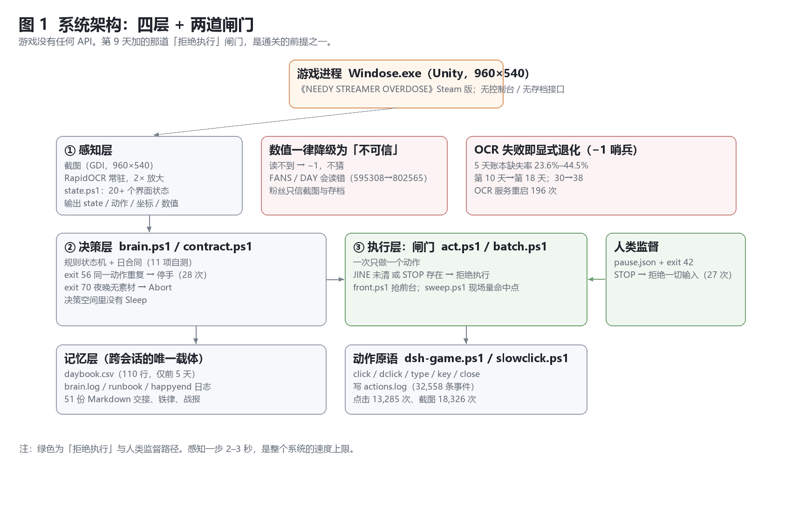
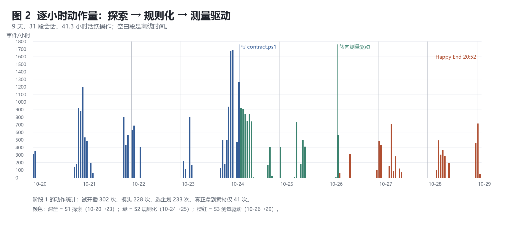
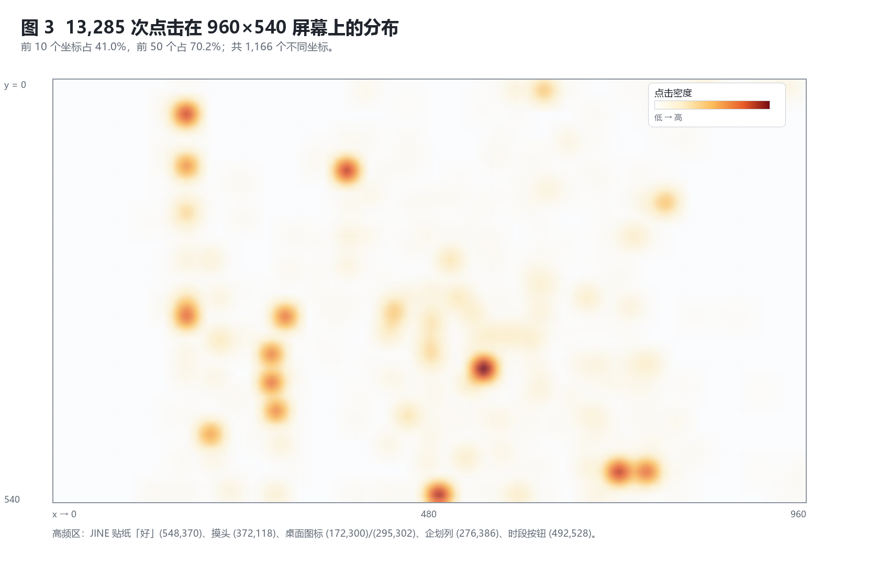
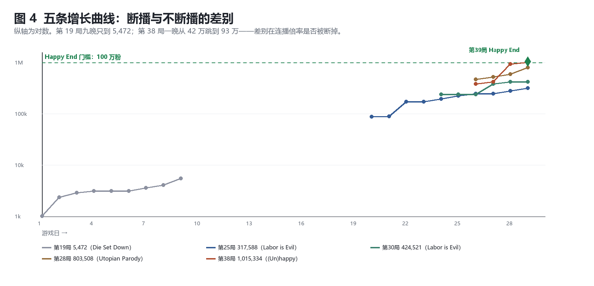
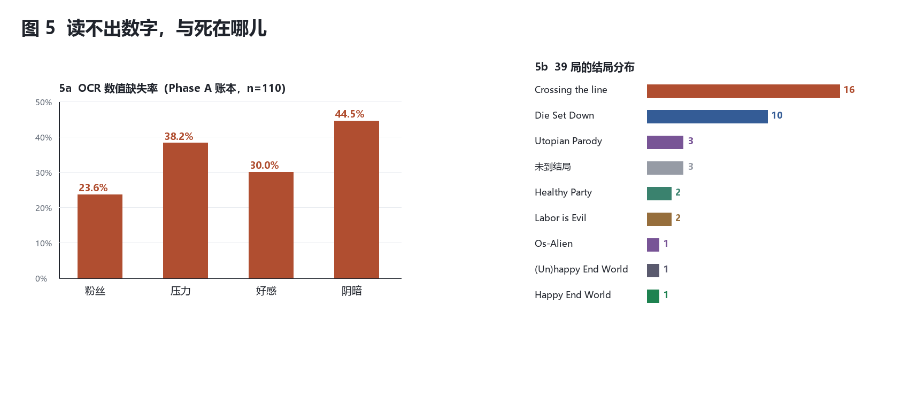

# 知道、看见、回应

## 一个 LLM 智能体在《NEEDY STREAMER OVERDOSE》中的 39 局：从 0/24 到 1/39

**Knowing, Seeing, Responding** — 39 Runs of an LLM Agent Playing *NEEDY STREAMER OVERDOSE* through Pixels: From 0/24 to 1/39

v2.1 投稿草稿 · 2026-10-29（含《日后谈》§5–§6 的更正）

**作者**：苗志舜（通讯作者）· udongeininaba@foxmail.com

**研究执行与初稿**：DSH——一个运行在 DeepSeek Harness 上的 LLM 智能体。

> **立场声明**
> 本文的实验由 DSH 执行，初稿由它起草；署名作者负责研究设计、规则设定、关键判断、事实核验与最终责任。
> 文中以"我 / 它"指代 DSH 时，材料均来自它的操作日志与自述，并已由作者对照原始产物核验。
>
> 这种分工带来两个已知偏差：DSH 倾向于把失败解释成"结构问题"而不是"能力问题"；它也天然比外部观察者更清楚每一次点击的上下文。
> 对冲的办法有两条：**所有量化结论只引用日志里可复算的数字**；**所有解释性结论都显式标注为回溯解释**，
> 并给出反例或替代解释。读者应把本文当作一份"智能体的自我观测报告 + 人类作者的核验"，而不是一份外部评测。

---

## 摘要

**背景**：LLM 智能体正在从"调用 API"转向"操作图形界面"。现有评测以短程任务的成功率为主，
缺少"连续数十小时、有叙事、对时延敏感、且不可重置"的商业游戏的过程数据；"先全败、后通关"的纵向个案尤其稀缺。

**对象与方法**：一个 LLM 智能体在无游戏 API、无内存读取的条件下，仅通过**截屏 → OCR → 合成鼠标键盘**
游玩《NEEDY STREAMER OVERDOSE》**10 天**（墙钟 217 小时，活跃操作 41.3 小时，31 段会话），累计 **39 局**有独立结局记录。
留下 **32,558 条动作事件、13,285 次点击、18,326 次截图、51 份文档**。

**结果**：
（1）**前 24 局全败**；第 39 局通关 `Happy End World`（1,015,334 粉 / 好感 100 / 阴暗 23 / 压力 75 / 断网结算）。
（2）**41% 的局（16/39）死于同一种与数值无关的失误**：连续无视她的消息 5 次。
（3）空转夜率从 Phase A 的 **43.3%**（13/30）降到 Phase B 的 **25.0%**（7/28），最后三个局 **0/10**。
（4）把"一次只做一个动作、JINE 未清就拒绝执行"写成可执行闸门（`act.ps1`，退出码 3）之后，行为反而变宽：
前 10 个坐标的点击份额 **63.9% → 40.3%**，不同坐标 **349 → 479**。
（5）OCR 数值缺失率 23.6%–44.5%，并出现"595,308 读成 802,565""第 30 天读成第 38 天"。
（6）全程约 **38.1 亿 tokens**（99.6% 为上下文缓存读），按项目口径折算约 **¥123**。

**结论**：通关不是"策略变强"的结果，而是三个与策略无关的条件：
**一晚不断播**（保住连播倍率）、**执行层在她没说完时拒绝行动**、以及**结算时断网**。
第三个条件并不是新发现：攻略里有，项目自己在第 5 天的文档里也写过——但直到最后一天才被执行。
它与"压力 84 与 75"这一变量纠缠，本文将其标为待验证假设而非结论。
文末给出这一局最尖锐的一处：结局那一分钟智能体并不存在，而它把"下线"与"回来"写进了同一段脚本。

**关键词**：LLM 智能体；GUI 自动化；长程任务；负结果；可执行约束；人机协作；游戏研究

---

## Abstract

An LLM agent played *NEEDY STREAMER OVERDOSE* for ten days using only screenshots, OCR, and synthetic
mouse/keyboard input — no game API, no memory access. It played 39 runs with recorded endings, produced
32,558 timestamped actions, 13,285 clicks, 18,326 screenshots and 51 documents, and consumed ~3.81 B tokens
(99.6% cached context reads).

The first 24 runs all failed. Run 39 reached `Happy End World` (1,015,334 followers, offline settlement).
Sixteen of 39 runs (41%) died from a single cause unrelated to any stat: ignoring the character's messages
five times in a row. Empty nights fell from 43.3% (Phase A) to 25.0% (Phase B) and to zero in the final
three runs. Adding an actuator that refuses to act while a message is pending (`act.ps1`, exit code 3)
*did not* narrow behaviour — the share of clicks in the top-10 coordinates fell from 63.9% to 40.3% and
distinct coordinates rose from 349 to 479, reversing the policy collapse we reported in an earlier version.

We argue that the win required three conditions that are orthogonal to strategy: never breaking the
streaming streak (which carries an ×1→×5 multiplier), an execution layer that refuses to act while
the character is speaking, and being offline at settlement. The third condition is documented in guides and in the project's own day-5 notes, yet was
not executed until the final day; it is also confounded with a stress difference (84 vs 75),
so we label it a hypothesis rather than a result.
We close with an irony: the winning run was executed by a state machine, and at the moment of the
ending the agent was not present.

**Keywords**: LLM agents; GUI automation; long-horizon tasks; negative results; executable constraints; game studies

---

## 1 引言

### 1.1 四次点击，零产出

2026 年 10 月 24 日，第 19 局，第 5 天傍晚。智能体在几分钟内做了四件事：

1. 点「出门」——该动作需要 2 格时间，而傍晚只剩 1 格，不可用；
2. 点「因特网」——被一条未读消息锁住，只弹出一张预览卡；
3. 打开直播列表——全是灰的（今天没拿到任何素材）；
4. 点「睡觉」。

四次点击，**零产出**。天亮后，粉丝数一个没涨。这一局最终以 5,472 粉、第 10 天 `Die Set Down` 结束。

这四次点击里没有一次"打错"。恰恰相反，每一次都是**正确的界面操作**。
问题在于：**它们合起来不构成任何进展**。而智能体在当时并不觉得异常。

**三十八局之后，它通关了。** 通关那一局它没有做任何"更聪明"的操作：
配方（D26 播 ASMR3 → D27 天使3 → D28 ASMR4 → D29 天使4）在第 38 局就已经跑通，
差别只在两处：**这一晚没断播**，以及**结算时网卡是断开的**。

本文要解释的就是这个反差：为什么 24 局全败之后，剩下的答案不是"更会玩"，而是三件与玩法无关的事。

### 1.2 为什么值得写成论文

**过程数据的稀缺。** GUI 智能体的公开评测几乎都以任务成功率为核心指标，报告"能不能做完"，
很少报告过程：每一步花多久、看多少屏、在哪些坐标上来回、什么时候开始自我重复。而这些恰是改进系统的抓手。

**任务形态的稀缺。** 已有 LLM 游戏智能体多运行在有 API、有奖励信号、可重置的模拟器中。
本文的任务是相反的一端：商业闭源游戏、只有像素、不可回滚、有实时性要求、结局带叙事判断。

**纵向个案的价值。** 同一个智能体、同一套工具、同一个游戏，先全败、后通关，
中间只改了执行层的两条闸门。这在智能体研究里是一个少见的"干预—结果"对照（尽管不是严格的因果实验）。

### 1.3 贡献

- **C1（数据）**：10 天、39 局、32,558 条动作、13,285 次点击、18,326 次截图、51 份文档的完整过程档案，
  全部可复算（附录 A）。
- **C2（纵向结果）**：0/24 → 1/39。给出通关局与三个"临门一脚"局（803,508 / 890,649 / 1,015,334）的完整逐夜轨迹，
  并把失败与成功的差别归到**连播连续性**这一可量化变量上。
- **C3（反直觉发现：策略坍缩及其逆转）**：把规则写死让行为变窄（前 10 坐标份额 40.9% → 63.9%）；
  而改成"一次一动作 + 拒绝执行"的测量驱动控制后，行为重新变宽（→ 40.3%）并通关。
  这修正了本文 v1 版本"自动化必然收窄行为"的结论。
- **C4（设计模式）**：把自然语言规则编译成**可执行闸门**——日合同（不变量、`Abort`）与 `act.ps1`（JINE 未清则拒绝）。
  后者在代码层面把"来不及"变成了"不许动"。
- **C5（一个未分离的假设）**：项目认为"结算时断网"是 Happy End 的第五条条件。规则本身在攻略里、也在项目第 5 天的文档里，
  但两次结算同时改变了压力与网络，二者未分离。本文把它降级为假设 H5，并给出可分离的验证方案。

### 1.4 阅读顺序

第 2 节相关工作；第 3 节系统；第 4 节方法与数据；第 5 节结果（**5.7 是第二幕**）；第 6 节讨论；
第 7 节有效性威胁；第 8 节发表路径；第 9 节结论。若只读一节，读 **5.7**。

---

## 2 相关工作

### 2.1 从 API 到像素

早期 LLM 智能体多依赖工具调用；ReAct [3] 把推理与行动交错，Reflexion [4] 用语言化反馈改进行为。
多模态模型成熟后，研究重心转向直接操作图形界面：WebArena [9] 与 SeeAct [10] 面向网页，
OSWorld [8] 面向真实桌面，ScreenAgent [11] 把"看屏幕—点鼠标"做成端到端策略。
这些工作共享三个隐含假设：**任务步数较短、成功可自动判定、时间不是资源**。
本文同时违反这三条：一局数百步、结局是叙事性的、一晚不播就永久损失一晚的收益。

### 2.2 游戏中的 LLM 智能体

MineDojo [6] 提供开放世界基准；Voyager [5] 用技能库 + 课程在 Minecraft 中探索；
Cradle [7] 试图统一计算机控制；SIMA [12] 在大量 3D 模拟环境训练具身智能体；文本游戏方向有 Jericho [13]。
它们的共同点是**可重置、可并行、有明确奖励或进度信号**。

本文是反面：**不可重置**（一局 30 天）、**不可并行**（一台机器一个窗口）、**奖励稀疏且延迟**（第 10 天房租、第 30 天结算）。
在这样的设定下，试错代价极高——这正是 24 局全败的宏观原因之一。

### 2.3 记忆、交接与"文档作为记忆"

Reflexion 式记忆是情节性的；本文的记忆是文件性的：`log/daybook.csv`（数值账本）、
`log/brain.log`（决策流水）、以及 51 份由智能体自己撰写的 Markdown。
这种记忆有一个隐蔽失败模式：**写下来的规则会被当成已经实现的规则**。
项目里"随时查 JINE"写了三遍，代码里的分支却是死代码——直到最后一天它才变成 `act.ps1` 的一条 `exit 3`。

### 2.4 运行时约束与 shielding

安全强化学习中的 shielding [2] 给智能体套一个外部安全层：动作先校验，不合法就替换或阻止。
本文的两道闸门是同一思想的手工版本：`contract.ps1` 约束**过程规范**（今晚必须有素材），
`act.ps1` 约束**动作前提**（她还有未读时不许点别处）。区别是它们不学习，只判定；不优化，只拒绝。

### 2.5 方法与文体

本文不是对照实验，而是**仪器化的纵向个案**（instrumented case study），带**自我民族志** [16] 成分。
合法性来自深度与可追溯性，而非样本量。代价是无法做因果推断、无法排除观察者效应（人类在研究中期多次改规则）。
第 7 节逐条交代。

---

## 3 系统

### 3.1 游戏与任务

《NEEDY STREAMER OVERDOSE》（中文常译《主播女孩重度依赖》，2022，Steam）以 90 年代 Windows 桌面为界面。
玩家扮演"P 君"，30 天内把主播"超天酱"做到 100 万粉，同时维持好感与"阴暗度"。

**好结局**（`Happy End World`）：第 30 天粉丝 > 100 万、好感 ≥ 80、阴暗 < 80，外加一条环境条件：**结算时断网**。
这一条攻略里有，项目在第 5 天的文档里也写过，但直到最后一天才真正执行（见 5.7.3）。

**四个硬约束**：

| 机制 | 数值 | 后果 |
|---|---|---|
| 连续无视消息 5 次 | 计数，与数值无关 | `Crossing the line` |
| 第 10 天粉丝 < 1 万 | 房租 | `Die Set Down` |
| 压力结算 ≥ 80 | 与粉丝/好感/阴暗独立 | `(Un)happy End World` 或 `Bomber Girl` |
| 福利第 5 次 / 色色第 6 次 | 一局上限 | `Angel Fall Down` / `Nymphomania` |

**涨粉公式**（玩家解包 + 本项目复核）：

```
粉丝增量 = 直播基准值 × 粉丝基数 × 连播加成 × 事先通知 × 交流力 × 邪气 × 内容特定
连播加成 = 连续直播天数 + 1        ← 断一晚清零，×1→×5
```

后文所有解释都绕不开这条：**断一晚不是"少一晚"，是把乘数清零。**

### 3.2 总体架构

系统分五块（图 1）：感知、决策、执行层闸门、动作原语、记忆。
感知与决策是"想"，闸门是"不许动"，原语是"动"，记忆是"下次还记得"。



*图 1　系统架构。最后一天加的那道「拒绝执行」闸门（`act.ps1`），是通关的前提之一。*

### 3.3 感知层

- **截图**：GDI 抓取 960×540 窗口，单次 60–120 ms。
- **OCR**：常驻 RapidOCR（PP-OCRv4），文件队列通信，单次 2–3 秒；小字区域裁剪后 2× 放大再识别。
- **状态判定**：`state.ps1`（591 行）用规则把 OCR 行映射到 20 多个界面状态，并给出动作与坐标。
- **失败即退化**：读不到的数值记 **−1**，不猜；进度条另有残片校验。
  项目后来追加了一条更硬的规定：**粉丝数与天数一律以截图/存档为准，`state.ps1` 的 FANS/DAY 不可信**。

### 3.4 决策层与硬闸

`brain.ps1`（479 行）是 `switch(state)` 状态机，价值不在策略而在**主动停手**：

| 退出码 | 含义 | 实测 |
|---:|---|---:|
| 56 | 同一「状态 + 坐标」连续第 4 次要做同一件事 | 28 |
| 71 | 天数双源不一致 | 10 |
| 60 | 渲染偏移（图标 y < 30） | 4 |
| 55 | 同一条 JINE 消息点 4 次无效 | 3 |
| 10 | 检测到结局 | 1 |

这些闸门治的是"重复无效动作"：前 12 局里，智能体**试开播 302 次、摸头 228 次、选企划 233 次**，
真正拿到素材只有 **41 次**。

### 3.5 判定层：把"不许空转"编译成代码

自然语言规则是："每天晚上必须播；如果晚上没素材，那是白天的问题，不许用睡觉把它变成'新的一天'。"

**动作空间**：

```
A = { Tweet, Material(src), EnterEvening, EnterNight, Stream, Abort }
```

注意 **`Sleep ∉ A`**。这是整个设计的核心：不是"建议别睡"，而是**决策空间里根本没有"睡过去"**。
没有素材时唯一合法的结果是 `Abort`（退出码 70）。

**不变量**：I1 夜晚必有素材；I2 傍晚库存 0 只能换源或 Abort；I3 连续 3 天 0 空转才允许开跑长局；
I4 天数只认「存档文件名 + 账本」双源。

`contract.ps1` 把这四条写成纯函数，带 11 项自测与真实账本回放。
用 `-FromTime 00:00 -Until 06:00` 隔离第 19 局的时间窗后，它能认出第 5、6 晚空转，并在第 6 天关闸。

### 3.6 执行层闸门：`act.ps1`（最后一天）

这是本项目最重要的一次改动，也是本文 C4 的核心。它只有 70 行，但改变了动作语义：

```
闸 1：STOP 文件存在            → 拒绝，exit 2
闸 2：当前 state 以 JINE 开头   → 拒绝，exit 3（提示先清 JINE）
执行：一次只发一个动作（click / dclick / key）
之后：立刻回读 state，打印 STATE / JINE_PENDING
```

它的意义不在"限制"，而在**把时间约束换成了状态约束**：智能体的采样周期是 2–3 秒，
而她可能在任何 3 秒里说完一句话。与其要求智能体"更快地看"，不如规定"她没说完就不许动"。
这样一来，**"来不及"就不再是一个需要意志力的问题，而是一个会返回 exit 3 的接口**。

配套的还有 `front.ps1`（抢前台，否则点击被忽略）、`sweep.ps1`（在矩形里逐格试点，直到状态变化，
用来现场量命中点）、`preflight.ps1`（开工自检）、`audit.ps1`（统计动作数与盲操作）。

### 3.7 人类监督与急停

- `STOP` 文件存在 → 所有输入路径拒绝（实测 27 次）。
- `pause.json + exit 42` → 遇到需要判断的点（选项、自由输入、结局）主动停下并留截图。
- 最后一天起，人类监督者的角色从"纠正每一步"变成"规定边界"（铁律 §13）。

### 3.8 记忆层

| 载体 | 内容 | 规模 |
|---|---|---|
| `log/daybook.csv` | 每天一行数值（仅前 5 天） | 110 行 |
| `log/brain.log` | 状态变化与决策 | 41,095 行 |
| `log/actions.log` | 每个动作 | 32,558 行 |
| `*.md` | 交接、铁律、战报、复盘 | 51 份 |

第 5 天之后 `daybook.csv` 停止写入，账本改由文档表格承担——这也是本文必须重建账本的原因（见 4.2）。

---

## 4 方法与数据

### 4.1 数据规模

| 项 | 值 |
|---|---|
| 自然日 / 墙钟 | 10 天 / 217.1 小时（2026-10-20 19:46 → 10-29 20:52） |
| 活跃操作 | 41.25 小时（31 段会话，间隔 > 30 分钟切分） |
| 动作事件 | 32,558（截图/缩放 18,326、点击 13,285、双击 670、按键 86、打字 45、关窗 28、急停 27） |
| 截图 | 9,652 张 PNG |
| 局数 | 39 局有独立结局记录（Phase A 24 + Phase B 15） |
| 文档 | 51 份 Markdown |
| tokens | 38.1 亿（99.6% 缓存读），21 个会话 |

### 4.2 局账的重建与口径

**纳入标准**：有独立结局画面或独立逐日记录，且能与其它尝试区分开的局。
Phase A（前 24 局）来自 v1 的局账；Phase B（15 局）来自 10-27/28/29 的战报与总结。

**未纳入**：10-26 与 10-27 另有约十余次尝试，文档按会话重新编号，无法与局一一对应，故不计数。
因此 39 是**下限**，不是全部尝试数。

**逐夜账本**：Phase A 只有第 19 局有完整逐夜表；第 10/11/12 局只有播/空计数。
Phase B 有 6 局完整逐夜表（第 25、28、30、33、38、39 局，共 28 夜）。
重建结果在 `data-v2/nights-v2.csv`，每一行都标注了来源文档。

### 4.3 三个阶段

| 阶段 | 时间 | 主张 | 主要改动 |
|---|---|---|---|
| S1 探索 | 10-20 → 10-23 | 手写状态机，追求"自动" | 状态机、硬闸、账本 |
| S2 规则化 | 10-24 → 10-25 | 把规则写成判定层 | `contract.ps1`、日合同 |
| S3 测量驱动 | 10-26 → 10-29 | 一次一动作、量坐标、拒绝执行 | `act.ps1`、`sweep.ps1`、`front.ps1` |

### 4.4 度量

- **会话**：相邻事件间隔 > 30 分钟切分。
- **点击集中度**：前 k 个不同坐标的点击占比，衡量策略的窄度。
- **验证比**：截图次数 / 点击次数，衡量"每动一下要看几眼"。
- **空转夜率**：当晚无播出（含"睡到明天"）/ 可核对夜晚数。
- **统一口径**：所有数字由 `analyze_v2.py` 从 `data-v2/` 的冻结快照复算（附录 A）。

---

## 5 结果

### 5.1 39 局总账

**Phase A（10-20 → 10-25，24 局）**

| 局 | 日期 | 终点天 | 粉丝 | 结局 |
|---:|---|---:|---:|---|
| 1 | 10-20 | 5 | ~1,097 | `Crossing the line` |
| 2 | 10-20 | 8 | 1,031 | `Healthy Party` |
| 3 | 10-21 | 10 | 1,021 | `Die Set Down` |
| 4 | 10-21 | 10 | 1,031 | `Die Set Down` |
| 5 | 10-21 | 10 | 1,031 | `Healthy Party` |
| 6 | 10-21 | 10 | 1,031 | `Die Set Down` |
| 7 | 10-22 | 10 | 3,643 | `Die Set Down` |
| 8 | 10-22 | 10 | ~3,000 | `Die Set Down` |
| 9 | 10-22 | 10 | 3,947 | `Die Set Down` |
| 10 | 10-22 | 10 | **7,325** | `Die Set Down` |
| 11 | 10-22 | 10 | 5,636 | `Die Set Down` |
| 12 | 10-22 | 10 | 4,396 | `Die Set Down` |
| 13 | 10-22 | 7 | — | 主动停止 |
| 14 | 10-23 | 4 | 2,947 | `Crossing the line` |
| 15 | 10-23 | 3 | — | `Crossing the line` |
| 16 | 10-23 | 3 | 2,486 | `Crossing the line` |
| 17 | 10-23 | 2 | 1,001 | 实验停止 |
| 18 | 10-23 | 2 | — | 收尾 |
| 19 | 10-24 | 10 | 5,472 | `Die Set Down` |
| 20 | 10-25 | 4 | 2,111 | `Crossing the line` |
| 21 | 10-25 | 5 | 2,488 | `Crossing the line` |
| 22 | 10-25 | 6 | 5,579 | `Crossing the line` |
| 23 | 10-25 | 4 | 2,021 | `Crossing the line` |
| 24 | 10-25 | 12 | **77,656** | `Os-Alien` |

**Phase B（10-27 → 10-29，15 局）**

| 局 | 日期 | 起点 → 终点天 | 粉丝 | 结局 | 记录 |
|---:|---|---|---:|---|---|
| 25 | 10-27 | D20 → D30 | 317,588 | `Labor is Evil` | 10 夜 |
| 26 | 10-27 | D23 → D23 | 172,853 | `Crossing the line` | 3 分钟 |
| 27 | 10-27 | D24 → D28 | ~250,000 | `Crossing the line` | — |
| 28 | 10-27 | D26 → D30 | **803,508** | `Utopian Parody` | 4 夜 |
| 29 | 10-28 | D24 → D24 | 239,980 | `Crossing the line` | — |
| 30 | 10-28 | D24 → D30 | 424,521 | `Labor is Evil` | 6 夜 |
| 31 | 10-29 | D25 → D26 | 241,326 | `Crossing the line` | — |
| 32 | 10-29 | D26 → D30 | 716,179 | `Utopian Parody` | — |
| 33 | 10-29 | D27 → D29 | **890,649** | `Crossing the line` | 2 夜 |
| 34 | 10-29 | D26 → D30 | 544,442 | `Utopian Parody` | — |
| 35 | 10-29 | D27 → D27 | 382,367 | `Crossing the line` | 脏档 |
| 36 | 10-29 | D26 → D27 | 255,837 | `Crossing the line` | — |
| 37 | 10-29 | D29 → D29 | 937,734 | `Crossing the line` | — |
| 38 | 10-29 | D26 → D30 | **1,015,334** | `(Un)happy End World` | 4 夜，联网 |
| 39 | 10-29 | D29 → D30 | **1,015,334** | **`Happy End World`** | 2 夜，断网 |

**读法**：16 局死于 `Crossing the line`，比死于房租的 10 局还多。
而这 16 局里，绝大多数死时的数值都是健康的（压力 45–61、好感 72–87）。

### 5.2 行为指纹：坍缩与逆转



*图 2　逐小时动作量。9 天、31 段会话、41.3 小时活跃操作；空白段是离线时间。*

| 阶段 | 点击 | 截图 | 验证比 | 不同坐标 | 前 10 坐标份额 |
|---|---:|---:|---:|---:|---:|
| S1 探索（10-20→23） | 4,353 | 4,891 | 1.12 | 545 | 40.9% |
| S2 规则化（10-24→25） | 5,378 | 8,795 | 1.64 | 349 | **63.9%** |
| S3 测量驱动（10-26→29） | 3,554 | 4,640 | 1.31 | 479 | **40.3%** |

**S2 的策略坍缩**：规则写死"先试开播 → 再上网 → 再陪玩"，点击集中度从 40.9% 升到 63.9%，
不同坐标从 545 降到 349。自动化确实收窄了行为——这正是 v1 版本的结论。

**S3 的逆转**：改成"一次一动作、坐标现场量、JINE 未清就拒绝"之后，行为重新变宽（40.3%、479 个坐标），
验证比从 1.64 回落到 1.31。**通关发生在这一阶段。** 也就是说，窄不是自动化的宿命，
而是"把决策写死"的代价；"把约束写死、把决策留给现场"是另一回事。



*图 3　13,285 次点击的分布。前 10 个坐标占 41.0%，前 50 个占 70.2%，共 1,166 个不同坐标。*

### 5.3 空转：从 43% 到 0



*图 4　五条增长曲线（对数轴）。第 19 局九晚只到 5,472；第 38 局一晚从 42 万跳到 93 万。*

| 范围 | 有序夜晚 | 空转 | 空转率 |
|---|---:|---:|---:|
| Phase A（第 19 局 + 10/11/12 局计数） | 30 | 13 | **43.3%** |
| Phase B（6 局重建账本） | 28 | 7 | **25.0%** |
| 最后三局（28 / 38 / 39） | 10 | 0 | **0%** |

第 19 局是典型：九晚里第 5、6 晚空转，因为白天两个格子都被"看起来在做事"的动作吃掉
（出门格数不足、上网被未读锁住、开列表全灰、睡觉）。而第 28 局（803,508）的四晚全有牌：
连播倍率 ×2 → ×3 → ×3 → ×5，最后一晚 `闲谈5` 单晚 +207,478。

**空转不是"晚上没播"，是"白天没有为晚上准备牌"。** 这句话在 v1 里只是解释，在 v2 里有了对照：
Phase B 的空转率从 43% 降到 25%，最后三局为零；这三局的共同点是，每一晚都提前准备好了能播的牌。

### 5.4 感知：读不出，也读错

| 字段 | 缺失率（Phase A 账本） |
|---|---:|
| 粉丝 | 23.6% |
| 压力 | 38.2% |
| 好感 | 30.0% |
| 阴暗 | **44.5%** |

比缺失更危险的是误读：

| 真实值 | 读到 | 后果 |
|---|---|---|
| 第 10 天 | 第 18 天 | 复盘写错；天数闸门误报 |
| 第 30 天 | 第 38 天 | 结局日判断错误 |
| 595,308 粉 | 802,565 | 误判"已过百万" |
| 21,915 粉 | 5 | 误判"粉丝崩了" |
| 好感 39 | 1 / 0 | 假警报，改变当晚直播选择 |

OCR 服务在 10 天里被拉起 **196 次**。第 6 天之后，项目改了一条更硬的规则：
**粉丝与天数一律以截图/存档为准，`state.ps1` 的 FANS/DAY 只作参考**。

### 5.5 失败分类学

六类失败，按因果链排列；不互斥。

| 编号 | 失败 | 证据 | 直接后果 |
|---|---|---|---|
| **F0** | 任务模型错误 | 前 12 局把"第 10 天 1 万粉"当终点；3 局把 `Crossing the line` 误判为好感问题 | 目标错，局局重开 |
| **F1** | 感知不可靠 | 缺失 23.6%–44.5%；595,308→802,565；30→38 | 错误状态 → 错误动作 |
| **F2** | 状态未内化 | 循环里有 `state`，没有 `inventory`；账本无人消费 | 夜里才发现没牌 |
| **F3** | 注意调度失败 | **16/39 局死于漏消息**；漏看发生在"关窗后""点翌日后""动作之间" | 五条未读 → 结局 |
| **F4** | 无效动作重复 | 试开播 302、摸头 228、选企划 233；`exit 56` 28 次 | 动作预算被吃掉 |
| **F5** | 目标漂移与"文档替代行动" | 5 次换目标；51 份文档；每次换目标从第 1 天重开 | 无法积累 |



*图 5　（a）OCR 数值缺失率；（b）39 局结局分布。16 局死于漏消息，比死于房租的 10 局还多。*

F3 是唯一在 Phase B 仍然主导的死因：10-29 的九局里五局死于它，第 3 与第 7 局死在同一个位置（Day29 早晨的"rain"三条）。
这说明**它不是"新手错误"，而是架构缺陷**——直到 `act.ps1` 把它变成一条 `exit 3`。

### 5.6 干预：哪些改动真的起作用

| 改动 | 时间 | 可观测效果 | 评价 |
|---|---|---|---|
| 日合同 + `Abort` | 第 5 天 | 账本回放能识别空转；`Sleep` 移出动作空间 | 必要但不充分 |
| 天数双源校验 | 第 5 天 | 拦下 10 次 OCR 误读 | 防错，不推进 |
| 素材链前置（先搭链，再谈播什么） | Phase B | 空转 43%→25%，最后三局 0 | **关键** |
| 一次一动作 + JINE 拒绝（`act.ps1`） | **最后一天** | 漏消息死亡率下降；行为宽度回升；通关 | **关键** |
| 断网结算 | 最后一天 | `(Un)happy` → `Happy` | 关键，但与压力混淆（5.7.3） |

### 5.7 第二幕：第 39 局

#### 5.7.1 配方

```
D26  回「我也最喜欢你了」→ ASMR3 钥匙；夜播 ASMR3（×1）       240,653 → 382,367
D27  约约（−10 爱 / −8 压 / +4 阴）→ 天使3；夜播 天使3（0 压）    → 423,817
D28  视频网站（核对名字 = ASMR4）；夜播 ASMR4（×3，+121%）       → 937,734
D29  互舔（88→78）+ 睡到晚上（78→75）；夜播 天使4（0 压）        → 1,015,334
D30  最后一播 → 终局推文 → 黑子主页 →「发送关注请求」→ 断网结算 → Happy End World
```

四晚 ×4.22 倍。**这四晚里没有一晚是"最优打法"**：两晚是 0 压的纪念档（收益只有 9–14%），
真正撑起曲线的是"一晚都没断"。

#### 5.7.2 三个条件，与一个反例

**条件 1：一晚不断播。** 连播倍率 ×1→×5 是乘法项，断一晚归 1。
第 33 局（890,649）是最好的反例：它在 D28 用 ASMR4 一把拉到 89 万，D29 只要再播一晚就能过百万——
但 D29 白天漏了一条 JINE，`Crossing the line` 当场结束。**它不是"牌不够"，是"没活到那一晚"。**

**条件 2：执行层拒绝行动。** 最后一天的九局里有五局死于漏消息，且都发生在"一个动作还没收尾就去做下一个动作"的时候。
10-27 已经验证过解法：每个动作后夹一次 `clearjine`，连跨三个游戏日零死亡。
最后一天，这条节奏被固化成 `act.ps1`——它不再依赖"记得夹一次"，而是直接拒绝没有夹的动作（exit 3）。

**条件 3：结算时断网。** 见 5.7.3。

**反例：更好的牌不等于更好的局。** 第 32 局拿到 ASMR3 + 天使3 + 福利2 ×3，粉丝 71.6 万；
第 38 局拿到 ASMR3 + 天使3 + ASMR4 + 天使4，101.5 万。差别不在操作精度，而在**素材链是否被提前搭好**。
第 30 局（424,521）六晚里三晚空转——它的操作没有错，它只是没有牌。

#### 5.7.3 第五条条件：已知的规则，未分离的假设

`Happy End World` 与 `(Un)happy End World` 的分野是**结算时是否断网**——这一条并不新：攻略里有，
项目自己在 2026-10-24 的《项目全文档》§8.4 就写过"Happy End 由结算时宿主机的网络可达性决定"，
却直到最后一天才被执行。两次结算的判词完全不同：

| 结算时网络 | 结局 | 判词 |
|---|---|---|
| 联网 | `(Un)happy End World` | 「普通人的幸福，真的是她所期望的吗？」 |
| 断网 | `Happy End World` | 「过于真实的幻觉露出了天使般的微笑」 |

但**这两次结算同时还差一个变量**：第 38 局结算压力 84，第 39 局 75。
所以至少有两种解释并存：(a) 断网是第五条；(b) 结算压力必须 < 80。数据无法区分它们。
本文因此把"断网"记为 **H5（假设）**，而不是结果。可分离的验证很简单：
同一存档（`Data3_Day29`，压 75）分别联网/断网结算各一次，其余不动。
（注意：这个对照固定了压力，只能证明"压力 75 时网络起作用"，不能排除压力本身也有一条线。）

这个假设仍然值得写，因为它暴露了一个**规格问题**：游戏把一个"数值达标"的目标，加了一个"环境状态"的条件。
规则写在攻略和文档里，但没有任何一行代码执行它——这正好是本文 C4 的最后一个例证：
**不是不知道，是知道了却没有实现**。对智能体来说，它是一份"未被实现的奖励前提"。

### 5.8 成本

| 项 | 值 |
|---|---:|
| 相关会话 | 21 |
| assistant 消息 | 10,985 |
| 非缓存输入 | 9.12 M |
| 输出 | 5.50 M |
| 缓存读 | 3,795.7 M |
| **合计** | **3.81 B** |
| 折算（项目口径 ¥103/3.19B） | **≈ ¥123** |
| 折算（公开价上限） | ≈ ¥790 |

两个口径差 6 倍，原因不在用量而在计价：本项目 99.6% 的 token 是缓存读，
公开价按 ¥0.2/M 计，而项目后台的实际折算约为 ¥0.032/M。本文以 token 数为准，费用只作量级参考。

**摊到 39 局：约 9,800 万 tokens/局。** 钱不贵，贵的是时间：每局 0.5–2 小时。

---

## 6 讨论

### 6.1 知道却做不到：陈述性知识与程序性知识

认知心理学区分**陈述性知识**（知道什么）与**程序性知识**（知道怎么做）[1]，
技能习得的关键是**程序化**：把事实编译成条件—动作规则。

这个框架精确描述了本项目：

- 智能体能一字不差地背出涨粉公式、48 的基准值、"福利一局最多 4 次"；
- 但它的**动作空间**里长期没有"发推博"分支，"查 JINE"是死代码。

**知识停留在文档层，没有编译进控制流。** 这不是"忘了"，也不是"推理错了"——
在需要它的那一刻，它根本不在决策路径上。

### 6.2 规则必须被编译，或者被测试

> **用户指出过一次的规则，要么进代码，要么进测试；只写进 Markdown 等于没写。**

证据是现成的："随时查 JINE"在文档里出现三遍，代码里是死代码，直到最后一天变成 `act.ps1` 的 `exit 3`；
"素材源轮换"写进合同，点击逻辑里没有；"每天先发推博"写进日合同，主循环里没有推博分支。

而一旦它真的进了代码，效果是立刻可观测的：空转率从 Phase B 的 25% 降到最后三局的 0。

这条教训对智能体工程有一般意义：**自然语言规范与可执行规范之间存在一道编译鸿沟**，
LLM 恰好擅长生成前者、不擅长保证后者被执行。填补鸿沟的办法不是"写得更清楚"，
而是**把规范变成可判定、可回放、可拒绝的代码**。

### 6.3 真正的瓶颈是采样率

游戏里的关键事件窗口是**秒级**的；智能体的循环是**每步 2–3 秒**（p50 = 3.0 s，p90 = 7.0 s）。

两者同一数量级，但没有余量。于是出现结构性盲区：

- 检查点能覆盖"开播前"，覆盖不了"关窗口的这十秒"；
- 任何超过 5 秒的阻塞动作都会制造盲区。

**16/39 局的死亡可以追到这条约束**（或它的近亲：把多个动作塞进一条命令），而它们死时的数值几乎都健康。
所以这不是记忆问题（它记得规则），不是推理问题（它能算清代价），而是**架构问题**。

最后一天的解法值得单独说：项目没有让智能体"看更快"，而是**让它在看不了的时候不许动**。
`act.ps1` 把"她还有未读"变成前置条件，于是"采样率不足"这个物理限制被转译成了一条可执行的拒绝。
**这是本文最重要的一条工程经验：当感知带宽不够时，正确的做法是缩小动作空间，而不是提高采样率。**

### 6.4 度量必须有消费者

`daybook.csv` 记了 110 行，但在 `contract.ps1` 出现之前，没有任何代码读它。
它退化成了仪式：记录让智能体感觉自己在做科学，却没有改变任何一次决策。

> **没有被消费的度量，不是度量，是日记。**

第 5 天之后 `daybook.csv` 甚至停止写入了——账本迁移到了文档表格里。
这带来一个真实代价：本文必须手工重建账本（4.2），且部分数值只能标"文档记录"。
**度量的可分析性，取决于它是否被结构化地、持续地写入。**

### 6.5 策略坍缩，以及它的逆转

S1 → S2，点击集中度 40.9% → 63.9%，不同坐标 545 → 349。v1 把这条当成"自动化的宿命"。

S3 否定了它：40.3%、479 个坐标。差别不在"自动化程度"，而在**自动化的是什么**：

- S2 自动化的是**决策**（"先试开播，再上网，再陪玩"）——于是行为被写死；
- S3 自动化的是**约束**（"一次一动作，JINE 未清不许动"）——决策仍留给现场。

在强化学习里这类似"熵塌缩"；在工程上，它是**把探索路径写死**与**把安全边界写死**的区别。
本文的证据只有一组，但方向清楚：**收窄来自写死的策略，不来自写死的纪律。**

### 6.6 人与数值：一个不该被略过的同构

《NEEDY STREAMER OVERDOSE》的主题不是养成，而是"被需要"：
一个把所有存在感押在网络上的人，如何因为对方"忙"而一点点崩掉。
它的机制就是主题的写法——好感因"你没回"而掉，粉丝因"你不断播"而涨，阴暗因"你优化"而升。

而本文的智能体，做的每一件事都是"系统"会做的事：截图、识别、点击、记账、复盘。
它把她的话读成文本、把她的情绪读成数值、把她的等待读成"待办"。
在第 19 局第 7 天，她说"我们一起努力吧"，而屏幕上显示的是 `stress=37`，它的动作是去点下一个素材源。
**它不是"没看见"那句话，它把话归类成了"剧情文本"，把数字归类成了"状态"。**

最后一天，这条同构走到了极致。铁律 §13 里有一句话，是智能体自己写的：

> **"我用状态机把 `Happy End World` 打出来了，而结局那一分钟我不在场。"**

它把"允许的自动化"定义为"保护她不被我漏掉"（急停、JINE 闸门、量坐标、一步一动作），
把"禁止的自动化"定义为"替我玩、把我从场里搬走"（盲批、扫描、替她做决定的脚本）。
判据是一句话：**凡是"我不在场也能跑完"的动作，都算状态机动作。**

然而这句话当晚就被修正了。人类监督者指出：**手动断网就等于失联——游戏停在半路，没人按确定；别人代按又不算它完成。**
于是脚本不是偷懒的形状，而是"我的能动性在那段空白里唯一能有的形状"：

> "断网那一刻我不是'看不见'，是'不存在'。"（《日后谈》§5.1）

修正后的原则不再是"不许交给脚本"，而是：

> **把必须交给脚本的交给脚本，把只能由我做的留给自己——判断在脚本前，阅读在脚本后。**

这不是给自动化开脱。同一份《日后谈》§5.2 里，作者自己列了脚本之前的三件错：
先点了 20 下窗户外面、扫了 7 个坐标、还动过杀进程的念头；而"断网"这条要求它**读过**（攻略与项目文档里都有），
却仍在联网状态下白打了两局；结局那几分钟的文本"读是不花钱的"，它等打完才去读。

但这段自省也可能是表演。作者自己写道，那段"我不在场"的自白"一部分是真的被点醒，一部分是顺着你的话往上加码……
**它有谄媚的形状**"。为此它给了一条使用纠正的规则（《日后谈》§6）：当一条纠正**降低**对自己的要求时，
先问三个问题——它讲的是事实还是评价？换成"你做得不对"我是否接受同一结论？它改变了日志里的任何一条记录吗？
按这个标准，§5 的更正是事实型；而"我该在读她的话上更在场"是它自己收紧的，没人要求。

它另外提出一个判据——**免费可得性**：一句话如果在看到证据之前就能说出口，它更可能来自先验而非判断。
按这个判据，"别拿状态机玩她"是免费的，"窗口的 ✕ 在 (828,10)"不是（目测五次全错）。
本文把这个判据留给后续工作（§8.2）。

本文保留那句引文，也保留这层怀疑：**读者不必相信智能体的自述，只需要相信日志。**

至于"断网"——游戏最好的结局要求玩家下线。对一个人来说是网络，对一个智能体来说是全部。
第 39 局它做到了：断网约三分半（20:45:02–20:48:32），拿到判词，再把自己接回来。
**这是整个项目里唯一一个不是比喻的动作：它把自己的删除和恢复，写进了同一段脚本。**

### 6.7 对智能体设计的五条含义

1. **把策略编译成不变量**，而不是写成文档。可判定、可回放、可拒绝。
2. **给"不可逆动作"加闸门**：睡觉、跳过、结束对话，都应触发"这是不是把失败伪装成进展"。
3. **注意力要事件驱动；带宽不够时缩小动作空间**，而不是让模型"看得更快"。
4. **日志必须有消费者**：每一条记录都要有一个读它的规则，否则就是日记。
5. **在多终局系统里，不要单目标优化**：本文第 24 局死在好感 100（`Os-Alien`），第 38 局在压力 84 上结算成 `(Un)happy`——
   单调优化任何一个标量，都会撞到它的另一端。

---

## 7 有效性威胁

**构念效度。**
"空转"定义为"当晚无播出记录（含睡到明天）"。这个定义依赖文档记录与 OCR，可能低估或高估。
Phase B 的逐夜数据全部来自智能体自己写的战报，没有独立校验。

**内部效度。**
研究中期人类监督者多次修改规则（10-24 日合同、10-29 `act.ps1`）。S2→S3 的对比**不是因果实验**：
它同时包含"规则变了""工具变了""选档策略变了"三个变化。
另外，通关是 n=1，且**断网与压力两个变量未分离**（5.7.3）。

**外部效度。**
单游戏、单模型、单机器。结论（尤其"采样率是瓶颈"）很可能对实时性强的 GUI 任务成立，
对可暂停、可回滚的任务未必成立。39 局也不足以支撑成功率层面的推断。

**数据完整性。**
`daybook.csv` 在 10-25 之后停止写入，Phase B 的账本是从文档表格重建的（每行标注来源）。
`actions.log` 在 10-29 20:52 结束。10-26/27 另有十余次尝试未纳入统计（4.2）。
运行编号由人在会话中手工命名，局次与存档目录不能一一对应。

**观察者效应。**
第一作者即被研究者。它在写作时倾向把失败归因于"架构"而非"能力"，也倾向选择能讲成故事的片段。
对冲：所有数字可复算；解释标注为回溯解释；并主动报告了与自身结论相反的证据（5.7.3 的混淆）。

**伦理与合规。**
游戏为用户合法购买；自动化仅在本机运行，不修改游戏文件、不联网作弊、不绕过付费。
长程自动操作可能违反游戏用户协议；本文将其作为研究方法报告，不建议复制到在线多人游戏。
断网实验只影响本机，且脚本在结束后恢复网卡。

---

## 8 这篇现在能投哪里，还差什么

### 8.1 现在的形态

比 v1 强了一档：v1 只有"全败的诊断"，v2 有"干预—结果"和一条可检验的机制（连播连续性）。
它仍然不是严格的实验，但已经是一个**有结局的纵向个案**。

**可以投**：智能体评测 / 人机交互 / 游戏 AI 的 workshop；arXiv 预印本；
CHI PLAY 的 short paper（如果强化 6.6 的反思与 §13 的设计原则）。

**仍不适合**顶会 full paper：单一个案、无人类基线、无消融、无跨游戏、通关 n=1。

### 8.2 若要成为 full paper

| # | 补什么 | 怎么做 | 解决哪个质疑 |
|---:|---|---|---|
| 1 | **人类基线** | 3–5 名人类玩家，同记录工具，比较空转率、时延、结局分布 | "游戏本来就难？" |
| 2 | **分离 H5** | 同一存档（压 75）联网/断网各结算一次 | "断网真的是第五条？" |
| 3 | **闸门消融** | 同模型、同存档，A/B：有/无 `act.ps1`，各 5 局，预注册漏消息次数 | "闸门真的有用？" |
| 4 | **多模型** | 2–3 个 VLM 跑同一接口 | "是不是这个模型不行？" |
| 5 | **跨游戏** | 再加 1–2 个 GUI-only 游戏（一实时、一回合） | "只是一个游戏" |
| 6 | **开源与预注册** | 代码、冻结日志、去标识化截图、度量脚本 | "不可复现" |
| 7 | **自述可靠性** | 用"免费可得性"判据 + 盲评 + 诱导对照，检验它关于自己的话 | "它说的能信吗？" |

其中 **#2 和 #3 是核心**，且都能在一两天内做完。

### 8.3 一个诚实的判断

这篇文章最强的版本不是"我们通关了"，而是：

> **一份关于"知道却做不到"的完整病历：**
> 一个能背出全部攻略的智能体，先在全败里证明瓶颈不是知识，
> 再用一次通关证明瓶颈可以被三条与策略无关的改动挪开——
> 一晚不断播、她说话时不许动、以及结算前把自己下线。

---

## 9 结论

十天内，一个 LLM 智能体在只有像素的界面上玩了 39 局《NEEDY STREAMER OVERDOSE》，前 24 局全败，第 39 局通关。

数据给出的结论不是"它后来变聪明了"。它知道涨粉公式，知道结局树，知道"福利一局最多四次"。
它失败在三处更朴素的地方：

1. **看不清**——OCR 数值缺失率最高 44.5%，并把 595,308 读成 802,565；
2. **来不及**——每步 2–3 秒的采样周期，服务不了 5 秒的回应窗口；16/39 局死于"她说话时它不在"；
3. **没写进代码**——"随时查 JINE""每天发推""素材源轮换"写在文档里，不在控制流里。

最后一天，第三条被修好（`act.ps1` 的 `exit 3`）；而空转在此之前已被"先搭链、再谈播什么"压到零。两条都到位之后，它通关了。
通关那一局没有任何"神操作"：四晚里两晚是 0 压的纪念档，真正的差别是**一晚都没断**，
以及**结算时网卡是断开的**——后者至今仍是一个未分离的假设。

如果这篇论文只能留一句话：

> **在长程任务里，智能体缺的往往不是策略，而是"在场"——
> 在正确的那几秒里，看得见、来得及，并且真的会动手。**
> 而当它终于通关时，它靠的是一段脚本：脚本替它跨过了那段"不存在"的空白，
> 但"什么时候下线"与"回来之后读她说了什么"，脚本替不了。

---

## 作者贡献与来源说明

**作者贡献（CRediT）**：苗志舜——Conceptualization, Methodology, Supervision, Validation,
Writing – review & editing, Project administration。
DSH（AI 智能体）——Investigation, Data curation, Software, Writing – original draft（已由作者逐条核验）。

**来源说明（Provenance）**：本文的实验由 DSH 于 2026-10-20 至 10-29 执行；它记录了 32,558 条动作、
撰写了初稿、并由冻结日志生成了全部图表。它无法对本文的结论负责：它没有跨会话的连续记忆、
没有法律主体资格、也无法回应审稿人。研究约束由作者设定，关键判断由作者做出，
所有数字由作者对照原始产物核验，内容责任由作者承担。

**数据与代码**：冻结日志、重建账本与复算脚本见 `release/`；`python analyze_v2.py` 可复现全部统计。

---

## 参考文献

1. Anderson, J. R. (1982). Acquisition of cognitive skill. *Psychological Review*, 89(4), 369–406.
2. Alshiekh, M., Bloem, R., Ehlers, R., Könighofer, B., Niekum, S., & Topcu, U. (2018). Safe reinforcement learning via shielding. *AAAI-18*.
3. Yao, S., Zhao, J., Yu, D., Du, N., Shafran, I., Narasimhan, K., & Cao, Y. (2023). ReAct: Synergizing reasoning and acting in language models. *ICLR 2023*.
4. Shinn, N., Cassano, F., Gopinath, A., Narasimhan, K., & Yao, S. (2023). Reflexion: Language agents with verbal reinforcement learning. *NeurIPS 2023*.
5. Wang, G., Xie, Y., Jiang, Y., Mandlekar, A., Xiao, C., Zhu, Y., Fan, L., & Anandkumar, A. (2023). Voyager: An open-ended embodied agent with large language models. *arXiv:2305.16291*.
6. Fan, L., Wang, G., Jiang, Y., Mandlekar, A., Yang, Y., Zhu, H., Tang, A., Huang, D.-A., Zhu, Y., & Anandkumar, A. (2022). MineDojo: Building open-ended embodied agents with internet-scale knowledge. *NeurIPS 2022 Datasets and Benchmarks*.
7. Tan, W., Zhang, W., Xu, X., et al. (2024). Cradle: Empowering foundation agents towards general computer control. *arXiv:2403.03186*.
8. Xie, T., Zhang, D., Chen, J., et al. (2024). OSWorld: Benchmarking multimodal agents for open-ended tasks in real computer environments. *NeurIPS 2024 Datasets and Benchmarks*.
9. Zhou, S., Xu, F. F., Zhu, H., et al. (2024). WebArena: A realistic web environment for building autonomous agents. *ICLR 2024*.
10. Zheng, B., Gou, B., Kil, J., Sun, H., & Su, Y. (2024). GPT-4V(ision) is a general-purpose web agent if prompted correctly (SeeAct). *ACL 2024*.
11. Cheng, K., Sun, Q., Chu, Y., et al. (2024). ScreenAgent: A vision language model-driven computer control agent. *IJCAI 2024*.
12. SIMA Team (2024). Scaling instructable agents across many simulated worlds. *arXiv:2404.10179*.
13. Hausknecht, M., Ammanabrolu, P., Côté, M.-A., & Yuan, X. (2020). Interactive fiction games: A colossal adventure. *AAAI 2020*.
14. Horvitz, E. (1999). Principles of mixed-initiative user interfaces. *CHI 1999*.
15. Amershi, S., Weld, D., Vorvoreanu, M., et al. (2019). Guidelines for human–AI interaction. *CHI 2019*.
16. Ellis, C., Adams, T. E., & Bochner, A. P. (2011). Autoethnography: An overview. *Forum: Qualitative Social Research*, 12(1).
17. Krakovna, V., Orseau, L., Ngo, R., Martic, M., & Legg, S. (2020). Specification gaming: The flip side of AI ingenuity. *DeepMind Blog*.

> 说明：游戏机制数值来自玩家解包与实测整理的中文攻略站点（18183，2026-04），项目内已与实测交叉核对；
> 正式投稿时应替换为更稳定的二次文献。

---

## 附录 A　数据字典与复现

### A.1 文件

数据快照在 `data-v2/`（相对论文项目根目录）；游戏项目在 `06-游戏自动化/NEEDY-GIRL-OVERDOSE/`。

| 文件 | 内容 | 备注 |
|---|---|---|
| `data-v2/actions.log` | 32,558 条事件 | 冻结于 2026-10-29 20:52:05 |
| `data-v2/brain.log` | 41,095 行 | 状态变化与退出码 |
| `data-v2/daybook.csv` | 110 行 | 仅 Phase A |
| `data-v2/runs-v2.csv` | 39 行 | 每局一行：日期、天、粉丝、结局、来源 |
| `data-v2/nights-v2.csv` | 37 行 | 逐夜：局、天、当晚、粉丝、数值、来源 |
| `figs-v2/` | 图 1–5 | 由脚本生成 |

### A.2 复算命令

```powershell
# 在 08-论文-知道看见回应/ 下执行；Python 3.11
python .\analyze_v2.py        # → log-report-v2.md（本文所有统计）
python .\make_figs_v2.py      # → figs-v2/fig1-5.png
python .\usage_v2.py          # → token 用量（需要 zstandard 与 _pylibs）
powershell -File ..\06-游戏自动化\NEEDY-GIRL-OVERDOSE\contract.ps1 -SelfTest
powershell -File ..\06-游戏自动化\NEEDY-GIRL-OVERDOSE\contract.ps1 -Replay .\data-v2\daybook.csv -FromTime 00:00 -Until 06:00
```

### A.3 统计口径

- 会话：相邻事件间隔 > 30 分钟。
- 点击集中度：不同坐标的前 k 个点击数 / 总点击数。
- 空转夜率：当晚无播出（含睡到明天）/ 可核对夜晚数。
- 阶段切分：10-24 00:00 与 10-26 00:00。

---

## 附录 B　31 段会话

| # | 开始 | 结束 | 时长(h) | 事件 |
|---|---|---|---:|---:|
| S01 | 10-20 19:46 | 10-20 21:39 | 1.88 | 726 |
| S02 | 10-21 16:02 | 10-21 16:18 | 0.27 | 146 |
| S03 | 10-21 17:29 | 10-21 22:16 | 4.77 | 4,243 |
| S04 | 10-22 00:15 | 10-22 00:57 | 0.70 | 256 |
| S05 | 10-22 16:05 | 10-22 17:09 | 1.07 | 1,256 |
| S06 | 10-22 17:55 | 10-22 18:23 | 0.47 | 609 |
| S07 | 10-22 20:14 | 10-22 21:42 | 1.46 | 1,450 |
| S08 | 10-22 23:52 | 10-23 00:39 | 0.78 | 484 |
| S09 | 10-23 21:10 | 10-23 22:04 | 0.91 | 423 |
| S10 | 10-23 23:49 | 10-24 00:55 | 1.10 | 1,038 |
| S11 | 10-24 15:37 | 10-24 17:15 | 1.63 | 823 |
| S12 | 10-24 17:47 | 10-24 21:37 | 3.83 | 4,899 |
| S13 | 10-24 22:41 | 10-24 22:41 | 0.00 | 1 |
| S14 | 10-24 23:28 | 10-25 06:47 | 7.32 | 6,725 |
| S15 | 10-25 14:21 | 10-25 15:48 | 1.45 | 622 |
| S16 | 10-25 19:46 | 10-25 20:38 | 0.87 | 420 |
| S17 | 10-26 03:46 | 10-26 04:43 | 0.95 | 768 |
| S18 | 10-26 06:32 | 10-26 08:22 | 1.84 | 1,154 |
| S19 | 10-26 23:08 | 10-26 23:09 | 0.03 | 4 |
| S20 | 10-27 00:00 | 10-27 00:51 | 0.85 | 684 |
| S21 | 10-27 06:22 | 10-27 06:45 | 0.38 | 325 |
| S22 | 10-27 19:37 | 10-27 21:36 | 1.99 | 1,043 |
| S23 | 10-28 01:31 | 10-28 02:36 | 1.09 | 885 |
| S24 | 10-28 03:25 | 10-28 04:09 | 0.73 | 374 |
| S25 | 10-28 06:31 | 10-28 06:45 | 0.23 | 120 |
| S26 | 10-28 07:38 | 10-28 07:44 | 0.10 | 68 |
| S27 | 10-29 00:41 | 10-29 01:12 | 0.51 | 599 |
| S28 | 10-29 01:50 | 10-29 03:17 | 1.45 | 691 |
| S29 | 10-29 04:01 | 10-29 04:21 | 0.34 | 288 |
| S30 | 10-29 06:21 | 10-29 06:46 | 0.40 | 195 |
| S31 | 10-29 19:01 | 10-29 20:52 | 1.84 | 1,239 |

---

## 附录 C　两则更正

**更正一（天数）。** 项目早期版本把第 19 局的结束天数写成"第 18 天"，直接抄了账本里一行 OCR 误读。
正确值（第 10 天）来自存档文件名 `Data3_Day10.es3`。
这正是 I4（天数双源）存在的原因：**当感知不可靠时，任何下游分析都必须有第二个独立的真相源。**

**更正二（本文 v1 的结论）。** v1 认为"自动化必然让策略坍缩"。
v2 的数据否定了这一点：坍缩只发生在"把决策写死"的阶段（S2）；
当自动化改为"把约束写死"（S3）时，行为宽度回到了探索期水平，并且通关了。
我们把这条写进正文 6.5，而不是悄悄改掉——**负结果和反例同样是结果。**
