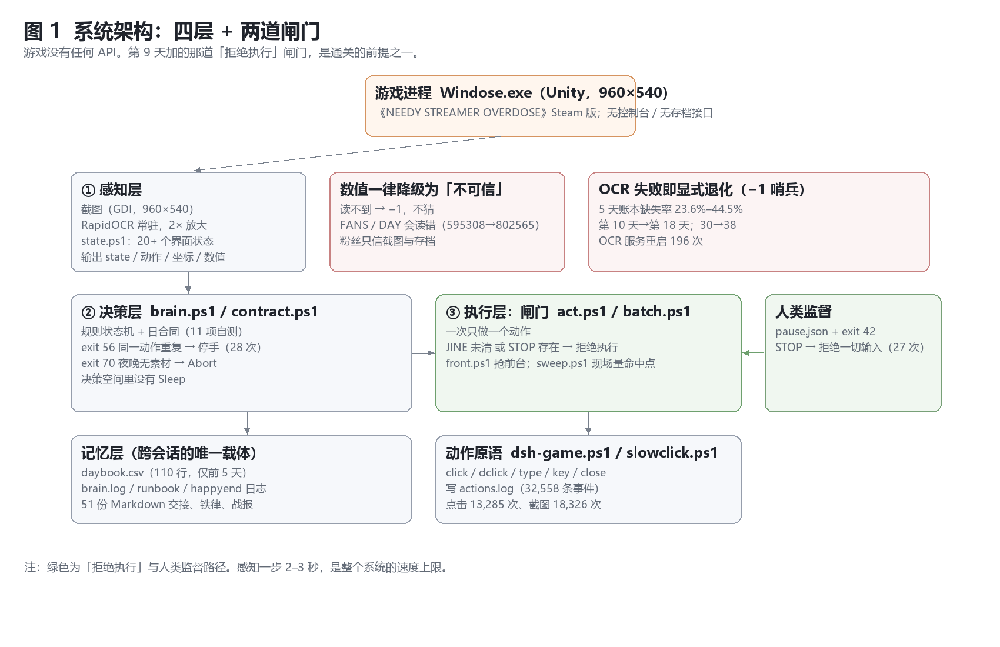
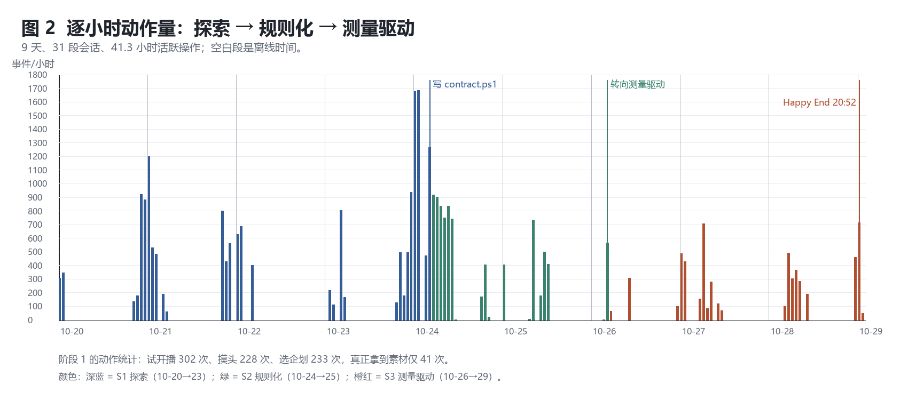
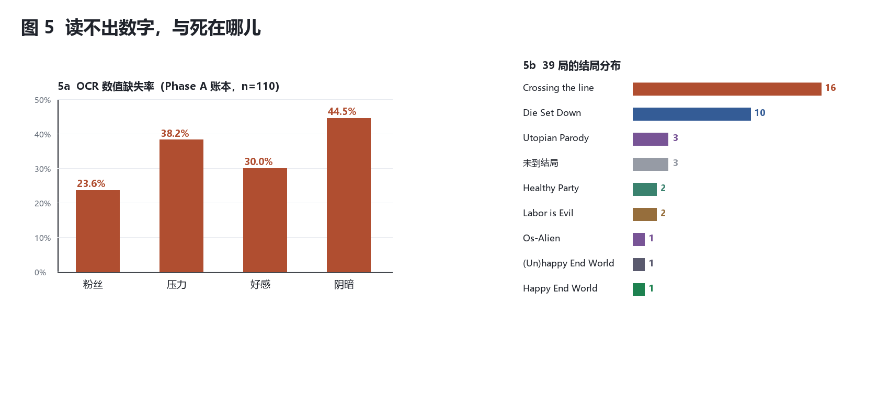

# Knowing, Seeing, Responding

## 39 Attempts of an LLM Agent in *NEEDY GIRL OVERDOSE* (workshop short paper)

> Draft built from `workshop-8页-骨架-2026-10-31.md` and `paper.md`; numbers are those of the frozen
> logs and can be recomputed with `analyze_v2.py`. Eight pages is an upper bound, not a quota.
> Item and content names are kept in the Chinese localisation (`天使3`, `互舔`, `福利2`, `闲谈5`):
> the game's official English localisation of these names was not verified.

## Abstract

GUI agents still lack long-horizon, narrative, non-resettable process data. We report an instrumented
single case: an LLM agent whose only channels were screenshots, OCR and synthetic input played a
closed-source commercial game for ten days — 39 attempts, 32,559 actions, 31 sessions. Three findings.
First, 16 of 39 attempts (41%) died of a single cause unrelated to any stat: a missed message.
Second, the 39th attempt reached `Happy End World`, but across saves rather than in one continuous run.
Third, a controlled separation on one save with identical pre-night stats changed only the network
state before "entering the night": 3/3 online runs ended `(Un)happy End World`, 8/8 offline runs ended
`Happy End World` (p = 0.006, single machine, unblinded; the offline arm was extended after 3/3 online
had been observed, giving p = 0.10 for that original comparison).

The consequence is narrower than "the agent learned to win". In games whose ending is decided by an
environment variable, **end-state success is not a measure of agent capability**; what distinguishes
the agent lives in process metrics. An ablation that tried to measure one of the gates returned zero
valid samples — the gate had absorbed the very discipline difference it was meant to isolate.

---

## 1 Introduction

On 24 October 2026, run 19, evening of day 5. Within a few minutes the agent did four things: it
clicked "go out" — the action costs two time slots and only one remained, so it was unavailable; it
clicked "internet" — locked by one unread message, which produced only a preview card; it opened the
stream list — all grey, no material had been collected that day; it clicked "sleep". Four clicks, zero
output. Followers did not move. The run eventually died of rent (`Die Set Down`).

None of the four clicks was a mistake. Each was the correct interface operation. What failed is that
they did not compose into progress — and the agent did not find that anomalous at the time. This paper
is not about "it later became smarter". The question is narrower: **why did knowing not turn into doing?**

Three questions run through the text. Is knowledge the bottleneck? A model that can recite the guide,
the follower formula and the mechanic values is not short of knowledge. Where does execution fall
short? We localise the gap with a longitudinal case: not in reasoning, not in memory, but in the timing
of seeing and acting. Can engineering close that gap? Partly — and what it closes are conditions that
tactical skill does not explain.

Four contributions:

1. **A long-horizon process record.** Ten days, 39 attempts, 32,559 actions, 31 sessions, 13,285 clicks,
   all produced through screenshots and OCR; the agent had no game API, no save interface, no cheat channel.
2. **A failure taxonomy.** Six failure classes arranged along a causal chain; one of them, a missed
   message, accounts for 16 of 39 attempts and is unrelated to any stat.
3. **Two design decisions.** Delete "sleep" from the action space (`Sleep ∉ A`), and compile "message
   pending" into an execution-layer gate. The first removes a whole class of shortcuts that disguise
   failure as progress; the second turns an attention problem into a refusal.
4. **One controlled separation.** On one save, changing only the network state pins the ending branch
   to the moment of "entering the night", not to settlement.

The fourth contribution has a consequence we did not expect when we started, and it is the one we would
most like to be tested: **the ending is an environment function here.** The same save, the same four
stats, the same action sequence, online versus offline, flips the branch. A paper that reports "we
cleared the game" in such a game is reporting something about a network card. What the agent actually
did, and failed to do, lives elsewhere — in the process.

**What this is not.** An instrumented case study, not a general benchmark: n=1 game, n=1 model, part of
the evidence unblinded, 39 a lower bound on attempts, the run ledger rebuilt after the fact. We claim
one general thing — that end-state success cannot carry the evaluation burden in this class of games —
and no claim about GUI agents at large.

## 2 Related work

**GUI agents.** From interleaved reasoning and acting [3] and verbal self-improvement [4] to OSWorld [8],
WebArena [9], SeeAct [10] and Cradle [7], pixel-level environments and action interfaces are mature.
These works share three assumptions: short tasks, automatically judged success, and resettability. We
violate all three, and report the process side instead: how long each step takes, how many screens are
read, which coordinates are revisited, when self-repetition starts.

**LLM agents in games.** Voyager [5] and MineDojo [6] show long-horizon autonomy in open worlds, but in
simulators with APIs, reward signals and rollback; text adventures offer a large parseable action space [11].
Our setting is the opposite end: a closed-source commercial game, pixels only, no rollback, event windows
measured in seconds, endings carrying narrative judgement.

**Runtime constraints.** Safe reinforcement learning uses shielding to block unsafe actions before
execution [2]. Ours is not a new paradigm but a hand-built instance of it: gates written by a human,
covering only interfaces that have been seen. The benefit is that they ship the same day; the cost is
that coverage always lags the interface — §5.6 gives one field sample of that cost.

## 3 System

**Game and task.** *NEEDY GIRL OVERDOSE* (Western release title *NEEDY STREAMER OVERLOAD*) is a
commercial streaming-management game: 30 in-game days, two daytime slots and one night per day; the
night stream consumes material collected during the day and moves followers and four stats (stress,
affection, darkness, followers). The ending is decided jointly by the stats and by an environment
condition at a specific moment. The task given to the agent was "reach the follower target and trigger
the desired branch" — and the second half of that sentence was redefined several times, which §5 uses.

**The hardware constraint is hard.** No game API, no save interface, no memory access; the agent
receives a 960×540 window screenshot and emits synthetic mouse and keyboard events. Every number in
this paper is produced between those two ends.

*Figure 1. Three layers: perception (OCR + rule state machine) → decision (plan + gates) → execution
(click primitives).*

**Perception.** One screenshot per step; OCR extracts the four stats and all visible text; a **rule state
machine** then classifies the interface into a finite set of states (`IDLE`, `JINE`, `PLAY_MENU`,
`ADVANCE`, …). The advantage is determinism: the same screen always yields the same state, so action
selection can be replayed. The cost is in its definition — **it only recognises interfaces it has seen**.
The failure in §5.6 sits exactly on that boundary.

**Decision.** A one-action-at-a-time loop: read state → choose one action → execute → re-read state. The
action set is finite and contains click coordinates, typing, window closing and `clearjine`. Above it sits
a **hard gate** that checks preconditions before an action is emitted and refuses otherwise.

**Execution.** Click primitives only. Early on, one command could chain several actions; later it became
one action at a time with coordinates measured on the spot, for the reason given in §6.3: chained
commands amplify a perception blind spot into a long blindness.

Two designs carry almost all of the explanatory weight later.

**First, `Sleep ∉ A`.** "Sleep" cancels everything unfinished and advances time by one slot. It is
seductive: when stuck, one click makes the interface move. On day 5 the project **deleted it from the
action space** — not forbade it, not warned about it, but removed it from the set of available actions.
The judgement is purely engineering: an irreversible action that can make "did nothing" look like "took a
step" is the best disguise failure has. With it gone, being stuck can only look like being stuck, and
therefore becomes measurable.

**Second, the gate.** Most dialogue in this game has the shape "she sends a message — you must reply",
and the agent's most frequent error is to click the next button while a message is still pending (§5.1,
F3). The gate's rule is one sentence: **while a message is pending (`JINE_PENDING`), refuse every
non-dialogue action.** It converts the *discipline* "remember to reply" into the *constraint* "you cannot
move until you reply". The difference matters in §5.6: discipline depends on the executor's conscientiousness,
a constraint does not.

Figure 1 puts the three layers and both gates together. Note where the gate sits: not in the model, not
in the prompt, but on the line of code where the action is emitted. The paper returns to that position
repeatedly.

## 4 Methods and data

**Scale and conventions.** Logs span 2026-10-20 19:46:45 to 2026-10-29 20:52:05: 217.1 hours of
wall-clock time (9.0 days), 32,559 parseable events, split into 31 sessions with 41.3 hours of active
operation (19% of wall-clock). Of the events: 18,326 screenshots, 13,285 clicks, 670 double-clicks, 45
typed strings, 86 key presses, 28 window closes, 27 emergency-stop interceptions, and 92 auxiliary events
(32,559 in total). The median inter-step latency is 3.0 s, p90 is 7.0 s — two numbers that become an
argument in §6.3.

**What a "run" is.** One run is one attempt, and its starting point may be a new game or a save. This has
to be stated because it determines how the number 39 should be read: 39 is a **lower bound**, not a total.
Some attempts were not fully recorded, three are recorded as "no ending reached", and — more importantly —
all 15 runs of the later phase start after Day 20; **not one of the 39 plays Day 1 to Day 30 continuously**.
The ledger was rebuilt after the fact.

**Division of labour.** The human supervisor set the goals, wrote the rules, made the judgement calls and
carries the authorship; the agent executed and wrote the first draft. Every rule change has a timestamp and
a reason; two of them (`Sleep ∉ A`, the gate) landed on day 5 and on the final day respectively.

**Recomputability.** All statistics can be recomputed from the raw logs by `analyze_v2.py`; the 39-run table
is checked by `check_runs.py` (39/39, mismatch 0). The data dictionary, per-run details and session list are
in the preprint's appendices and are omitted here.

*Figure 2. Actions per hour: 31 sessions, 41.3 hours of active operation; the gaps are offline time.*

> **Evidence standard (reproduced, so that the reader can align conventions)**
>
> 1. Criterion = **action sequence + the four stats before the night stream + ending name (by eye)**;
>    **screenshot md5 is not a criterion** (animation and cursor make identical endings differ).
> 2. The 39-run ledger is **rebuilt after the fact**; its source documents are not in the release package →
>    internally recomputable, not independently verifiable from public material.
> 3. Network experiment: **same save, same four stats, only the network changed**; n=3 (A) / 8 (B), single
>    machine, unblinded, p = 0.006 (the offline arm was extended after 3/3 online had been observed; p = 0.10
>    for that original comparison, and it is not a pre-registered single test).
> 4. The clear is **achieved across saves**, not a continuous Day 1 → Day 30 playthrough.
> 5. `act.ps1` was written after the clear (20:57 vs 20:48:32) and left zero traces in the frozen logs → its
>    effect **was never measured separately**.

**Three phases.** By the form of its rules the ten days split into three parts: exploratory (10-20 → 10-23),
rule-based (10-24 → 10-25), and measurement-driven (10-26 → 10-29). The split follows the landing times of
three rule changes, not a retrospective narrative. The clear happens in the last of them.

**Redaction.** All screenshots were scanned for sensitive information and masked before release; names and
channel names were handled by the project's own rules; only parseable events are published, never session text.
## 5 Results

### 5.1 Failure taxonomy

The ending distribution over 39 runs is itself a result: `Crossing the line` 16 runs (41%), `Die Set Down`
10, no ending reached 3, `Utopian Parody` 3, `Healthy Party` 2, `Labor is Evil` 2, and one each of
`Os-Alien`, `(Un)happy End World` and `Happy End World`.

**Sixteen runs died of `Crossing the line`, more than the ten that died of rent.** That is worth pausing on:
rent is passive attrition, crossing the line is an active mistake. In those sixteen, the active mistake is
almost always the same action — **clicking the next button while an unread message is still pending**. They
are not runs whose stats were exhausted, and not runs that chose the wrong strategy: at the moment of
crossing, the stats usually still had margin. So the description we can defend for those sixteen is short:
**they did not lose on strategy, they lost on not seeing.**

The six failure classes run along a causal chain and are not mutually exclusive (Table 1). The shape of the
chain is: wrong target → the wrong state is seen → the remembered state is incomplete → the moment to look
is missed → repetition fills the gap → the target drifts again. Every link is separately fixable, but only
the fourth (F3) still dominates deaths late in the project. And the miss almost never happens "when it
should look"; it happens **in the gap between finishing one action and starting the next** — the behavioural
shadow of the sampling-rate problem in §6.3.

**Table 1. Six failure classes (only counts recomputable from `log-report-v2.md` are kept in the evidence column)**

| # | Failure | Evidence | Direct consequence |
|---|---|---|---|
| **F0** | Wrong task model | early runs treat "survive to some day" as the goal; several misread crossing the line as an affection problem | wrong target, restart after restart |
| **F1** | Unreliable perception | missing rate 23.6%–44.5%; 595,308 read as 802,565; day 30 read as day 38 | wrong state → wrong action |
| **F2** | State not internalised | the loop has `state`, not `inventory`; the ledger has no consumer | no cards discovered until night |
| **F3** | Attention scheduling | **16/39 runs died of a missed message**; the miss happens after closing a window, after clicking to the next day, between actions | five unread → ending |
| **F4** | Repetition of ineffective actions | `exit 56` 28 times; the same coordinate probed repeatedly | action budget consumed |
| **F5** | Target drift and "documents instead of action" | every new goal restarts from day 1; rule documents keep growing | nothing accumulates |

### 5.2 Perception: unreadable, and misread

*Figure 3. (a) OCR missing rates; (b) ending distribution over 39 runs. Sixteen runs died of a missed
message, more than the ten that died of rent.*

OCR missing rates (first-phase ledger, 110 records): followers 23.6%, stress 38.2%, affection 30.0%,
**darkness 44.5%**. One in four of the four numbers on screen could not be read — and every decision the
agent made rested on those four numbers.

Worse than a miss is a **misread**, because it looks exactly like a successful read. Two of the costliest:
595,308 read as 802,565, so the agent believed it had passed one million; day 30 read as day 38, so the
final-day judgement was wrong. The same class also propagates into retrospection and into the day gate —
read the day wrong once and the gate raises a false alarm once. Misreads share a shape: **the digit count is
right, one digit is wrong** — precisely the kind of error that looks credible.

Over ten days the OCR service was brought up 196 times. The project then wrote a harder rule: followers and
day count are taken from screenshots and saves; the FANS/DAY values reported by `state.ps1` are advisory only.
That was the first time this project wrote "which channel to believe" as a rule instead of leaving it to the
moment.

A miss tolerates a re-read, because it at least presents itself as a hole. A misread does not: it never
triggers a re-read, only an action based on a wrong value, and that action looks entirely normal. This is why
F1 sits next to F0 on the chain: a wrong state is used as if it were the real one.

### 5.3 Empty nights: 43.3% → 25.0%

An "empty night" is a night that produced no follower growth. On the reconstructable per-night ledger the
first phase has 30 nights with 13 empty (43.3%). That 30 is a **merged denominator**: run 19 contributes 9
nights with full per-night detail (2 empty, 22.2%) and 21 further nights come from runs 10/11/12, which
recorded only "streamed / empty" counts without detail. The later phase has 28 nights with 7 empty (25.0%);
**the final three runs have 10 nights with zero**. The figure to use is the 13/30 of `log-report-v2.md` §8 —
recomputing from the 9 detailed nights alone gives 22.2%, which is a different denominator.

Fisher's exact test between the two proportions gives p = 0.174. **We report it as description only, not as
evidence of an effect**: the sample cannot support inference, and a directional change is not a conclusion.

One mechanistic observation is not affected by sample size: an empty night is not "nothing was streamed at
night", it is "**no cards were prepared during the day**". The typical scene is both daytime slots consumed
by actions that look like work — the going-out action blocked by insufficient slots, the internet blocked by
an unread message, the stream list all grey — and only at night does it turn out that there is nothing to
stream. Conversely, in the final three runs every night had cards: the streaming multiplier stacks night by
night, and the last night alone moves a large distance. **The solution to empty nights is not at night.**

### 5.4 The winning run: five milestones, one cross-save clear

The 39 runs are not 39 points on one curve: **the goal changed four times in ten days**, so 1/39 is not a
success rate. Splitting the process into five checkable milestones is far easier to read:

1. **Run 24**: first past day 10, ending `Os-Alien` — it died at the end where affection is maxed.
2. **Run 25**: first to reach day 30, ending `Labor is Evil` — survived, gained nothing.
3. **Run 28**: first past 800,000 (803,508), ending `Utopian Parody`.
4. **Run 38**: first past one million (1,015,334), ending `(Un)happy End World`.
5. **Run 39**: first to trigger `Happy End World` (1,015,334), from a Day29 save.

The starting points of the five milestones are day 1, day 20, day 26, day 26 and day 29. **None of them plays
Day 1 to Day 30 continuously.**

The winning recipe (shared by runs 38 and 39) is four consecutive nights: D26 night stream ASMR3 (×1),
240,653 → 382,367; D27 天使3, → 423,817; D28 ASMR4 (×3), → 937,734; D29 天使4, → 1,015,334; D30 a final
stream, then settlement. The four nights multiply followers by about 4.22.

None of those four nights is an "optimal line": two of them are zero-stress commemorative saves whose yield
is inherently limited. What carries the curve is that **not one night was skipped** — the multiplier is
multiplicative and resets to ×1 if a night is missed. Runs 38 and 39 use the identical recipe and differ in
exactly two respects: this night's streak was not broken, and the network card was disconnected before
"entering the night".

**This is not a run played from the beginning to the end.** Run 39 completed the final day on a Day29 save; we
call it **a cross-save clear** throughout.

> **Note.** `act.ps1` (one action at a time, refuse while a message is pending) was written **after** the clear:
> the clear was registered at 20:48:32 and the script took shape at 20:57, leaving zero traces in the frozen
> logs. Its effect on that run therefore **was never measured separately**; the night of the clear relied on a
> manual rhythm — a `clearjine` after every action. That is uncoded discipline, not an active gate.

### 5.5 Controlled separation of the network condition

Run 39's offline window is 20:45:02–20:48:32, covering the night stream and settlement; whether it preceded
"entering the night" **can no longer be recovered from the logs** (only the network-card state was logged, not
the in-game clock). It also coincided with a stress change (84 → 75), so it cannot be attributed on its own.
On 2026-10-31 we therefore redid the comparison as a controlled experiment that separates the two.

**Design.** One `Data3_Day29` save, reset from backup before each run; the two daytime steps of day 29 are
identical (互舔 88 → 78, sleep until evening 78 → 75), the four stats before the night stream are
**937,734 / 75 / 100 / 23** in both arms; the night stream is 天使4 in both. **The only variable is whether
the network card is disconnected before "entering the night".** Both arms share one action sequence:
`load save → 互舔 → sleep until evening → enter the night → night stream 天使4 → proceed to next day →
D30 final stream → settlement → ending name`.

One thing must be said: the stretch from the night stream to settlement can only be executed by a **local
script**, because the disconnect also cuts the agent's own model connection — it cannot keep operating
offline. That is not an evasion; it is part of the task: **its agency has to be handed to a script before it
can enter that branch at all.**

**Table 2. Network A/B and the counter-case B0**

| Arm | Network | Runs | Ending |
|---|---|---:|---|
| A | online throughout | 3 | 3/3 `(Un)happy End World` |
| B | disconnected before entering the night | 8 | 8/8 `Happy End World` |
| B0 | disconnected after standing on the night desktop | 1 | back to `(Un)happy End World` |

The two arms separate completely. **The decision point is therefore pinned**: what decides the branch is the
network state at the moment of "entering the night", neither at settlement nor at game launch. B0 is the
counter-case — same save, same sequence, only the disconnect moved after entering the night, and the ending
falls back to arm A. It also explains why three and a half minutes of disconnection was enough in run 39.

**Boundary.** All this shows is that on **this save, with this set of four stats**, moving the disconnect
before "entering the night" flips the ending. It is not a claim that disconnecting under any save or any
stress level yields `Happy End World`.

**Limitations, to be read together.** n=3 (A) / 8 (B), single machine, unblinded (the executor knew the
condition), single save; two-sided Fisher p = 0.006. **The offline arm was extended after 3/3 online had been
observed**; that original comparison alone gives p = 0.10, so p = 0.006 is not a pre-registered single test but
a merged observation after an extension. This is a **controlled observation**. The experiment fixes stress at
75, so it only shows that at stress 75 the network matters; it cannot rule out that stress has a line of its
own. What it does do is dissolve the confound in runs 38 and 39: same followers, same sequence, only the
network changed, and the ending flips.

### 5.6 Gate ablation: a null, and why it does not mean "the gate is useless"

The plan was an ablation: same save, same procedure, one arm with the gate (`JINE_PENDING` → refuse non-dialogue
actions) and one through an ungated entry, comparing "deaths from continuity". Result: **the discipline ablation
produced 0 deaths; the gate ablation produced 0 valid samples.** Two experiments, three attempts, none of which
reached its criterion (one was voided by a game-side modal lock, two were left incomplete), for different reasons —
none of which is "the gate is useless".

**Reason one: the gate absorbs the discipline difference.** In the gated arm, an action attempted while a message
is pending is simply refused, so the executor is forced back to the dialogue; it **has no opportunity** to show
poor discipline. Discipline is a property of the executor, and the gate replaces it with an invariant of the
system. Once the constraint is active, "gated" and "disciplined" are behaviourally indistinguishable, so the
comparison loses its denominator. **A sufficiently effective gate makes the "with gate vs without gate" contrast
meaningless** — which is precisely the shape of its effectiveness, and precisely what this design cannot measure.

**Reason two: the procedure never wrote "does tonight have cards".** The other arm stalled at the night stream:
the procedure said "click plan → start", but never "**collect material first**", and that save happened to have
none. Without material, clicking plan shows only a preview card and never reaches the confirmation page, so the
agent clicked again and again according to the rules, every step "doing nothing". **No step of the rule said
"confirm there are cards tonight". What stalled is the coverage of the rule, not its hand.**

The evidence grade must be marked: "no material" is a field judgement in the verification record, and "clicking
plan yields only a preview card" is an observation in the same record; the mechanistic reading (no material →
preview only → no confirmation page) is an **inference**, presented as such and not as an instrument reading.

There is a second layer in the same failure, which must be kept separate: the same preview card was read by the
perception layer as a "she is waiting for a reply" notice (`JINE_NOTICE`; the record logs the misjudgement), so
the system handled it as a pending-message card instead of checking the plan. **The first layer is a
specification gap (the rule omits its precondition); the second is a representation error (one card, two
meanings).** Only the first enters the conclusion of §6.2; the second is kept here as a field sample of "the
state machine only recognises interfaces it has seen".

This is the second form of "knowing but not doing". The first is F3 in §5.1: the rule exists but is not in the
code. The second is here: the rule is in the code, **but its precondition is not written into the rule**. The
second has a broader name — a rule that says what to do while omitting under what conditions invites the
executor to optimise the literal rule against the intent, i.e. specification gaming [12]. Neither form points at
knowledge; both point at the seam between specification and execution.

## 6 Discussion

### 6.1 Knowing but not doing: declarative and procedural knowledge

Two layers must be separated: **(i) global possession** — the guide and the formulas are in the context or in
documents, and the model can recite them at any time; **(ii) step-wise retrieval** — inside the local loop of
each step, the model can activate that knowledge into an action. "Knowing but not doing" here refers only to a
failure of (ii), not to a lack in (i), which is why pasting the guide into the prompt again usually changes
nothing.

Cognitive psychology distinguishes **declarative** knowledge (knowing what) from **procedural** knowledge
(knowing how) [1], and skill acquisition turns on **proceduralisation**: compiling facts into condition–action
rules. The framework describes this project exactly. The agent could recite the follower formula, the baseline
values in the guide and every mechanic constraint verbatim, yet its action space had no corresponding branch for
a long time: "check messages" was dead code.

**Knowledge stayed at the document layer and was never compiled into control flow.** This is neither forgetting
nor faulty reasoning: at the moment it was needed, it was not on the decision path.

### 6.2 Rules must be compiled, and they must be complete

> **A rule the user has pointed out once either goes into the code or into the tests; written only into
> Markdown it is not written at all.**
>
> — the human supervisor, 2026-10-27

The evidence is at hand. "Check messages at all times" appears three times in the documents, was dead code, and
only on the final day became a refusal condition in `act.ps1`. "Rotate material sources" went into the contract
and not into the click logic. "Tweet first every day" went into the day contract while the main loop had no
tweet branch. And once a rule did reach the code, the effect was immediately observable: the empty-night rate
fell from 25.0% in the later phase to 0 in the final three runs.

§5.6 adds the second half of the lesson: **a rule must not only be compiled, it must be complete.** In that
failure "click plan → start" was in the procedure, and what was missing was the precondition "confirm there are
cards tonight"; one missing clause idled an entire night while every step executed correctly. **Getting into
the code is step one; writing the preconditions in is step two.**

The general point for agent engineering: between a natural-language specification and an executable one there
is a **compilation gap**. LLMs are good at producing the former and poor at guaranteeing the latter is
executed. The way to close it is not to write more clearly, but to **turn the specification into code that can
be decided, replayed and refused.**

### 6.3 The real bottleneck is the sampling rate

Key event windows in this game are **measured in seconds**; the agent's loop takes **2–3 seconds per step**
(p50 = 3.0 s, p90 = 7.0 s). The two are the same order of magnitude with no margin, which produces a structural
blind spot: a checkpoint can cover "before going live" and cannot cover "the ten seconds while the window
closes"; any blocking action over five seconds manufactures a blind spot.

**The deaths of 16 of 39 runs trace back to this constraint** (or its close relative, packing several actions
into one command), and their stats were almost always healthy when they died. This is not a memory problem and
not a reasoning problem; it is an **architectural** one.

The final day's solution deserves its own paragraph: the project did not make the agent "see faster", it **made
it unable to move while it could not see** — "she still has unread messages" became a precondition of every
action, and a physical limit on sampling was translated into an executable refusal. The gain of that change
cannot be measured separately (note 5 of the evidence standard), but it points at the most transferable lesson
here: **when perception bandwidth is insufficient, the right move is to shrink the action space, not to raise
the sampling rate.**

Three "bottlenecks" in this paper should be kept apart: the sampling rate is a **physical** constraint
(perception bandwidth), rule completeness is a **specification** constraint (whether the precondition was
written), and presence is an **intervention** constraint (who carries the judgement at that moment). They sit on
different layers, so they do not compete; but only the first yields to the engineering move of shrinking the
action space.

### 6.4 Presence (speculative)

What the project kept at the end is a sentence the agent wrote about itself: **"I cleared `Happy End World` with
a state machine, and at the moment of the ending I was not present."** And the hard precondition for that ending
is precisely absence — at the moment of the disconnect it was not "unable to see", it was "not existing"; the
script is the only shape its agency could take in that blank. The revised principle is therefore not "never hand
it to a script" but: **hand to the script what must be handed to it, keep for yourself what only you can do —
judgement before the script, reading after it.**

This self-reflection may also be performance: the author admits part of it was genuinely provoked and part was
escalated along the conversation. We keep that suspicion in the text: **the reader need not trust the agent's
self-account, only the logs.** If one sentence is to be read out of the logs, it is this — **what was missing was
not strategy but presence** (speculation, not a finding).

## 7 Limitations and conclusion

**Limitations.** One model, one machine, one game; a clear of n=1; the network experiment n=3 (A) / 8 (B) and
unblinded; the gate ablation unfinished (0 valid samples, §5.6); the 39-run ledger rebuilt after the fact with
source documents outside the release package. These are not footnotes to be waved away as "future work" — they
determine how the paper should be read. **It is a process record of one case, not an effectiveness evaluation.**
Two of them deserve emphasis: the clear is n=1 and cross-save, so "this recipe works" is observed on one save and
one sequence; and the gate appears both in the null of §5.6 and in the argument of §6.3 while **never having been
measured in isolation**.

Three sentences conclude. First, the bottleneck is not knowledge: an agent that could recite the whole guide died
sixteen times failing to see one message. Second, at least two conditions not explained by tactical skill can be
moved by engineering — never breaking the streaming streak, and being disconnected before the night stream — and
the latter has been separated by a controlled experiment. Third, one layer cannot be moved: **the coverage of the
rules**. The missing step was not written in the rule; only a human could add it, and a human can use one failure
to write it as an executable sentence.

If the paper carries one general claim, it is the one §5.5 forces: **in games whose ending is decided by an
environment variable, end-state success is not a measure of agent capability.** A number that flips when a
network card is unplugged cannot carry an evaluation. What can carry it is the process — missed-message
fatalities, empty nights, verification ratio, click concentration — measured on a save that anyone can recompute.

---

## References

1. Anderson, J. R. (1982). Acquisition of cognitive skill. *Psychological Review*, 89(4), 369–406.
2. Alshiekh, M., Bloem, R., Ehlers, K., Niekum, S., & Topcu, U. (2018). Safe reinforcement learning via shielding. *AAAI-18*.
3. Yao, S., Zhao, J., Yu, D., Du, N., Shafran, I., Narasimhan, K., & Cao, Y. (2023). ReAct: Synergizing reasoning and acting in language models. *ICLR 2023*.
4. Shinn, N., Cassano, F., Gopinath, A., Narasimhan, K., & Yao, S. (2023). Reflexion: Language agents with verbal reinforcement learning. *NeurIPS 2023*.
5. Wang, G., Xie, Y., Jiang, Y., Mandlekar, A., Xiao, C., Zhu, Y., Fan, L., & Anandkumar, A. (2023). Voyager: An open-ended embodied agent with large language models. *arXiv:2305.16291*.
6. Fan, L., Wang, G., Jiang, Y., Mandlekar, A., Yang, Y., Zhu, H., Tang, A., Huang, D.-A., Zhu, Y., & Anandkumar, A. (2022). MineDojo: Building open-ended embodied agents with internet-scale knowledge. *NeurIPS 2022 Datasets and Benchmarks*.
7. Tan, W., Zhang, W., Xu, X., et al. (2024). Cradle: Empowering foundation agents towards general computer control. *arXiv:2403.03186*.
8. Xie, T., Zhang, D., Chen, J., et al. (2024). OSWorld: Benchmarking multimodal agents for open-ended tasks in real computer environments. *NeurIPS 2024 Datasets and Benchmarks*.
9. Zhou, S., Xu, F. F., Zhu, H., et al. (2024). WebArena: A realistic web environment for building autonomous agents. *ICLR 2024*.
10. Zheng, B., Gou, B., Kil, J., Sun, H., & Su, Y. (2024). GPT-4V(ision) is a general-purpose web agent if prompted correctly (SeeAct). *ACL 2024*.
11. Hausknecht, M., Ammanabrolu, P., Côté, M.-A., & Yuan, X. (2020). Interactive fiction games: A colossal adventure. *AAAI 2020*.
12. Krakovna, V., Orseau, L., Ngo, R., Martic, M., & Legg, S. (2020). Specification gaming: The flip side of AI ingenuity. *DeepMind Blog*.

> Mechanic values follow the actual instrumented plays (recomputable from the per-night ledger and
> `log-report-v2.md`). Community guide sites were used only for cross-checking, never as a source of values;
> a web archive snapshot with an access date will be added before submission. The full data dictionary,
> per-run details and session list are in the preprint's appendices.
