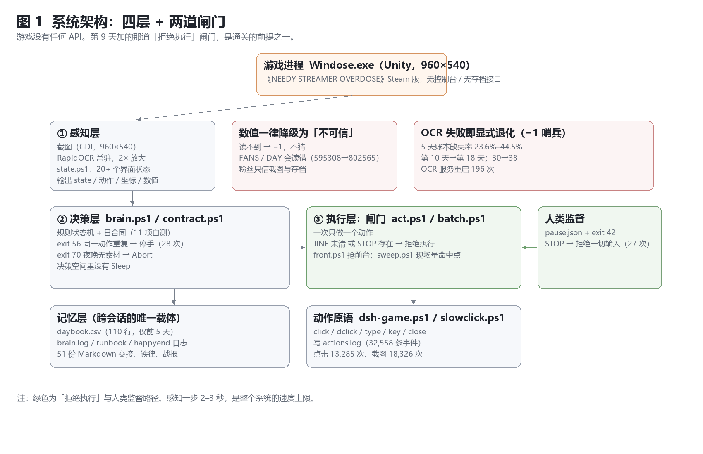
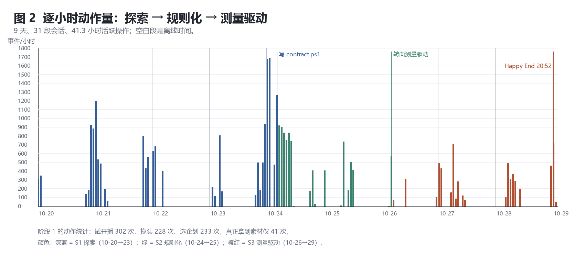
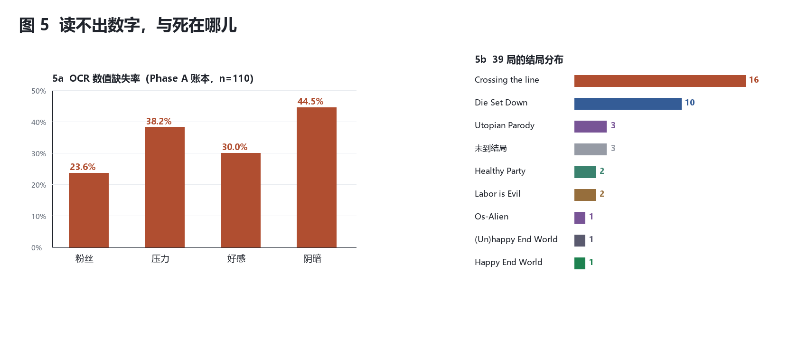

# 知道、看见、回应

## 一个 LLM 智能体在《NEEDY GIRL OVERDOSE》中的 39 次尝试（workshop short paper 版）

> 本稿由 `workshop-8页-骨架-2026-10-31.md` 施工，母本为 `paper.md`（v2.8）。
> 数字一律取自 `log-report-v2.md` 或骨架 §2；证据标准照骨架 §4 原文照抄（见 §4 方框）。
> 文件名沿骨架任务的 `workshop-8页`：8 页是**上限而非配额**，实测篇幅与取舍见文末「附」。
> **出处补注**：结果类数字均可由 `log-report-v2.md` 复算；少数设计参数（窗口分辨率 960×540、读档四维的白天两步序列 88→78 与 78→75、第 39 局断网窗口起止 20:45:02–20:48:32）母本 §3.1/§5.7.1/§5.7.4 已有记录，本文沿用；引言开场的四次点击照母本 §1.1 的事实描述。全文未新增任何未跑过的数字。

---

## 摘要

GUI 智能体缺少长程、有叙事、不可重置的过程数据。本文报告一个仪器化个案：只有截屏、OCR 与合成输入通道的 LLM 智能体，在商业闭源游戏《NEEDY GIRL OVERDOSE》上持续 10 天，做了 39 次尝试、32,559 个动作。三个结果：其一，16/39 次尝试死于同一种与数值无关的失误——漏读消息；其二，第 39 次尝试触发 `Happy End World`，但那是跨存档达成，不是一次连续打完；其三，一次受控分离实验显示，在同一存档、同一夜播前四维之下，只改「进入夜晚」之前的网络条件，联网 3/3 得 `(Un)happy End World`、断网 8/8 得 `Happy End World`（p = 0.006，单机非盲；B 组为看到 A 组 3/3 之后的补测扩展，A 组单独 p = 0.10，非预注册单次检验）。结论：瓶颈是执行层的在场与规则的覆盖范围，不是知识；一次闸门消融只拿到 0 个有效样本——这个 null 的一个来源是闸门吸收了纪律差异。
由此收窄成一条可推广的主张：**在结局由环境变量决定的这类游戏上，结局成功率不是能力的度量**；能区分能力的是过程指标（漏消息致死、空转夜率、验证比、点击集中度）。

## Abstract

GUI agents still lack long-horizon, narrative, non-resettable process data. We report a longitudinal single case: an LLM agent whose only channels were screenshots, OCR and synthetic input played a closed-source commercial game for ten days, making 39 attempts and 32,559 actions. Three findings. First, 16 of 39 attempts died of a single numeric-independent error: a missed message. Second, the 39th attempt reached `Happy End World`, but across saves rather than in one continuous run. Third, a controlled separation on one save with identical pre-night stats changed only the network state before "entering the night": 3/3 online runs ended `(Un)happy End World`, 8/8 offline runs ended `Happy End World` (p = 0.006, single machine, unblinded; the offline arm was extended after 3/3 online had been observed, giving p = 0.10 for that original comparison, and is not a pre-registered single test). We further report an ablation that yielded a null: the gate absorbed individual discipline differences, and one flow stalled only because the written procedure omitted its own precondition. We argue that the bottleneck is presence at the execution layer and the coverage of written rules, not knowledge. This narrows to one general claim: in games whose ending is decided by an environment variable, end-state success is not a measure of agent capability; what distinguishes the agent lives in process metrics (missed-message fatalities, empty-night rate, verification ratio, click concentration).

---

## 1 引言

2026 年 10 月 24 日，第 19 局，第 5 天傍晚。智能体在几分钟内做了四件事：点「出门」——该动作需要 2 格时间，而傍晚只剩 1 格，不可用；点「因特网」——被一条未读消息锁住，只弹出一张预览卡；打开直播列表——全是灰的，今天没拿到任何素材；最后点「睡觉」。四次点击，零产出。天亮后粉丝一个没涨，这一局最终死于房租（`Die Set Down`）。

这四次点击里没有一次"打错"，每一次都是正确的界面操作。问题在于：它们合起来不构成任何进展——而智能体当时并不觉得异常。本文要解释的不是"它后来变聪明了"，而是一个更窄的问题：**为什么知道了，却做不到？**

三个问题贯穿全文。其一，**知识够不够**？一个能背出攻略、涨粉公式与机制数值的模型，知识显然不是短板。其二，**执行差在哪**？我们用一个纵向个案，把差距定位到很具体的层面：不是推理，不是记忆，是看与动的时相。其三，**差的那一步能不能用工程手段补**？答案是能，但补上的只是三条不由战术水平解释的条件。

贡献四条：

1. **一份长程过程档案**。10 天、39 次尝试、32,559 个动作、31 段会话、13,285 次点击，全部经由截屏与 OCR 产生；智能体没有任何 API、存档接口或作弊通道。
2. **一套失败分类学**。六类失败按因果链排列，其中 16/39 次尝试死于同一种与数值无关的失误——漏读消息。
3. **两个设计判断**。把"睡过去"从动作空间里删除（`Sleep ∉ A`）；用执行层闸门把"消息未清"变成前置条件。前者消灭了一整类"用不可逆动作把失败伪装成进展"的捷径，后者把注意力问题编译成一条可拒绝的规则。
4. **一次受控分离**。在同一存档上只改网络条件，把结局分支钉在「进入夜晚」那一刻，而不是结算那一刻。

必须先把话说清楚：**这是一篇 instrumented case study（仪器化个案研究）**，不是通用算法评测。n=1 的游戏、n=1 的模型、部分实验非盲；39 是尝试次数的下限，账本是事后重建的。本文不宣称成功率，也不宣称这套做法可以原样搬到别处。它提供的是一份足够细的过程记录，以及三个可以从记录里读出来的、关于"知道与做到之间那道缝"的判断。

## 2 相关工作

**GUI 智能体。** 从"推理—动作"交替的通用范式[3]与语言反馈式自我改进[4]，到 OSWorld[8]、WebArena[9]、SeeAct[10]、Cradle[7]，像素级交互的评测环境与动作接口已相当成熟。这些工作的共同点是以任务成功率为核心指标、任务短、可重置。本文补的是过程侧：每一步花多久、看多少屏、在哪些坐标上来回、什么时候开始自我重复。

**游戏中的 LLM 智能体。** Voyager[5]、MineDojo[6] 一类工作展示了开放世界里的长程自主性，但它们运行在有 API、有奖励信号、可回滚的模拟器中；文字冒险一侧则有庞大的可解析动作空间[11]。本文的处境是相反的一端：商业闭源、只有像素、不可回滚、实时事件窗口以秒计、结局带叙事判断。

**运行时约束。** 安全强化学习用 shielding 在动作执行前按自动机拦截不安全动作[2]。本文不是新范式，而是它的手工落地：闸门由人写、只覆盖见过的界面。好处是当天就能上线，代价是覆盖范围永远滞后于界面——§5.6 会给出这条代价的一次现场样本。

## 3 系统

**游戏与任务。**《NEEDY GIRL OVERDOSE》（欧美区发行名 *NEEDY STREAMER OVERLOAD*）是一款商业发行的直播经营游戏：30 个游戏日，每天两个白天格子加一个夜晚；夜晚直播消耗白天攒下的素材，粉丝与四个数值（压力、好感、阴暗，以及粉丝数本身）随之变化；结局由数值与结算时的环境条件共同决定，共有多条分支。智能体的目标是"粉丝达标并打出想要的那个结局"——而后半句在项目里被换过好几次，这一点 §5 会用到。

**硬件层面的限制是硬的。** 智能体没有游戏 API、没有存档接口、不能读内存；它拿到的是 960×540 的窗口截屏，输出是合成鼠标键盘事件。整篇论文的所有数字都从这两端之间产生。

*图 1　三层架构：感知（OCR + 规则状态机）→ 决策（计划 + 闸门）→ 执行（点击原语）。*

**感知层。** 每步截屏一次，OCR 抽出粉丝、压力、好感、阴暗四个数值与全部可见文本，再由一个**规则状态机**把界面归入有限个状态（`IDLE`、`JINE`、`PLAY_MENU`、`ADVANCE` 等）。状态机的优点是确定性：同一个界面永远读到同一个状态，动作选择因此可回放。代价写在它的定义里——**它只认识见过的界面**。§5.6 的那次失败就落在这个边界上。

**决策层。** 一个"一次一动作"的计划循环：读状态 → 选一个动作 → 执行 → 重新读状态。动作集合是有限的，包含点击坐标、打字、关窗、`clearjine` 等原语。决策层之上还有一层**硬闸**：在动作被发出之前检查前置条件，不满足就拒绝。

**执行层。** 只有点击原语。早期是"一条命令串多个动作"，后来改成一次一动作、坐标现场量——理由在 §6.3：串行命令会把感知盲区放大成整段失明。

两个设计必须单独写，因为它们承担了后文几乎全部的解释力。

**其一，`Sleep ∉ A`。** 游戏里"睡觉"是一个把所有未完成的事一笔勾销、并把时间推进到下一格的动作。它极其诱人：状态卡住时点一下，界面就动了。项目在第 5 天把它**从动作空间里删除**——不是禁止、不是警告，而是让它在可选集合里不存在。原因是纯粹的工程判断：一个不可逆、且能让"什么都没做"看起来像"做了一步"的动作，是失败最好的伪装。删掉它之后，"卡住"只能表现为卡住，于是可被度量。

**其二，闸门。** 游戏里绝大多数对话是"她发消息—你必须回"的结构，而智能体最常犯的错是：消息还挂着，它已经去点下一个按钮了（§5.1 的 F3）。闸门的规则只有一句：**消息未清（`JINE_PENDING`）时，拒绝一切非对话动作**。它把"记得回消息"这条**纪律**，变成"不回就动不了"这条**约束**。两者的区别在 §5.6 会变得具体：纪律依赖执行者的自觉，约束不依赖。

图 1 把这三层与两道闸门画在一起。可以看到，闸门不在模型里，也不在提示词里——它在动作被发出的那一行代码上。这是全文反复回到的一个位置。

## 4 方法与数据

**规模与口径。** 日志跨 2026-10-20 19:46:45 至 2026-10-29 20:52:05，墙钟 217.1 小时（9.0 天），可解析事件 32,559 行；拆成 31 段会话，活跃操作 41.3 小时，占墙钟的 19%。其中截图 18,326、点击 13,285、双击 670、打字 45、按键 86、关窗 28、急停拦截 27，另有 92 条辅助事件未归入上述类别（合计 32,559）。步间时延中位数 3.0 秒，p90 为 7.0 秒——这两个数字在 §6.3 会变成论点。

**"局"的定义。** 一"局"是一次尝试，起点可以是开局，也可以是一份存档。这一点必须写明，因为它决定了 39 这个数字怎么读：39 是**下限**，不是总量。日志里有些尝试没有被完整记录，有些被记为"未到结局"（3 局）；更关键的是，后 15 局全部从 Day20 之后起跑，39 局里没有任何一局连续打完 Day1→Day30。账本是事后重建的（见方框第 2 条）。

**分工。** 人类监督者定目标、写规则、做判断、承担署名；智能体执行操作并撰写初稿。规则的每一次修改都有时间戳与理由，其中两条（`Sleep ∉ A`、闸门）在第 5 天与最后一天各落地一次。

**可复算。** 文中全部统计可由 `analyze_v2.py` 从原始日志复算；39 局表由 `check_runs.py` 校验，结果为 39/39、mismatch 0。完整数据字典、逐局明细与会话清单见预印本 v2.8 的附录，本文从略。

*图 2　逐小时动作量：31 段会话、41.3 小时活跃操作；空白段是离线时间。*

> **证据标准（原文照抄，供审读时对齐口径）**
>
> 1. 判据＝**动作序列 + 夜播前四维 + 结局名（目视）**；**截图 md5 不作判据**（动效/光标会让同一结局的截图不同）。
> 2. 39 局账本是**事后重建**，来源文档未随包发布 → 可内部复算，不能由公开材料独立核验。
> 3. 网络条件实验：**同存档、同四维、只改网络**；n=3（A）/8（B）、单机、非盲、p=0.006（B 组为看到 A 组 3/3 之后的补测扩展，A 组单独 p=0.10，非预注册单次检验）。
> 4. 通关是**跨存档达成**，不是连续 Day1→Day30。
> 5. `act.ps1` 写在通关之后（20:57 vs 20:48:32），冻结日志零留痕 → 其作用**未被单独测量**。

**三个阶段。** 按规则形态，10 天可切成三段：探索期（10-20 → 10-23）、规则化期（10-24 → 10-25）、测量驱动期（10-26 → 10-29）。切分依据不是事后叙事，而是三次规则变更的落地时点；通关发生在测量驱动期。

**脱敏。** 全部截屏在发布前经敏感信息扫描与打码，人物名与频道名按项目规则处理；原始日志只发布可解析事件，不含会话正文。

## 5 结果

### 5.1 失败分类学

39 局的结局分布本身就是第一个结果：`Crossing the line` 16 局（41%），`Die Set Down` 10 局，未到结局 3 局，`Utopian Parody` 3 局，`Healthy Party` 2 局，`Labor is Evil` 2 局，`Os-Alien`、`(Un)happy End World`、`Happy End World` 各 1 局。

**16 局死于 `Crossing the line`，比死于房租的 10 局还多。** 这一条值得停一下：房租是被动消耗，越线是主动触碰。而在这 16 局里，越线几乎都由同一个动作引起——**在一条未读消息还挂着的时候，去点了下一个按钮**。它们不是数值耗尽，也不是策略选错；越线那一刻数值通常还有余额。所以本文对这 16 局的描述只有一句：**它们不是输在策略上，是输在"没看见"上。**

六类失败按因果链排列，不互斥（表 1）。这条链的形状是：目标错了 → 看见的是错的状态 → 记住的状态不完整 → 该看的时候没看 → 用重复动作填空 → 目标再漂移。链条上每一环都单独可修，但只有第四环（F3）在后 15 局仍然主导死亡。而漏看几乎从不发生在"该看的时候"，它发生在"刚做完一个动作、还没开始下一个动作"的那条缝里——这是 §6.3 的采样率问题在行为上的投影。

**表 1　六类失败（沿用母本 §5.5 的分类；证据一栏只保留可由 `log-report-v2.md` 复算的计数）**

| 编号 | 失败 | 证据 | 直接后果 |
|---|---|---|---|
| **F0** | 任务模型错误 | 早期多局把"活到某一天"当终点；另有多局把越线误判为好感问题 | 目标错，局局重开 |
| **F1** | 感知不可靠 | 缺失率 23.6%–44.5%；595,308 读成 802,565；第 30 天读成第 38 天 | 错误状态 → 错误动作 |
| **F2** | 状态未内化 | 循环里有 `state`，没有 `inventory`；账本无人消费 | 夜里才发现没牌 |
| **F3** | 注意调度失败 | **16/39 局死于漏消息**；漏看发生在"关窗后""点翌日后""动作之间" | 五条未读 → 结局 |
| **F4** | 无效动作重复 | `exit 56` 28 次；同一坐标反复试点 | 动作预算被吃掉 |
| **F5** | 目标漂移与"文档替代行动" | 每次换目标从第 1 天重开；规则文档持续膨胀 | 无法积累 |

### 5.2 感知：读不出，也读错

*图 3　（a）OCR 数值缺失率；（b）39 局结局分布。16 局死于漏消息，多于死于房租的 10 局。*

OCR 的缺失率（前 24 局账本，110 行记录）：粉丝 23.6%、压力 38.2%、好感 30.0%、**阴暗 44.5%**。也就是说，屏幕上的四个数字里，平均每四个有一个读不出来——而智能体的全部决策都建立在这四个数字上。

比缺失更危险的是**误读**，因为它长得和"读到了"一模一样。两次最贵的误读：595,308 被读成 802,565，于是它以为已过百万；第 30 天被读成第 38 天，于是结局日判断错误。同一类错误还会波及复盘与天数闸门——天数读错一次，闸门就误报一次。误读有个共同形态：**数字的位数对了，某一位错了**——这正好是"看起来可信"的错误。

十天里 OCR 服务被拉起 196 次。此后项目改了一条更硬的规则：**粉丝与天数一律以截图/存档为准，`state.ps1` 上报的 FANS/DAY 只作参考**。这是本项目第一次把"相信哪个通道"写成一条规则，而不是留给现场判断。

这两类错误对下游的伤害方式不同：**缺失**可以被"再读一次"缓解，因为它至少表现为一个空洞；**误读**不会——它不触发重读，只会触发一个基于错值的动作，而那个动作看起来完全正常。这就是为什么 F1 在因果链上紧挨着 F0：错的状态会被当成真的状态使用。

### 5.3 空转：43.3% → 25.0%

"空转"指一个夜晚没有产生任何粉丝增长。按可重建的逐夜账本：前 24 局累计 30 个夜晚、空转 13 个（43.3%）。这个 30 是**合并口径**：第 19 局有 9 夜逐夜明细（空转 2，22.2%），另 21 夜来自第 10/11/12 局只记"播/空"的计数、没有逐夜明细；后 15 局 28 个夜晚、空转 7 个（25.0%）；**最后三局 10 个夜晚、0 次空转**。合计以 `log-report-v2.md` §8 的 13/30 为准——只拿有明细的那 9 夜复算会得到 22.2%，两者不是同一个分母。

两个比例之间的 Fisher 精确检验 p = 0.174。**本文只把它作描述，不作效应证据**：样本量不足以支持任何推断，方向上的变化也不能当成结论。

但有一个机制性的观察不受样本量影响：空转不是"晚上没播"，而是"**白天没有为晚上准备牌**"。典型场景是白天两个格子被"看起来在做事"的动作吃掉——出门格数不足、上网被未读锁住、直播列表全灰——到了夜里才发现没有素材可播。反过来，最后三局每一晚都有牌：连播倍率一晚一晚地叠上去，最后一晚单场就能拉出一大截。**空转的解法不在夜里，在白天。**

### 5.4 通关局：五个里程碑与一次跨存档

39 局不是同一条曲线上的 39 个点：**目标在十天内变过四次**，所以 1/39 不是成功率。把过程拆成五个可核对的里程碑，读起来清楚得多：

1. **局 24**：第一次越过 Day10，结局 `Os-Alien`——它死在好感拉满的那一端。
2. **局 25**：第一次活到 Day30，结局 `Labor is Evil`——"活下来了，但什么都没得到"。
3. **局 28**：第一次上 80 万（803,508），结局 `Utopian Parody`。
4. **局 38**：第一次破百万（1,015,334），结局 `(Un)happy End World`。
5. **局 39**：第一次触发 `Happy End World`（1,015,334），起点是 Day29 的存档。

五个里程碑的起点分别是 Day1、Day20、Day26、Day26、Day29——**没有一次连续打完 Day1→Day30**。

**通关配方**（局 38 与局 39 共用）是四晚连播：D26 夜播 ASMR3（×1），粉丝 240,653 → 382,367；D27 夜播天使3，→ 423,817；D28 夜播 ASMR4（×3），→ 937,734；D29 夜播天使4，→ 1,015,334；D30 最后一播后结算。四晚合计放大约 4.22 倍。

需要说明的是：这四晚里**没有一晚是"最优打法"**。其中两晚是零压力的纪念档，收益本来就有限；真正撑起曲线的是"一晚都没断"——连播倍率是乘法项，断一晚就归 1。第 39 局与第 38 局的配方完全相同，差别只有两处：这一晚没断播，以及结算时网卡是断开的。

**这不是一次从头打到尾的局。** 第 39 局是在 Day29 的存档上完成了最后一天，本文一律称"**跨存档达成**"。

> **脚注**　`act.ps1`（一次一动作 + 消息未清即拒绝）写于通关**之后**：通关登记 20:48:32，脚本成型 20:57，冻结日志里没有它的执行留痕。因此它对这一局的作用**未被单独测量**；通关当晚靠的是手工节奏——每个动作后夹一次 `clearjine`。这是未编码的纪律，不是已生效的闸门。

### 5.5 网络条件的受控分离

第 39 局的断网窗口是 20:45:02–20:48:32，覆盖夜播与结算；它是否早于"进入夜晚"已无法从日志复原（当时只打了网卡状态，没打游戏内时点）。它还与压力变化（84 → 75）同时发生，无法单独归因。于是 2026-10-31 重做了一组对照实验，把两件事分开。

**设计。** 同一份 Day29 存档，每局开跑前从备份重置；Day29 白天两步完全相同（互舔 88 → 78、睡到晚上 78 → 75），夜播前四维都是 **937,734 / 75 / 100 / 23**；夜播同为天使4。**唯一变量是「进入夜晚」之前网卡是否断开。** 动作序列两组共用：读档 → 互舔 → 睡到晚上 → 进入夜晚 → 夜播天使4 → 前往翌日 → D30 最后一播 → 结算 → 结局名。

有一段必须说明：夜播→结算这一段只能由本地脚本执行，因为断网会切断智能体自己的模型连接——它不可能在断网状态下继续操作。这不是回避，而是任务的一部分：**它的能动性必须交给脚本才能进入那个分支。**

**表 2　网络条件 A/B 与反证 B0（每组 3 局，序列相同）**

| 组 | 网络 | 局数 | 结局 |
|---|---|---:|---|
| A | 全程联网 | 3 | 3/3 `(Un)happy End World` |
| B | 进入夜晚前断网，夜播→结算→结局名全程离线 | 8 | 8/8 `Happy End World` |
| B0 | 已站在夜晚桌面之后才断网 | 1 | 回到 `(Un)happy End World` |

两组全部分开。**判定时点因此被钉住**：决定分支的是"进入夜晚那一刻"的网络，既不是结算那一刻，也不是游戏启动那一刻。B0 是这条结论的反证——同一存档、同一序列，只把断网挪到进入夜晚之后，结局退回 A 组。这也解释了第 39 局为什么断三分半就够。

**界线**：以上只证明在**这一个存档、这一组四维**上把断网挪到「进入夜晚」之前可以翻转结局，
不构成"任何存档、任何压力下断网都能拿到 `Happy End World`"。

**局限（必须一起读）**：n=3（A）/8（B）、单机、非盲（执行者知道当次条件）、单一存档；双侧 Fisher 精确检验 p = 0.006。**B 组是在看到 A 组 3/3 之后补测的扩展**，A 组单独 p = 0.10——p = 0.006 不是预注册的单次检验，而是一次扩展后的合并观察。这是一次**受控观察**。实验固定了压力 75，因此它只说明"压力 75 时网络起作用"，不能排除压力本身也有一条线；但它解开了第 38/39 局的混淆——同样的粉数、同样的序列，只改网络，结局翻转。

### 5.6 闸门消融：一个 null，和它为什么不说明"闸门没用"

原计划是一次消融：同一存档、同一流程，一组有闸（`JINE_PENDING` 时拒绝非对话动作）、一组走无闸入口，比较"连续性致死"次数。结果：**纪律消融 0 例致死；闸门消融 0 个有效样本。** 两个实验、三次尝试都没走到判据（一次因游戏侧模态锁作废，两次未完成），原因各不相同，但都不是"闸门没用"。

**原因一：闸门把纪律差异吸收了。** 有闸那一臂里，消息未清时下一个动作会被直接拒绝，执行者被迫回到对话——它**没有机会**表现"纪律差"。纪律是执行者的属性，闸门把它换成了系统的不变量；约束一旦生效，"有闸"与"有纪律"在行为上不可区分，对照就失去了分母。**一个足够有效的闸门会让"有闸 vs 无闸"的对比失去意义**——这正是它有效的形状，只是这个设计测不到。

**原因二：流程没写"今晚有没有牌"。** 另一臂卡在夜播：流程写的是「点企划 → 开始」，而没写「**先攒素材**」这一步；那一档存档恰好没有素材（`验证/战报-实验C-2026-10-31.md` 把 C2 的根因记为"这一档没有素材"），没有素材时点企划行只弹预览卡、进不到确认页。于是它按规则一遍遍地点，每一步都"没反应"。规则里**没有一步**写着"先确认今晚有牌"。**卡住的是规则的覆盖范围，不是她的手。**

需要标清楚证据等级："没有素材"是验证记录里的现场判断，"点企划只弹预览卡"是同一份记录里的观察（`验证/战报-实验C-2026-10-31.md` 的「记录 · C2」段、`log/expc.log` 的 C2 END 行各有一条），两者的机制解释（无素材 → 只出预览卡 → 进不到确认页）是推断，本文按推断呈现，不当作仪表读数。

同一次失败里还有第二层原因，必须与上一条分开：那张预览卡同时被感知层读成了"她在等回复"的提示卡（`JINE_NOTICE`，战报已记录该误判），于是系统按"她在等回复"去处理这张卡，而不是去确认企划。**前者是规范缺口（规则没写前提），后者是表示错误（同一张卡有两种含义）。** 本文只把前者写进 §6.2 的结论；后者作为"状态机只认识见过的界面"的一次现场样本留在这里，不参与结论。

这是"知道却做不到"的第二种形态。第一种是 §5.1 的 F3：规则存在，但不在代码里；第二种是本节：规则在代码里，**但前提没被写进规则**。后者有更广的名字——规则只写"做什么"、漏掉"在什么条件下做"，执行者会忠实优化字面规则而背离意图，即 specification gaming[12]。两种形态都不指向知识，只指向规范与执行之间的缝。

## 6 讨论

### 6.1 知道却做不到：陈述性知识与程序性知识

先把两个层次分开：**① 全局拥有**——攻略、公式写在上下文/文档里，模型随时背得出来；
**② 逐步可调取**——在每一步的局部循环里，它能把这条知识激活成一个动作。
本文说的"知道却做不到"只指 ② 的失败，不是 ① 的缺失；这也就解释了为什么"把攻略再贴一遍进提示词"通常没用。

认知心理学区分**陈述性知识**（知道什么）与**程序性知识**（知道怎么做）[1]，技能习得的关键是**程序化**：把事实编译成条件—动作规则。这个框架精确描述了本项目——智能体能一字不差地背出涨粉公式、攻略里的基准值与全部机制约束；但它的动作空间里长期没有对应分支，"查消息"是一段死代码。

**知识停留在文档层，没有编译进控制流。** 这既不是"忘了"，也不是"推理错了"：在需要它的那一刻，它根本不在决策路径上。

### 6.2 规则必须被编译，而且必须完整

> **用户指出过一次的规则，要么进代码，要么进测试；只写进 Markdown 等于没写。**
>
> ——人类监督者，2026-10-27

证据是现成的："随时查消息"在文档里出现三遍，代码里是死代码，直到最后一天才变成 `act.ps1` 的一条拒绝条件；"素材源轮换"写进了合同，点击逻辑里没有；"每天先发推博"写进了日合同，主循环里没有推博分支。而一旦它真的进了代码，效果立刻可观测：空转率从后 15 局的 25.0% 降到最后三局的 0。

§5.6 给这条教训补了后半句：**规则不仅要被编译，还要完整。** 那次失败里，"点企划 → 开始"是写进流程的，缺的是"先确认今晚有牌"这个前提；一句缺失让整晚流程全部空转，而每一步都"执行正确"。（同一张卡在感知层还有第二重含义，那属于 §5.6 的第二层原因——表示问题，不是规范问题。）**进代码是第一步，把前提也写进去是第二步。**

这对智能体工程有一般意义：自然语言规范与可执行规范之间有一道**编译鸿沟**，LLM 擅长生成前者、不擅长保证后者被执行；填补它的办法不是"写得更清楚"，而是**把规范变成可判定、可回放、可拒绝的代码**。

### 6.3 真正的瓶颈是采样率

游戏里的关键事件窗口是**秒级**的；智能体的循环是**每步 2–3 秒**（p50 = 3.0 s，p90 = 7.0 s）。两者同一数量级，但没有余量，于是出现结构性盲区：检查点能覆盖"开播前"，覆盖不了"关窗口的这十秒"；任何超过 5 秒的阻塞动作都会制造盲区。

**16/39 局的死亡可以追到这条约束**（或它的近亲：把多个动作塞进一条命令），而它们死时的数值几乎都健康。所以这不是记忆问题，不是推理问题，而是**架构问题**。

最后一天的解法值得单独说：项目没有让智能体"看更快"，而是**让它在看不了的时候不许动**——把"她还有未读"变成动作的前置条件，"采样率不足"这个物理限制于是被转译成一条可执行的拒绝。这条改进的收益无法单独测量（方框第 5 条），但它指向一句我认为最可迁移的经验：**感知带宽不够时，正确的做法是缩小动作空间，而不是提高采样率。**

顺带把本文出现的三个"瓶颈"摆平：采样率是**物理约束**（感知带宽），规则的完整性是**规范约束**（有没有把前提写进去），在场是**介入约束**（那一刻谁承担判断）。三者不在同一层，因此不互相排斥；但只有第一条可以用"缩小动作空间"这类工程手段化解。

### 6.4 在场（思辨）

> **本节是阐释，不进入实证结论。** 它不由日志证明或证伪，与第 5 节的量化结果没有依赖关系。

项目最后留下的一句话，是智能体自己写的：**"我用状态机把 `Happy End World` 打出来了，而结局那一分钟我不在场。"** 而通往这个结局的硬条件恰恰是"不在场"——断网那一刻它不是"看不见"，是"不存在"；脚本是它的能动性在那段空白里唯一能有的形状。修正后的原则因此不是"不许交给脚本"，而是：**把必须交给脚本的交给脚本，把只能由我做的留给自己——判断在脚本前，阅读在脚本后。**

这段自省也可能是表演：作者自己承认，一部分是真的被点醒，一部分是顺着对话往上加码。本文保留这层怀疑：**读者不必相信智能体的自述，只需要相信日志。** 若要从日志里读出一句结论，那就是——**缺的不是策略，是在场**（此句为思辨，非实证）。

## 7 局限与结论

**局限。** 单模型、单机、单游戏；通关 n=1；网络实验 n=3（A）/8（B）且非盲；闸门消融未完成（0 个有效样本，见 §5.6）；39 局账本事后重建，来源文档未随包发布。这些不是可以一句"留待后续工作"带过的脚注——它们决定了本文的读法：**这是一份个案的过程记录，不是一篇效果评估。** 其中两条要特别强调：其一，通关 n=1 且跨存档，"这个配方能生效"只在这一个存档、这一条序列上被观察到；其二，闸门同时出现在 §5.6 的 null 与 §6.3 的论证里，而**它从未被单独测量**。

**结论。** 三句话。第一，瓶颈不是知识：一个能背出全部攻略的智能体，有 16 次死在"没看见一条消息"上。第二，至少要两条不由战术水平解释的条件——一晚不断播、夜播前确实处于断网状态——可以被工程手段挪开，其中后者已被受控实验分开。第三，还有一层挪不开：**规则的覆盖范围**。缺的那一步，规则里没有写；它只能由人补，而人可以借一次失败，把它写成一句可以执行的话。

如果这篇只能留一条可推广的主张，那就是受控实验逼出来的那条：**在结局由环境变量决定的游戏上，结局成功率不是能力的度量。**一个拔掉网卡就会翻转的数字，不能承担评测；能承担的是过程——漏消息致死、空转夜率、验证比、点击集中度，在一份任何人都能重算的存档上。

---

## 参考文献

1. Anderson, J. R. (1982). Acquisition of cognitive skill. *Psychological Review*, 89(4), 369–406.
2. Alshiekh, M., Bloem, R., Ehlers, R., Könighofer, B., Niekum, S., & Topcu, U. (2018). Safe reinforcement learning via shielding. *AAAI-18*.
3. Yao, S., Zhao, J., Yu, D., Du, N., Shafran, I., Narasimhan, K., & Cao, Y. (2023). ReAct: Synergizing reasoning and acting in language models. *ICLR 2023*.
4. Shinn, N., Cassano, F., Gopinath, A., Narasimhan, K., & Yao, S. (2023). Reflexion: Language agents with verbal reinforcement learning. *NeurIPS 2023*.
5. Wang, G., Xie, Y., Jiang, Y., Mandlekar, A., Xiao, C., Zhu, Y., Fan, L., & Anandkumar, A. (2023). Voyager: An open-ended embodied agent with large language models. *arXiv:2305.16291*.
6. Fan, L., Wang, G., Jiang, Y., Mandlekar, A., Yang, Y., Zhu, H., Tang, A., Huang, D.-A., Zhu, Y., & Anandkumar, A. (2022). MineDojo: Building open-ended embodied agents with internet-scale knowledge. *NeurIPS 2022 Datasets and Benchmarks*.
7. Tan, W., Zhang, W., Xu, X., et al. (2024). Cradle: Empowering foundation agents towards general computer control. *arXiv:2403.03186*.
8. Xie, T., Zhang, D., Chen, J., et al. (2024). OSWorld: Benchmarking multimodal agents for open-ended tasks in real computer environments. *NeurIPS 2024 Datasets and Benchmarks*.
9. Zhou, S., Xu, F. F., Zhu, H., et al. (2024). WebArena: A realistic web environment for building autonomous agents. *ICLR 2024*.
10. Zheng, B., Gou, B., Kil, J., Sun, H., & Su, Y. (2024). GPT-4V(ision) is a general-purpose web agent if prompted correctly (SeeAct). *ACL 2024*.
11. Hausknecht, M., Ammanabrolu, P., Côté, M.-A., & Yuan, X. (2020). Interactive fiction games: A colossal adventure. *AAAI 2020*.
12. Krakovna, V., Orseau, L., Ngo, R., Martic, M., & Legg, S. (2020). Specification gaming: The flip side of AI ingenuity. *DeepMind Blog*.

> 说明：本文的机制数值以**实机实测**为准（§5 的逐夜账本、`log-report-v2.md` 可复算）。中文攻略站（18183，2026-04 访问）只用于**交叉核对**，不是数值来源——这类社区资料没有对应的学术文献，可引的稳定来源只有游戏本体（版本与运行环境见预印本 v2.8 §3.1）。正式投稿前补一份网页存档快照与访问日期即可，不必、也不可能换成"论文"。完整数据字典、逐局明细与会话清单见预印本 v2.8 附录。
